# Introduction
* The `metaSEM` package provides functions for conducting univariate and multivariate meta-analysis using a structural equation modeling approach via the `OpenMx` package. It also implemented the two-stage structural equation modeling (TSSEM) approach to conducting a fixed- and random-effects meta-analytic structural equation modeling (MASEM) on correlation/covariance matrices. 

* The `metaSEM` package is based on the following papers:
    + Cheung, M. W.-L. (2008). A model for integrating fixed-, random-, and mixed-effects meta-analyses into structural equation modeling. *Psychological Methods*, *13*(3), 182–202. https://doi.org/10.1037/a0013163
    + Cheung, M. W.-L. (2009). Constructing approximate confidence intervals for parameters with structural equation models. *Structural Equation Modeling: A Multidisciplinary Journal*, *16*(2), 267–294. https://doi.org/10.1080/10705510902751291
    + Cheung, M. W.-L. (2010). Fixed-effects meta-analyses as multiple-group structural equation models. *Structural Equation Modeling: A Multidisciplinary Journal*, *17*(3), 481–509. https://doi.org/10.1080/10705511.2010.489367
    + Cheung, M. W.-L. (2013). Implementing restricted maximum likelihood estimation in structural equation models. *Structural Equation Modeling: A Multidisciplinary Journal*, *20*(1), 157–167. https://doi.org/10.1080/10705511.2013.742404
    + Cheung, M. W.-L. (2013). Multivariate meta-analysis as structural equation models. *Structural Equation Modeling: A Multidisciplinary Journal*, *20*(3), 429–454. https://doi.org/10.1080/10705511.2013.797827
    + Cheung, M. W.-L. (2014). Modeling dependent effect sizes with three-level meta-analyses: A structural equation modeling approach. *Psychological Methods*, *19*(2), 211–229. https://doi.org/10.1037/a0032968
    + Cheung, M. W.-L. (2014). Fixed- and random-effects meta-analytic structural equation modeling: Examples and analyses in R. *Behavior Research Methods*, *46*(1), 29–40. https://doi.org/10.3758/s13428-013-0361-y
    + Cheung, M. W.-L. (2015). metaSEM: an R package for meta-analysis using structural equation modeling. *Frontiers in Psychology*, *5*(1521). https://doi.org/10.3389/fpsyg.2014.01521
    + Cheung, M. W.-L. (2015). *Meta-Analysis: A Structural Equation Modeling Approach*. [Wiley](https://www.wiley.com/en-sg/Meta-Analysis%3A+A+Structural+Equation+Modeling+Approach-p-9781118957820). 
    + Cheung, M.W.-L. (2018). Computing multivariate effect sizes and their sampling covariance matrices with structural equation modeling: Theory, examples, and computer simulations. *Frontiers in Psychology*, *9*(1387). https://doi.org/10.3389/fpsyg.2018.01387
    + Cheung, M. W.-L. (2018). Issues in solving the problem of effect size heterogeneity in meta-analytic structural equation modeling: A commentary and simulation study on Yu, Downes, Carter, and O’Boyle (2016). *Journal of Applied Psychology*, *103*(7), 787–803. https://doi.org/10.1037/apl0000284
    + Cheung, M. W.-L. (2019). Some reflections on combining meta-analysis and structural equation modeling. *Research Synthesis Methods*, *10*(1), 15-22. https://doi.org/10.1002/jrsm.1321
    + Cheung, M. W.-L. (2022). Synthesizing indirect effects in mediation models with meta-analytic methods. *Alcohol and Alcoholism*, *57*(1), 5–15. https://doi.org/10.1093/alcalc/agab044
    + Cheung, M. W.-L. (2023). Structural equation modeling (sem)-based meta-analysis. In R. H. Hoyle (Ed.), *Handbook of Structural Equation Modeling* (2nd ed., pp. 664–680). Guilford Press. https://www.guilford.com/books/Handbook-of-Structural-Equation-Modeling/Rick-Hoyle/9781462544646/contents
    + Cheung, M. W.-L., & Chan, W. (2004). Testing dependent correlation coefficients via structural equation modeling. *Organizational Research Methods*, *7*(2), 206–223. https://doi.org/10.1177/1094428104264024
    + Cheung, M. W.-L., & Chan, W. (2005). Meta-analytic structural equation modeling: A two-stage approach. *Psychological Methods*, *10*(1), 40–64. https://doi.org/10.1037/1082-989X.10.1.40
    + Cheung, M. W.-L., & Chan, W. (2005). Classifying correlation matrices into relatively homogeneous subgroups: A cluster analytic approach. *Educational and Psychological Measurement*, *65*(6), 954–979. https://doi.org/10.1177/0013164404273946
    + Cheung, M. W.-L., & Chan, W. (2009). A two-stage approach to synthesizing covariance matrices in meta-analytic structural equation modeling. *Structural Equation Modeling: A Multidisciplinary Journal*, *16*(1), 28–53. https://doi.org/10.1080/10705510802561295
    + Cheung, M. W.-L., & Cheung, S. F. (2016). Random-effects models for meta-analytic structural equation modeling: Review, issues, and illustrations. *Research Synthesis Methods*, *7*(2), 140–155. https://doi.org/10.1002/jrsm.1166
    + Cheung, M. W.-L., & Hafdahl, A. R. (2016). Special issue on meta-analytic structural equation modeling: Introduction from the guest editors. *Research Synthesis Methods*, *7*(2), 112–120. https://doi.org/10.1002/jrsm.1212
    + Cheung, M. W.-L., & Hong, R. Y. (2017). Applications of meta-analytic structural equation modelling in health psychology: examples, issues, and recommendations. *Health Psychology Review*, *11*(3), 265–279. https://doi.org/10.1080/17437199.2017.1343678
    + Jak, S., & Cheung, M. W.-L. (2018). Testing moderator hypotheses in meta-analytic structural equation modeling using subgroup analysis. *Behavior Research Methods*, *50*(4), 1359–1373. https://doi.org/10.3758/s13428-018-1046-3
    + Jak, S., & Cheung, M. W.-L. (2019). Meta-analytic structural equation modeling with moderating effects on SEM parameters.*Psychological Methods*. https://doi.org/10.1037/met0000245

# Univariate meta-analysis
## Random-effects model

``` r
## Load the library
library(metaSEM)

## Try to use more than one cores
mxOption(NULL, 'Number of Threads', 2)

## Show the first few studies of the data set
head(Becker83)
```

```
  study    di   vi percentage items
1     1 -0.33 0.03         25     2
2     2  0.07 0.03         25     2
3     3 -0.30 0.02         50     2
4     4  0.35 0.02        100    38
5     5  0.69 0.07        100    30
6     6  0.81 0.22        100    45
```

``` r
## Random-effects meta-analysis with ML
summary( meta(y=di, v=vi, data=Becker83) )
```

```

Call:
meta(y = di, v = vi, data = Becker83)

95% confidence intervals: z statistic approximation (robust=FALSE)
Coefficients:
            Estimate Std.Error    lbound    ubound z value Pr(>|z|)
Intercept1  0.174734  0.113378 -0.047482  0.396950  1.5412   0.1233
Tau2_1_1    0.077376  0.054108 -0.028674  0.183426  1.4300   0.1527

Q statistic on the homogeneity of effect sizes: 30.64949
Degrees of freedom of the Q statistic: 9
P value of the Q statistic: 0.0003399239

Heterogeneity indices (based on the estimated Tau2):
                             Estimate
Intercept1: I2 (Q statistic)   0.6718

Number of studies (or clusters): 10
Number of observed statistics: 10
Number of estimated parameters: 2
Degrees of freedom: 8
-2 log likelihood: 7.928307 
OpenMx status1: 0 ("0" or "1": The optimization is considered fine.
Other values may indicate problems.)
```

## Fixed-effects model

``` r
## Fixed-effects meta-analysis by fixing the heterogeneity variance at 0
summary( meta(y=di, v=vi, data=Becker83, RE.constraints=0) )
```

```

Call:
meta(y = di, v = vi, data = Becker83, RE.constraints = 0)

95% confidence intervals: z statistic approximation (robust=FALSE)
Coefficients:
            Estimate Std.Error    lbound    ubound z value Pr(>|z|)  
Intercept1  0.100640  0.060510 -0.017957  0.219237  1.6632  0.09627 .
---
Signif. codes:  0 '***' 0.001 '**' 0.01 '*' 0.05 '.' 0.1 ' ' 1

Q statistic on the homogeneity of effect sizes: 30.64949
Degrees of freedom of the Q statistic: 9
P value of the Q statistic: 0.0003399239

Heterogeneity indices (based on the estimated Tau2):
                             Estimate
Intercept1: I2 (Q statistic)        0

Number of studies (or clusters): 10
Number of observed statistics: 10
Number of estimated parameters: 1
Degrees of freedom: 9
-2 log likelihood: 17.86043 
OpenMx status1: 0 ("0" or "1": The optimization is considered fine.
Other values may indicate problems.)
```

## Mixed-effects model

``` r
## Mixed-effects meta-analysis with "log(items)" as the predictor
summary( meta(y=di, v=vi, x=log(items), data=Becker83) ) 
```

```

Call:
meta(y = di, v = vi, x = log(items), data = Becker83)

95% confidence intervals: z statistic approximation (robust=FALSE)
Coefficients:
              Estimate   Std.Error      lbound      ubound z value  Pr(>|z|)
Intercept1 -3.2015e-01  1.0981e-01 -5.3539e-01 -1.0492e-01 -2.9154  0.003552
Slope1_1    2.1088e-01  4.5084e-02  1.2251e-01  2.9924e-01  4.6774 2.905e-06
Tau2_1_1    1.0000e-10  2.0095e-02 -3.9386e-02  3.9386e-02  0.0000  1.000000
              
Intercept1 ** 
Slope1_1   ***
Tau2_1_1      
---
Signif. codes:  0 '***' 0.001 '**' 0.01 '*' 0.05 '.' 0.1 ' ' 1

Q statistic on the homogeneity of effect sizes: 30.64949
Degrees of freedom of the Q statistic: 9
P value of the Q statistic: 0.0003399239

Explained variances (R2):
                           y1
Tau2 (no predictor)    0.0774
Tau2 (with predictors) 0.0000
R2                     1.0000

Number of studies (or clusters): 10
Number of observed statistics: 10
Number of estimated parameters: 3
Degrees of freedom: 7
-2 log likelihood: -4.208024 
OpenMx status1: 0 ("0" or "1": The optimization is considered fine.
Other values may indicate problems.)
```

## Handling missing covariates with FIML

``` r
## Sample data from Tenenbaum and Leaper (2002, Table 1).
Tenenbaum02 <- Tenenbaum02[, c("r", "v", "Offspring_age", "Year_pub")]

## Set seed for reproducibility
set.seed(1234567)

## Let's drop 40% in Offspring_age
missing_per <- 0.4

## MCAR
index <- round(nrow(Tenenbaum02)*missing_per)
index <- rep(c(TRUE, FALSE), times=c(index, nrow(Tenenbaum02)-index))
index <- sample(index)
my.MCAR <- Tenenbaum02
my.MCAR[index, "Offspring_age"] <- NA
my.MCAR$Offspring_age <- scale(my.MCAR$Offspring_age, scale=FALSE)
my.MCAR$Year_pub <- scale(my.MCAR$Year_pub, scale=FALSE)

my.MCAR
```

```
       r            v Offspring_age     Year_pub
1   0.12 0.0029084053            NA  -4.91666667
2  -0.08 0.0099721309   -48.3448276   3.08333333
3  -0.05 0.0103646484   -72.3448276  -7.91666667
4  -0.08 0.0094022949   -69.3448276  -8.91666667
5   0.15 0.0013089127   209.6551724  -1.91666667
6   0.12 0.0404753067   -60.3448276   0.08333333
7   0.17 0.0052101393            NA   0.08333333
8   0.34 0.0181898456   107.6551724  -3.91666667
9  -0.01 0.0020238867            NA   5.08333333
10  0.33 0.0048124801            NA  10.08333333
11  0.40 0.0147000000   -93.3448276   1.08333333
12  0.30 0.0138016667   -90.3448276   4.08333333
13  0.07 0.0162331805   -57.3448276  13.08333333
14 -0.02 0.0099920016            NA  -2.91666667
15  0.19 0.0092910321    -5.3448276  -2.91666667
16  0.15 0.0006964331    23.6551724  11.08333333
17  0.19 0.0032148900   -18.3448276   7.08333333
18  0.02 0.0057097152   -30.3448276  -7.91666667
19  0.47 0.0085492508            NA  -6.91666667
20  0.19 0.0046455161     5.6551724  11.08333333
21  0.33 0.0124071752            NA  -7.91666667
22  0.06 0.0157589359   -36.3448276  -7.91666667
23  0.05 0.0033166875            NA   2.08333333
24  0.24 0.0024877248            NA   5.08333333
25  0.14 0.0123228738            NA -10.91666667
26 -0.02 0.0285485760            NA   5.08333333
27  0.28 0.0066877682            NA  11.08333333
28  0.14 0.0034825513    35.6551724   9.08333333
29  0.27 0.0245575546   -42.3448276  -3.91666667
30  0.38 0.0140779108   -12.3448276 -10.91666667
31  0.52 0.0212926464            NA  -5.91666667
32  0.66 0.0127418944    23.6551724  -5.91666667
33  0.36 0.0303038464    23.6551724  -5.91666667
34  0.21 0.0042698356    11.6551724  10.08333333
35  0.19 0.0042231964    11.6551724  10.08333333
36  0.14 0.0184843108            NA -12.91666667
37  0.36 0.0102377859    95.6551724  -7.91666667
38  0.09 0.0006314927    23.6551724  11.08333333
39  0.16 0.0053946327            NA  13.08333333
40 -0.07 0.0319427100            NA  -0.91666667
41  0.36 0.0140295585    89.6551724  -8.91666667
42  0.36 0.0008270700    95.6551724  -4.91666667
43  0.22 0.0238300674    -0.3448276   8.08333333
44  0.04 0.0066899501   -72.3448276   7.08333333
45  0.06 0.0146001906            NA  -8.91666667
46  0.41 0.0150447307            NA  -3.91666667
47  0.04 0.0140394727            NA  -3.91666667
48  0.23 0.0067954425   -48.3448276   2.08333333
```

``` r
## y: effect size
## v: sampling variance
## x: covariate
## av: auxiliary variable
fit <- metaFIML(y=r, v=v, x=Offspring_age, av=Year_pub, data=my.MCAR)
summary(fit)
```

```

Call:
metaFIML(y = r, v = v, x = Offspring_age, av = Year_pub, data = my.MCAR)

95% confidence intervals: z statistic approximation (robust=FALSE)
Coefficients:
              Estimate   Std.Error      lbound      ubound z value  Pr(>|z|)
Tau2_1_1    1.2136e-02  4.5317e-03  3.2543e-03  2.1018e-02  2.6781 0.0074043
CovX1_X1    4.6116e+03  1.2071e+03  2.2456e+03  6.9775e+03  3.8203 0.0001333
CovX2_X1   -6.0799e+01  9.3480e+01 -2.4402e+02  1.2242e+02 -0.6504 0.5154378
CovX2_X2    5.7118e+01  1.1659e+01  3.4267e+01  7.9970e+01  4.8990 9.633e-07
CovX2_Y1   -1.3300e-01  1.6016e-01 -4.4691e-01  1.8090e-01 -0.8304 0.4062874
Slope1_1    6.8319e-04  3.5911e-04 -2.0648e-05  1.3870e-03  1.9025 0.0571103
Intercept1  1.8420e-01  2.1886e-02  1.4130e-01  2.2709e-01  8.4164 < 2.2e-16
MeanX1      7.7304e-02  1.2395e+01 -2.4216e+01  2.4371e+01  0.0062 0.9950239
MeanX2     -3.3781e-08  1.0909e+00 -2.1382e+00  2.1382e+00  0.0000 1.0000000
              
Tau2_1_1   ** 
CovX1_X1   ***
CovX2_X1      
CovX2_X2   ***
CovX2_Y1      
Slope1_1   .  
Intercept1 ***
MeanX1        
MeanX2        
---
Signif. codes:  0 '***' 0.001 '**' 0.01 '*' 0.05 '.' 0.1 ' ' 1

Q statistic on the homogeneity of effect sizes: 179.0075
Degrees of freedom of the Q statistic: 47
P value of the Q statistic: 2.753073e-17

Explained variances (R2):
                           y1
Tau2 (no predictor)    0.0142
Tau2 (with predictors) 0.0121
R2                     0.1474

Number of studies (or clusters): 48
Number of observed statistics: 125
Number of estimated parameters: 9
Degrees of freedom: 116
-2 log likelihood: 613.2553 
OpenMx status1: 0 ("0" or "1": The optimization is considered fine.
Other values may indicate problems.)
```

# Multivariate meta-analysis
## Random-effects model

``` r
## Show the data set
Berkey98
```

```
  trial pub_year no_of_patients   PD    AL var_PD cov_PD_AL var_AL
1     1     1983             14 0.47 -0.32 0.0075    0.0030 0.0077
2     2     1982             15 0.20 -0.60 0.0057    0.0009 0.0008
3     3     1979             78 0.40 -0.12 0.0021    0.0007 0.0014
4     4     1987             89 0.26 -0.31 0.0029    0.0009 0.0015
5     5     1988             16 0.56 -0.39 0.0148    0.0072 0.0304
```

``` r
## Multivariate meta-analysis with a random-effects model
mult1 <- meta(y=cbind(PD, AL), v=cbind(var_PD, cov_PD_AL, var_AL), data=Berkey98) 

summary(mult1)
```

```

Call:
meta(y = cbind(PD, AL), v = cbind(var_PD, cov_PD_AL, var_AL), 
    data = Berkey98)

95% confidence intervals: z statistic approximation (robust=FALSE)
Coefficients:
             Estimate  Std.Error     lbound     ubound z value  Pr(>|z|)    
Intercept1  0.3448392  0.0536312  0.2397239  0.4499544  6.4298 1.278e-10 ***
Intercept2 -0.3379381  0.0812479 -0.4971812 -0.1786951 -4.1593 3.192e-05 ***
Tau2_1_1    0.0070020  0.0090497 -0.0107351  0.0247391  0.7737    0.4391    
Tau2_2_1    0.0094607  0.0099698 -0.0100797  0.0290010  0.9489    0.3427    
Tau2_2_2    0.0261445  0.0177409 -0.0086270  0.0609161  1.4737    0.1406    
---
Signif. codes:  0 '***' 0.001 '**' 0.01 '*' 0.05 '.' 0.1 ' ' 1

Q statistic on the homogeneity of effect sizes: 128.2267
Degrees of freedom of the Q statistic: 8
P value of the Q statistic: 6.593131e-24

Heterogeneity indices (based on the estimated Tau2):
                             Estimate
Intercept1: I2 (Q statistic)   0.6021
Intercept2: I2 (Q statistic)   0.9250

Number of studies (or clusters): 5
Number of observed statistics: 10
Number of estimated parameters: 5
Degrees of freedom: 5
-2 log likelihood: -11.68131 
OpenMx status1: 0 ("0" or "1": The optimization is considered fine.
Other values may indicate problems.)
```

``` r
## Plot the effect sizes
plot(mult1)
```

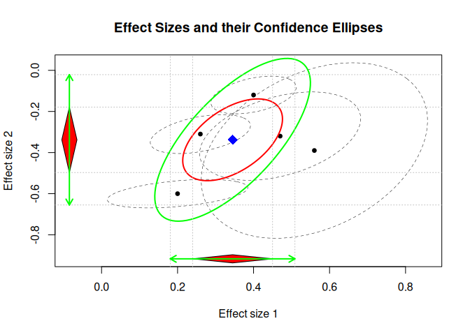<!-- -->

``` r
## Plot the effect sizes with the forest plots
## Load the library for forest plots 
library("metafor")

## Create extra panels for the forest plots
plot(mult1, diag.panel=TRUE, main="Multivariate meta-analysis",
axis.label=c("PD", "AL"))

## Forest plot for PD
forest( rma(yi=PD, vi=var_PD, data=Berkey98) )
title("Forest plot of PD")

## Forest plot for AL
forest( rma(yi=AL, vi=var_AL, data=Berkey98) )
title("Forest plot of AL")
```

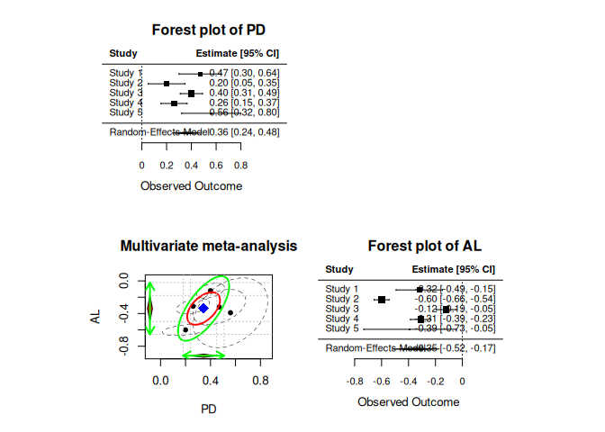<!-- -->

## Fixed-effects model

``` r
## Fixed-effects meta-analysis by fixiing the heterogeneity variance component at 
## a 2x2 matrix of 0.
summary( meta(y=cbind(PD, AL), v=cbind(var_PD, cov_PD_AL, var_AL), data=Berkey98,
              RE.constraints=matrix(0, nrow=2, ncol=2)) )
```

```

Call:
meta(y = cbind(PD, AL), v = cbind(var_PD, cov_PD_AL, var_AL), 
    data = Berkey98, RE.constraints = matrix(0, nrow = 2, ncol = 2))

95% confidence intervals: z statistic approximation (robust=FALSE)
Coefficients:
            Estimate Std.Error    lbound    ubound z value  Pr(>|z|)    
Intercept1  0.307219  0.028575  0.251212  0.363225  10.751 < 2.2e-16 ***
Intercept2 -0.394377  0.018649 -0.430929 -0.357825 -21.147 < 2.2e-16 ***
---
Signif. codes:  0 '***' 0.001 '**' 0.01 '*' 0.05 '.' 0.1 ' ' 1

Q statistic on the homogeneity of effect sizes: 128.2267
Degrees of freedom of the Q statistic: 8
P value of the Q statistic: 6.593131e-24

Heterogeneity indices (based on the estimated Tau2):
                             Estimate
Intercept1: I2 (Q statistic)        0
Intercept2: I2 (Q statistic)        0

Number of studies (or clusters): 5
Number of observed statistics: 10
Number of estimated parameters: 2
Degrees of freedom: 8
-2 log likelihood: 90.88326 
OpenMx status1: 0 ("0" or "1": The optimization is considered fine.
Other values may indicate problems.)
```

## Mixed-effects model

``` r
## Multivariate meta-analysis with "publication year-1979" as a predictor 
summary( meta(y=cbind(PD, AL), v=cbind(var_PD, cov_PD_AL, var_AL), data=Berkey98,
              x=scale(pub_year, center=1979)) )
```

```

Call:
meta(y = cbind(PD, AL), v = cbind(var_PD, cov_PD_AL, var_AL), 
    x = scale(pub_year, center = 1979), data = Berkey98)

95% confidence intervals: z statistic approximation (robust=FALSE)
Coefficients:
             Estimate  Std.Error     lbound     ubound z value  Pr(>|z|)    
Intercept1  0.3440001  0.0857659  0.1759020  0.5120982  4.0109 6.048e-05 ***
Intercept2 -0.2918175  0.1312797 -0.5491208 -0.0345141 -2.2229   0.02622 *  
Slope1_1    0.0063540  0.1078235 -0.2049762  0.2176842  0.0589   0.95301    
Slope2_1   -0.0705888  0.1620966 -0.3882922  0.2471147 -0.4355   0.66322    
Tau2_1_1    0.0080405  0.0101206 -0.0117955  0.0278766  0.7945   0.42692    
Tau2_2_1    0.0093413  0.0105515 -0.0113392  0.0300218  0.8853   0.37599    
Tau2_2_2    0.0250135  0.0170788 -0.0084603  0.0584873  1.4646   0.14303    
---
Signif. codes:  0 '***' 0.001 '**' 0.01 '*' 0.05 '.' 0.1 ' ' 1

Q statistic on the homogeneity of effect sizes: 128.2267
Degrees of freedom of the Q statistic: 8
P value of the Q statistic: 6.593131e-24

Explained variances (R2):
                              y1     y2
Tau2 (no predictor)    0.0070020 0.0261
Tau2 (with predictors) 0.0080405 0.0250
R2                     0.0000000 0.0433

Number of studies (or clusters): 5
Number of observed statistics: 10
Number of estimated parameters: 7
Degrees of freedom: 3
-2 log likelihood: -12.00859 
OpenMx status1: 0 ("0" or "1": The optimization is considered fine.
Other values may indicate problems.)
```

# Three-level meta-analysis
* This section illustrates how to conduct three-level meta-analyses using the [metaSEM](https://github.com/mikewlcheung/metasem) package implemented in the [R](https://www.r-project.org/) environment. The `metaSEM` package was written to simplify the procedures to perform a meta-analysis. Most readers may only need to use the `metaSEM` package to conduct the analysis. The next section shows how to conduct two- and three-level meta-analyses with the `meta()` and `meta3L()` functions. The third section demonstrates more complicated three-level meta-analyses using a dataset with more predictors. This section shows how to implement three-level meta-analyses as structural equation models using the `OpenMx` package. It provides detailed steps on how three-level meta-analyses can be formulated as structural equation models.

* This section also demonstrates the advantages of using the SEM approach to conduct three-level meta-analyses. These include flexibility on imposing constraints for model comparisons and construction of likelihood-based confidence interval (LBCI). I also demonstrate how to conduct three-level meta-analysis with restricted (or residual) maximum likelihood (REML) using the `reml3L()` function and handling missing covariates with the full information maximum likelihood (FIML) using the `meta3LFIML()` function. Readers may refer to Cheung (2015) for the design and implementation of the `metaSEM` package and Cheung (2014) for the theory and issues on how to formulate three-level meta-analyses as structural equation models. 

* Two datasets from published meta-analyses were used in the illustrations. The first dataset was based on Cooper et al. (2003) and Konstantopoulos (2011). Konstantopoulos (2011) selected part of the dataset to illustrate how to conduct a three-level meta-analysis. The second dataset was reported by Bornmann et al. (2007) and Marsh et al. (2009). They conducted a three-level meta-analysis on gender effects in peer reviews of grant proposals. 

## Comparisons between two- and three-level models with Cooper et al.'s (2003) dataset
As an illustration, I first conduct the tradition (two-level) meta-analysis using the `meta()` function. Then I conduct a three-level meta-analysis using the `meta3L()` function. We may compare the similarities and differences between these two sets of results. 

### Inspecting the data
Before running the analyses, we need to load the `metaSEM` library. The datasets are stored in the library. It is always a good idea to inspect the data before the analyses. We may display the first few cases of the dataset by using the `head()` command. 

``` r
#### Cooper et al. (2003)
library("metaSEM")

head(Cooper03)
```

```
  District Study     y     v Year
1       11     1 -0.18 0.118 1976
2       11     2 -0.22 0.118 1976
3       11     3  0.23 0.144 1976
4       11     4 -0.30 0.144 1976
5       12     5  0.13 0.014 1989
6       12     6 -0.26 0.014 1989
```

### Two-level meta-analysis
Similar to other `R` packages, we may use `summary()` to extract the results after running the analyses. I first conduct a random-effects meta-analysis and then a fixed- and mixed-effects meta-analyses.

* Random-effects model
The summary reports the heterogeneity test, variance, $I^2$, and average effect with its confidence interval.

``` r
#### Two-level meta-analysis

## Random-effects model  
cooper_random <- summary(meta(y=y, v=v, data=Cooper03))
cooper_random
```

```

Call:
meta(y = y, v = v, data = Cooper03)

95% confidence intervals: z statistic approximation (robust=FALSE)
Coefficients:
           Estimate Std.Error   lbound   ubound z value  Pr(>|z|)    
Intercept1 0.128003  0.043472 0.042799 0.213207  2.9445  0.003235 ** 
Tau2_1_1   0.086537  0.019485 0.048346 0.124728  4.4411 8.949e-06 ***
---
Signif. codes:  0 '***' 0.001 '**' 0.01 '*' 0.05 '.' 0.1 ' ' 1

Q statistic on the homogeneity of effect sizes: 578.864
Degrees of freedom of the Q statistic: 55
P value of the Q statistic: 1.79683e-88

Heterogeneity indices (based on the estimated Tau2):
                             Estimate
Intercept1: I2 (Q statistic)   0.9459

Number of studies (or clusters): 56
Number of observed statistics: 56
Number of estimated parameters: 2
Degrees of freedom: 54
-2 log likelihood: 33.2919 
OpenMx status1: 0 ("0" or "1": The optimization is considered fine.
Other values may indicate problems.)
```

The average effect is 0.1280 (95% CI 0.0428, 0.2132), the heterogeneity variance is 0.0865, and $I^2$ is 0.9459.

* Fixed-effects model
A fixed-effects meta-analysis can be conducted by fixing the heterogeneity variance at zero with `RE.constraints`.

``` r
## Fixed-effects model
cooper_fixed <- summary(meta(y=y, v=v, data=Cooper03, RE.constraints=0))
cooper_fixed
```

```

Call:
meta(y = y, v = v, data = Cooper03, RE.constraints = 0)

95% confidence intervals: z statistic approximation (robust=FALSE)
Coefficients:
            Estimate Std.Error    lbound    ubound z value Pr(>|z|)    
Intercept1 0.0464072 0.0091897 0.0283957 0.0644186  5.0499 4.42e-07 ***
---
Signif. codes:  0 '***' 0.001 '**' 0.01 '*' 0.05 '.' 0.1 ' ' 1

Q statistic on the homogeneity of effect sizes: 578.864
Degrees of freedom of the Q statistic: 55
P value of the Q statistic: 1.79683e-88

Heterogeneity indices (based on the estimated Tau2):
                             Estimate
Intercept1: I2 (Q statistic)        0

Number of studies (or clusters): 56
Number of observed statistics: 56
Number of estimated parameters: 1
Degrees of freedom: 55
-2 log likelihood: 434.2075 
OpenMx status1: 0 ("0" or "1": The optimization is considered fine.
Other values may indicate problems.)
```

The common effect is 0.0464 (95% CI 0.0284, 0.0644).

* Mixed-effects model
`Year` is centered (but not standardized) with `scale(Year, scale=FALSE)` for the mixed-effects model.

``` r
## Mixed-effects model
cooper_mixed <- summary(meta(y=y, v=v, x=scale(Year, scale=FALSE), data=Cooper03))
cooper_mixed
```

```

Call:
meta(y = y, v = v, x = scale(Year, scale = FALSE), data = Cooper03)

95% confidence intervals: z statistic approximation (robust=FALSE)
Coefficients:
             Estimate  Std.Error     lbound     ubound z value  Pr(>|z|)    
Intercept1  0.1259126  0.0432028  0.0412367  0.2105884  2.9145  0.003563 ** 
Slope1_1    0.0051307  0.0043248 -0.0033457  0.0136071  1.1864  0.235483    
Tau2_1_1    0.0851153  0.0190462  0.0477856  0.1224451  4.4689 7.862e-06 ***
---
Signif. codes:  0 '***' 0.001 '**' 0.01 '*' 0.05 '.' 0.1 ' ' 1

Q statistic on the homogeneity of effect sizes: 578.864
Degrees of freedom of the Q statistic: 55
P value of the Q statistic: 1.79683e-88

Explained variances (R2):
                           y1
Tau2 (no predictor)    0.0865
Tau2 (with predictors) 0.0851
R2                     0.0164

Number of studies (or clusters): 56
Number of observed statistics: 56
Number of estimated parameters: 3
Degrees of freedom: 53
-2 log likelihood: 31.88635 
OpenMx status1: 0 ("0" or "1": The optimization is considered fine.
Other values may indicate problems.)
```

The slope is 0.0051 (95% CI -0.0033, 0.0136).

### Three-level meta-analysis
* Random-effects model
The three-level model estimates heterogeneity separately for schools and districts.

``` r
#### Three-level meta-analysis
## Random-effects model
cooper_three <- summary(meta3L(y=y, v=v, cluster=District, data=Cooper03))
cooper_three
```

```

Call:
meta3L(y = y, v = v, cluster = District, data = Cooper03)

95% confidence intervals: z statistic approximation (robust=FALSE)
Coefficients:
            Estimate  Std.Error     lbound     ubound z value Pr(>|z|)   
Intercept  0.1844554  0.0805411  0.0265977  0.3423131  2.2902 0.022010 * 
Tau2_2     0.0328648  0.0111397  0.0110314  0.0546982  2.9502 0.003175 **
Tau2_3     0.0577384  0.0307423 -0.0025154  0.1179921  1.8781 0.060362 . 
---
Signif. codes:  0 '***' 0.001 '**' 0.01 '*' 0.05 '.' 0.1 ' ' 1

Q statistic on the homogeneity of effect sizes: 578.864
Degrees of freedom of the Q statistic: 55
P value of the Q statistic: 1.79683e-88

Heterogeneity indices (based on the estimated Tau2):
                              Estimate
I2_2 (Typical v: Q statistic)   0.3440
I2_3 (Typical v: Q statistic)   0.6043

Number of studies (or clusters): 11
Number of observed statistics: 56
Number of estimated parameters: 3
Degrees of freedom: 53
-2 log likelihood: 16.78987 
OpenMx status1: 0 ("0" or "1": The optimization is considered fine.
Other values may indicate problems.)
```

The average effect is 0.1845 (95% CI 0.0266, 0.3423); the level-2 and level-3 variances are 0.0329 and 0.0577.

* Mixed-effects model
`Year` is also used as a covariate in the three-level model.

``` r
## Mixed-effects model
cooper_three_mixed <- summary(meta3L(y=y, v=v, cluster=District, x=scale(Year, scale=FALSE),
                                    data=Cooper03))
cooper_three_mixed
```

```

Call:
meta3L(y = y, v = v, cluster = District, x = scale(Year, scale = FALSE), 
    data = Cooper03)

95% confidence intervals: z statistic approximation (robust=FALSE)
Coefficients:
            Estimate  Std.Error     lbound     ubound z value Pr(>|z|)   
Intercept  0.1780268  0.0805219  0.0202067  0.3358469  2.2109 0.027042 * 
Slope_1    0.0050737  0.0085266 -0.0116382  0.0217856  0.5950 0.551814   
Tau2_2     0.0329390  0.0111620  0.0110618  0.0548162  2.9510 0.003168 **
Tau2_3     0.0564628  0.0300330 -0.0024007  0.1153264  1.8800 0.060104 . 
---
Signif. codes:  0 '***' 0.001 '**' 0.01 '*' 0.05 '.' 0.1 ' ' 1

Q statistic on the homogeneity of effect sizes: 578.864
Degrees of freedom of the Q statistic: 55
P value of the Q statistic: 1.79683e-88

Explained variances (R2):
                        Level 2 Level 3
Tau2 (no predictor)    0.032865  0.0577
Tau2 (with predictors) 0.032939  0.0565
R2                     0.000000  0.0221

Number of studies (or clusters): 11
Number of observed statistics: 56
Number of estimated parameters: 4
Degrees of freedom: 52
-2 log likelihood: 16.43629 
OpenMx status1: 0 ("0" or "1": The optimization is considered fine.
Other values may indicate problems.)
```

The slope is 0.0051 (95% CI -0.0116, 0.0218).

* Model comparisons
Many research hypotheses involve model comparisons among nested models. `anova()`, a generic function for comparing nested models, may be used to conduct a likelihood ratio test which is also known as a chi-square difference test.

* Testing $H_0: \tau^2_{(3)} = 0$
    + Based on the data structure, it is clear that a 3-level meta-analysis is preferred to a traditional 2-level meta-analysis. It is still of interest to test whether the 3-level model is statistically better than the 2-level model by testing $H_0: \tau^2_{(3)}=0$. Since the models with $\tau^2_{(3)}$ being freely estimated and with $\tau^2_{(3)}=0$ are nested, we may compare them by the use of a likelihood ratio test. 
    + The null $H_0: \tau^2_{(3)}=0$ is on the boundary. Under the usual 50:50 mixture reference distribution, a one-degree-of-freedom chi-square _p_ value below .10 corresponds to a mixture _p_ value below .05. This approximation relies on the assumptions for that reference distribution.
    + The model comparison is reported below.

``` r
## Model comparisons
  
model2 <- meta(y=y, v=v, data=Cooper03, model.name="2 level model", silent=TRUE) 
#### An equivalent model by fixing tau2 at level 3=0 in meta3L()
## model2 <- meta3L(y=y, v=v, cluster=District, data=Cooper03, 
##                  model.name="2 level model", RE3.constraints=0) 
model3 <- meta3L(y=y, v=v, cluster=District, data=Cooper03, 
                 model.name="3 level model", silent=TRUE) 
cmp_cooper_level <- anova(model3, model2)
cmp_cooper_level
```

```
           base    comparison ep minus2LL df      AIC   diffLL diffdf
1 3 level model          <NA>  3 16.78987 53 22.78987       NA     NA
2 3 level model 2 level model  2 33.29190 54 37.29190 16.50203      1
             p
1           NA
2 4.859793e-05
```

Likelihood-ratio difference = 16.5020, df = 1, unadjusted p < 0.0001.

* Testing $H_0: \tau^2_{(2)} = \tau^2_{(3)}$
    + From the results of the 3-level random-effects meta-analysis, it appears the level 3 heterogeneity is much larger than that at level 2. 
    + We may test the null hypothesis $H_0: \tau^2_{(2)} = \tau^2_{(3)}$ by the use of a likelihood-ratio test.
    + We may impose an equality constraint on $\tau^2_{(2)} = \tau^2_{(3)}$ by using the same label in `meta3L()`. For example, `Eq_tau2` is used as the label in `RE2.constraints` and `RE3.constraints` meaning that both the level 2 and level 3 random effects heterogeneity variances are constrained equally. The value of `0.1` was used as the starting value in the constraints. 
    + The model comparison is reported below.

``` r
## Testing \tau^2_2 = \tau^2_3
modelEqTau2 <- meta3L(y=y, v=v, cluster=District, data=Cooper03, 
                      model.name="Equal tau2 at both levels",
                      RE2.constraints="0.1*Eq_tau2", RE3.constraints="0.1*Eq_tau2") 
cmp_cooper_equal <- anova(model3, modelEqTau2)
cmp_cooper_equal
```

```
           base                comparison ep minus2LL df      AIC    diffLL
1 3 level model                      <NA>  3 16.78987 53 22.78987        NA
2 3 level model Equal tau2 at both levels  2 17.47697 54 21.47697 0.6870959
  diffdf         p
1     NA        NA
2      1 0.4071539
```

Likelihood-ratio difference = 0.6871, df = 1, unadjusted p = 0.4072.

* Likelihood-based confidence interval
    + A Wald CI is constructed by $\hat{\theta} \pm 1.96 SE$ where $\hat{\theta}$ and $SE$ are the parameter estimate and its estimated standard error. 
    + An LBCI can be constructed by the use of the likelihood ratio statistic (e.g., Cheung, 2009; Neal & Miller, 1997).  
    + A Wald CI on a variance component can extend below zero, outside its meaningful range.
    + An LBCI on the heterogeneity variance is preferred. Since $I^2_{(2)}$ and $I^2_{(3)}$ are functions of $\tau^2_{(2)}$ and $\tau^2_{(3)}$, LBCI on these indices may also be requested and used to indicate the precision of these indices. 
    + An LBCI may be requested by specifying `LB` in the `intervals.type` argument. 
    + The summary below reports likelihood-based confidence intervals for the variance and $I^2$ indices.

``` r
## LBCI for random-effects model
cooper_lb <- summary(meta3L(y=y, v=v, cluster=District, data=Cooper03,
                             I2=c("I2q", "ICC"), intervals.type="LB"))
cooper_lb
```

```

Call:
meta3L(y = y, v = v, cluster = District, data = Cooper03, intervals.type = "LB", 
    I2 = c("I2q", "ICC"))

95% confidence intervals: Likelihood-based statistic
Coefficients:
          Estimate Std.Error   lbound   ubound z value Pr(>|z|)
Intercept 0.184455        NA 0.011605 0.358269      NA       NA
Tau2_2    0.032865        NA 0.016298 0.063113      NA       NA
Tau2_3    0.057738        NA 0.019780 0.177329      NA       NA

Q statistic on the homogeneity of effect sizes: 578.864
Degrees of freedom of the Q statistic: 55
P value of the Q statistic: 1.79683e-88

Heterogeneity indices (I2) and their 95% likelihood-based CIs:
                               lbound Estimate ubound
I2_2 (Typical v: Q statistic) 0.12739  0.34396 0.6568
ICC_2 (tau^2/(tau^2+tau^3))   0.13116  0.36273 0.7006
I2_3 (Typical v: Q statistic) 0.27835  0.60429 0.8452
ICC_3 (tau^3/(tau^2+tau^3))   0.29938  0.63727 0.8688

Number of studies (or clusters): 11
Number of observed statistics: 56
Number of estimated parameters: 3
Degrees of freedom: 53
-2 log likelihood: 16.78987 
OpenMx status1: 0 ("0" or "1": The optimization is considered fine.
Other values may indicate problems.)
```

``` r
## LBCI for mixed-effects model
summary( meta3L(y=y, v=v, cluster=District, x=scale(Year, scale=FALSE), 
                data=Cooper03, intervals.type="LB") ) 
```

```

Call:
meta3L(y = y, v = v, cluster = District, x = scale(Year, scale = FALSE), 
    data = Cooper03, intervals.type = "LB")

95% confidence intervals: Likelihood-based statistic
Coefficients:
            Estimate Std.Error     lbound     ubound z value Pr(>|z|)
Intercept  0.1780268        NA  0.0047821  0.3513321      NA       NA
Slope_1    0.0050737        NA -0.0128999  0.0238841      NA       NA
Tau2_2     0.0329390        NA  0.0163205  0.0634266      NA       NA
Tau2_3     0.0564628        NA  0.0192097  0.1204622      NA       NA

Q statistic on the homogeneity of effect sizes: 578.864
Degrees of freedom of the Q statistic: 55
P value of the Q statistic: 1.79683e-88

Explained variances (R2):
                        Level 2 Level 3
Tau2 (no predictor)    0.032865  0.0577
Tau2 (with predictors) 0.032939  0.0565
R2                     0.000000  0.0221

Number of studies (or clusters): 11
Number of observed statistics: 56
Number of estimated parameters: 4
Degrees of freedom: 52
-2 log likelihood: 16.43629 
OpenMx status1: 0 ("0" or "1": The optimization is considered fine.
Other values may indicate problems.)
```

The level-3 variance is 0.0577 (95% CI 0.0198, 0.1773) using a likelihood-based interval.

* Restricted maximum likelihood estimation
    + REML may also be used in the three-level meta-analysis.

``` r
## REML
summary( reml1 <- reml3L(y=y, v=v, cluster=District, data=Cooper03) )
```

```

Call:
reml3L(y = y, v = v, cluster = District, data = Cooper03)

95% confidence intervals: z statistic approximation
Coefficients:
         Estimate  Std.Error     lbound     ubound z value Pr(>|z|)   
Tau2_2  0.0327365  0.0110922  0.0109963  0.0544768  2.9513 0.003164 **
Tau2_3  0.0650619  0.0355102 -0.0045368  0.1346607  1.8322 0.066921 . 
---
Signif. codes:  0 '***' 0.001 '**' 0.01 '*' 0.05 '.' 0.1 ' ' 1

Number of studies (or clusters): 56
Number of observed statistics: 55
Number of estimated parameters: 2
Degrees of freedom: 53
-2 log likelihood: -81.14044 
OpenMx status1: 0 ("0" or "1": The optimization is considered fine.
Other values may indicate problems.)
```

The REML variance estimates are 0.0327 and 0.0651.
* We may impose an equality constraint on the two variance components and compare the result with the unconstrained model.

``` r
summary( reml0 <- reml3L(y=y, v=v, cluster=District, data=Cooper03,
                        RE.equal=TRUE, model.name="Equal Tau2") )
```

```

Call:
reml3L(y = y, v = v, cluster = District, data = Cooper03, RE.equal = TRUE, 
    model.name = "Equal Tau2")

95% confidence intervals: z statistic approximation
Coefficients:
     Estimate Std.Error   lbound   ubound z value  Pr(>|z|)    
Tau2 0.040418  0.010290 0.020249 0.060587  3.9277 8.576e-05 ***
---
Signif. codes:  0 '***' 0.001 '**' 0.01 '*' 0.05 '.' 0.1 ' ' 1

Number of studies (or clusters): 56
Number of observed statistics: 55
Number of estimated parameters: 1
Degrees of freedom: 54
-2 log likelihood: -80.1371 
OpenMx status1: 0 ("0" or "1": The optimization is considered fine.
Other values may indicate problems.)
```

``` r
cmp_reml_equal <- anova(reml1, reml0)
cmp_reml_equal
```

```
                          base comparison ep  minus2LL df       AIC   diffLL
1 Variance component with REML       <NA>  2 -81.14044 -2 -77.14044       NA
2 Variance component with REML Equal Tau2  1 -80.13710 -1 -78.13710 1.003336
  diffdf         p
1     NA        NA
2      1 0.3165046
```

Likelihood-ratio difference = 1.0033, df = 1, unadjusted p = 0.3165.
* We may also estimate residual heterogeneity after controlling for the covariate.

``` r
reml_mixed <- reml3L(y=y, v=v, cluster=District, x=scale(Year, scale=FALSE),
                     data=Cooper03)
summary(reml_mixed)
```

```

Call:
reml3L(y = y, v = v, cluster = District, x = scale(Year, scale = FALSE), 
    data = Cooper03)

95% confidence intervals: z statistic approximation
Coefficients:
         Estimate  Std.Error     lbound     ubound z value Pr(>|z|)   
Tau2_2  0.0326502  0.0110529  0.0109870  0.0543134  2.9540 0.003137 **
Tau2_3  0.0722656  0.0405349 -0.0071813  0.1517125  1.7828 0.074619 . 
---
Signif. codes:  0 '***' 0.001 '**' 0.01 '*' 0.05 '.' 0.1 ' ' 1

Number of studies (or clusters): 56
Number of observed statistics: 54
Number of estimated parameters: 2
Degrees of freedom: 52
-2 log likelihood: -72.09405 
OpenMx status1: 0 ("0" or "1": The optimization is considered fine.
Other values may indicate problems.)
```

The residual variance estimates are 0.0327 and 0.0723.

## More complex 3-level meta-analyses with Bornmann et al.'s (2007) dataset
This section replicates the findings in Table 3 of Marsh et al. (2009). Several additional analyses on model comparisons were conducted. Missing data were artificially introduced to illustrate how missing data might be handled with FIML.

## Inspecting the data
The effect size and its sampling variance are `logOR` (log of the odds ratio) and `v`, respectively. `Cluster` is the variable representing the cluster effect, whereas the potential covariates are `Year` (year of publication), `Type` (`Grants` vs. `Fellowship`), `Discipline` (`Physical sciences`, `Life sciences/biology`, `Social sciences/humanities` and `Multidisciplinary`) and `Country` (`United States`, `Canada`, `Australia`, `United Kingdom` and `Europe`).


``` r
#### Bornmann et al. (2007)
head(Bornmann07)
```

```
  Id                       Study Cluster    logOR          v Year       Type
1  1 Ackers (2000a; Marie Curie)       1 -0.40108 0.01391692 1996 Fellowship
2  2 Ackers (2000b; Marie Curie)       1 -0.05727 0.03428793 1996 Fellowship
3  3 Ackers (2000c; Marie Curie)       1 -0.29852 0.03391122 1996 Fellowship
4  4 Ackers (2000d; Marie Curie)       1  0.36094 0.03404025 1996 Fellowship
5  5 Ackers (2000e; Marie Curie)       1 -0.33336 0.01282103 1996 Fellowship
6  6 Ackers (2000f; Marie Curie)       1 -0.07173 0.01361189 1996 Fellowship
                  Discipline Country
1          Physical sciences  Europe
2          Physical sciences  Europe
3          Physical sciences  Europe
4          Physical sciences  Europe
5 Social sciences/humanities  Europe
6          Physical sciences  Europe
```

## Model 0: Intercept
The summary reports the average effect and the level-2 and level-3 heterogeneity.


``` r
## Model 0: Intercept  
summary( Model0 <- meta3L(y=logOR, v=v, cluster=Cluster, data=Bornmann07, 
                          model.name="3 level model") )
```

```

Call:
meta3L(y = logOR, v = v, cluster = Cluster, data = Bornmann07, 
    model.name = "3 level model")

95% confidence intervals: z statistic approximation (robust=FALSE)
Coefficients:
            Estimate  Std.Error     lbound     ubound z value Pr(>|z|)  
Intercept -0.1007784  0.0401327 -0.1794371 -0.0221198 -2.5111  0.01203 *
Tau2_2     0.0037965  0.0027210 -0.0015367  0.0091297  1.3952  0.16295  
Tau2_3     0.0141352  0.0091445 -0.0037877  0.0320580  1.5458  0.12216  
---
Signif. codes:  0 '***' 0.001 '**' 0.01 '*' 0.05 '.' 0.1 ' ' 1

Q statistic on the homogeneity of effect sizes: 221.2809
Degrees of freedom of the Q statistic: 65
P value of the Q statistic: 6.46038e-19

Heterogeneity indices (based on the estimated Tau2):
                              Estimate
I2_2 (Typical v: Q statistic)   0.1568
I2_3 (Typical v: Q statistic)   0.5839

Number of studies (or clusters): 21
Number of observed statistics: 66
Number of estimated parameters: 3
Degrees of freedom: 63
-2 log likelihood: 25.80256 
OpenMx status1: 0 ("0" or "1": The optimization is considered fine.
Other values may indicate problems.)
```

The average effect is -0.1008 (95% CI -0.1794, -0.0221); the level-2 and level-3 variances are 0.0038 and 0.0141.

* Testing $H_0: \tau^2_3 = 0$
The model comparison is reported below.

``` r
## Testing tau^2_3 = 0
Model0a <- meta3L(logOR, v, cluster=Cluster, data=Bornmann07, 
                  RE3.constraints=0, model.name="2 level model")
cmp_bornmann_level <- anova(Model0, Model0a)
cmp_bornmann_level
```

```
           base    comparison ep minus2LL df      AIC   diffLL diffdf
1 3 level model          <NA>  3 25.80256 63 31.80256       NA     NA
2 3 level model 2 level model  2 36.02279 64 40.02279 10.22024      1
            p
1          NA
2 0.001389081
```

Likelihood-ratio difference = 10.2202, df = 1, unadjusted p = 0.0014.

* Testing $H_0: \tau^2_2 = \tau^2_3$
The model comparison is reported below.

``` r
## Testing tau^2_2 = tau^2_3
Model0b <- meta3L(logOR, v, cluster=Cluster, data=Bornmann07, 
                  RE2.constraints="0.1*Eq_tau2", RE3.constraints="0.1*Eq_tau2", 
                  model.name="tau2_2 equals tau2_3")
cmp_bornmann_equal <- anova(Model0, Model0b)
cmp_bornmann_equal
```

```
           base           comparison ep minus2LL df      AIC   diffLL diffdf
1 3 level model                 <NA>  3 25.80256 63 31.80256       NA     NA
2 3 level model tau2_2 equals tau2_3  2 27.16166 64 31.16166 1.359103      1
         p
1       NA
2 0.243693
```

Likelihood-ratio difference = 1.3591, df = 1, unadjusted p = 0.2437.

## Model 1: `Type` as a covariate
* Conventionally, one level (e.g., `Grants`) is used as the reference group. The estimated intercept (labeled `Intercept` in the output) represents the estimated effect size for `Grants` and the regression coefficient (labeled `Slope_1` in the output) is the difference between `Fellowship` and `Grants`. 
    + The model estimates the `Type` slope and the explained variance at each level.

``` r
## Model 1: Type as a covariate  
## Convert characters into a dummy variable
## Type2=0 (Grants); Type2=1 (Fellowship)    
Type2 <- ifelse(Bornmann07$Type=="Fellowship", yes=1, no=0)
summary( Model1 <- meta3L(logOR, v, x=Type2, cluster=Cluster, data=Bornmann07)) 
```

```

Call:
meta3L(y = logOR, v = v, cluster = Cluster, x = Type2, data = Bornmann07)

95% confidence intervals: z statistic approximation (robust=FALSE)
Coefficients:
            Estimate  Std.Error     lbound     ubound z value  Pr(>|z|)    
Intercept -0.0066071  0.0371125 -0.0793462  0.0661320 -0.1780 0.8587001    
Slope_1   -0.1955869  0.0541649 -0.3017483 -0.0894256 -3.6110 0.0003051 ***
Tau2_2     0.0035335  0.0024306 -0.0012303  0.0082974  1.4538 0.1460058    
Tau2_3     0.0029079  0.0031183 -0.0032039  0.0090197  0.9325 0.3510704    
---
Signif. codes:  0 '***' 0.001 '**' 0.01 '*' 0.05 '.' 0.1 ' ' 1

Q statistic on the homogeneity of effect sizes: 221.2809
Degrees of freedom of the Q statistic: 65
P value of the Q statistic: 6.46038e-19

Explained variances (R2):
                         Level 2 Level 3
Tau2 (no predictor)    0.0037965  0.0141
Tau2 (with predictors) 0.0035335  0.0029
R2                     0.0692595  0.7943

Number of studies (or clusters): 21
Number of observed statistics: 66
Number of estimated parameters: 4
Degrees of freedom: 62
-2 log likelihood: 17.62569 
OpenMx status1: 0 ("0" or "1": The optimization is considered fine.
Other values may indicate problems.)
```

The `Type` slope is -0.1956 (95% CI -0.3017, -0.0894). The explained variance is level-2 R² = 0.0693 and level-3 R² = 0.7943.

* Alternative model: `Grants` and `Fellowship` as indicator variables
    + If we want to estimate the effects for both `Grants` and `Fellowship`, we may create two indicator variables to represent them. Since we cannot estimate the intercept and these coefficients at the same time, we need to fix the intercept at 0 by specifying the `intercept.constraints=0` argument in `meta3L()`. We are now able to include both `Grants` and `Fellowship` in the analysis.


``` r
## Alternative model: Grants and Fellowship as indicators  
## Indicator variables
Grant <- ifelse(Bornmann07$Type=="Grant", yes=1, no=0)
Fellowship <- ifelse(Bornmann07$Type=="Fellowship", yes=1, no=0)
  
Model1b <- meta3L(logOR, v, x=cbind(Grant, Fellowship), 
                  cluster=Cluster, data=Bornmann07,
                  intercept.constraints=0, model.name="Model 1")
summary(Model1b)
```

```

Call:
meta3L(y = logOR, v = v, cluster = Cluster, x = cbind(Grant, 
    Fellowship), data = Bornmann07, intercept.constraints = 0, 
    model.name = "Model 1")

95% confidence intervals: z statistic approximation (robust=FALSE)
Coefficients:
          Estimate  Std.Error     lbound     ubound z value  Pr(>|z|)    
Slope_1 -0.0066071  0.0371125 -0.0793462  0.0661320 -0.1780    0.8587    
Slope_2 -0.2021940  0.0399473 -0.2804893 -0.1238987 -5.0615 4.159e-07 ***
Tau2_2   0.0035335  0.0024306 -0.0012303  0.0082974  1.4538    0.1460    
Tau2_3   0.0029079  0.0031183 -0.0032039  0.0090197  0.9325    0.3511    
---
Signif. codes:  0 '***' 0.001 '**' 0.01 '*' 0.05 '.' 0.1 ' ' 1

Q statistic on the homogeneity of effect sizes: 221.2809
Degrees of freedom of the Q statistic: 65
P value of the Q statistic: 6.46038e-19

Explained variances (R2):
                         Level 2 Level 3
Tau2 (no predictor)    0.0037965  0.0141
Tau2 (with predictors) 0.0035335  0.0029
R2                     0.0692595  0.7943

Number of studies (or clusters): 21
Number of observed statistics: 66
Number of estimated parameters: 4
Degrees of freedom: 62
-2 log likelihood: 17.62569 
OpenMx status1: 0 ("0" or "1": The optimization is considered fine.
Other values may indicate problems.)
```

The estimated effects for grants and fellowships are -0.0066 (95% CI -0.0793, 0.0661) and -0.2022 (95% CI -0.2805, -0.1239), respectively.

## Model 2: `Year` and `Year^2` as covariates
* When there are several covariates, we may combine them with the `cbind()` command. For example, `cbind(Year, Year^2)` includes both `Year` and its squared as covariates. In the output, `Slope_1` and `Slope_2` refer to the regression coefficients for `Year` and `Year^2`, respectively. To increase the numerical stability, the covariates are usually centered before creating the quadratic terms. Since Marsh et al. (2009) standardized `Year` in their analysis, I follow this practice here.
- The summary reports the coefficients and explained variances for this model.

``` r
## Model 2: Year and Year^2 as covariates
summary( Model2 <- meta3L(logOR, v, x=cbind(scale(Year), scale(Year)^2), 
                          cluster=Cluster, data=Bornmann07,
                          model.name="Model 2") ) 
```

```

Call:
meta3L(y = logOR, v = v, cluster = Cluster, x = cbind(scale(Year), 
    scale(Year)^2), data = Bornmann07, model.name = "Model 2")

95% confidence intervals: z statistic approximation (robust=FALSE)
Coefficients:
             Estimate   Std.Error      lbound      ubound z value Pr(>|z|)  
Intercept -0.08627312  0.04125581 -0.16713302 -0.00541322 -2.0912  0.03651 *
Slope_1   -0.00095287  0.02365224 -0.04731040  0.04540466 -0.0403  0.96786  
Slope_2   -0.01176840  0.00659995 -0.02470407  0.00116727 -1.7831  0.07457 .
Tau2_2     0.00287389  0.00206817 -0.00117965  0.00692744  1.3896  0.16466  
Tau2_3     0.01479446  0.00926095 -0.00335666  0.03294558  1.5975  0.11015  
---
Signif. codes:  0 '***' 0.001 '**' 0.01 '*' 0.05 '.' 0.1 ' ' 1

Q statistic on the homogeneity of effect sizes: 221.2809
Degrees of freedom of the Q statistic: 65
P value of the Q statistic: 6.46038e-19

Explained variances (R2):
                         Level 2 Level 3
Tau2 (no predictor)    0.0037965  0.0141
Tau2 (with predictors) 0.0028739  0.0148
R2                     0.2430134  0.0000

Number of studies (or clusters): 21
Number of observed statistics: 66
Number of estimated parameters: 5
Degrees of freedom: 61
-2 log likelihood: 22.3836 
OpenMx status1: 0 ("0" or "1": The optimization is considered fine.
Other values may indicate problems.)
```

The linear and quadratic slopes are -0.0010 (95% CI -0.0473, 0.0454) and -0.0118 (95% CI -0.0247, 0.0012), respectively. The explained variance is level-2 R² = 0.2430 and level-3 R² = 0.0000.

* Testing $H_0: \beta_{Year} = \beta_{Year^2}=0$
The following test jointly evaluates the linear and quadratic `Year` coefficients; it does not isolate the quadratic term.

``` r
## Testing beta_{Year} = beta_{Year^2}=0
cmp_year <- anova(Model2, Model0)
cmp_year
```

```
     base    comparison ep minus2LL df      AIC   diffLL diffdf         p
1 Model 2          <NA>  5 22.38360 61 32.38360       NA     NA        NA
2 Model 2 3 level model  3 25.80256 63 31.80256 3.418955      2 0.1809603
```

Likelihood-ratio difference = 3.4190, df = 2, unadjusted p = 0.1810.

## Model 3: `Discipline` as a covariate
* There are four categories of `Discipline`. `multidisciplinary` is used as the reference group in the analysis.
* The summary reports the coefficients and explained variances for this model.

``` r
## Model 3: Discipline as a covariate
## Create dummy variables using multidisciplinary as the reference group
DisciplinePhy <- ifelse(Bornmann07$Discipline=="Physical sciences", yes=1, no=0)
DisciplineLife <- ifelse(Bornmann07$Discipline=="Life sciences/biology", yes=1, no=0)
DisciplineSoc <- ifelse(Bornmann07$Discipline=="Social sciences/humanities", yes=1, no=0)
summary( Model3 <- meta3L(logOR, v, x=cbind(DisciplinePhy, DisciplineLife, DisciplineSoc), 
                          cluster=Cluster, data=Bornmann07,
                          model.name="Model 3") )
```

```

Call:
meta3L(y = logOR, v = v, cluster = Cluster, x = cbind(DisciplinePhy, 
    DisciplineLife, DisciplineSoc), data = Bornmann07, model.name = "Model 3")

95% confidence intervals: z statistic approximation (robust=FALSE)
Coefficients:
             Estimate   Std.Error      lbound      ubound z value Pr(>|z|)  
Intercept -0.01474783  0.06389945 -0.13998845  0.11049279 -0.2308  0.81747  
Slope_1   -0.00913064  0.09949198 -0.20413134  0.18587005 -0.0918  0.92688  
Slope_2   -0.12617957  0.07866274 -0.28035571  0.02799656 -1.6041  0.10870  
Slope_3   -0.23695698  0.12123091 -0.47456520  0.00065124 -1.9546  0.05063 .
Tau2_2     0.00390942  0.00283949 -0.00165587  0.00947471  1.3768  0.16857  
Tau2_3     0.00710338  0.00643210 -0.00550331  0.01971006  1.1044  0.26944  
---
Signif. codes:  0 '***' 0.001 '**' 0.01 '*' 0.05 '.' 0.1 ' ' 1

Q statistic on the homogeneity of effect sizes: 221.2809
Degrees of freedom of the Q statistic: 65
P value of the Q statistic: 6.46038e-19

Explained variances (R2):
                         Level 2 Level 3
Tau2 (no predictor)    0.0037965  0.0141
Tau2 (with predictors) 0.0039094  0.0071
R2                     0.0000000  0.4975

Number of studies (or clusters): 21
Number of observed statistics: 66
Number of estimated parameters: 6
Degrees of freedom: 60
-2 log likelihood: 20.07571 
OpenMx status1: 0 ("0" or "1": The optimization is considered fine.
Other values may indicate problems.)
```

The discipline slopes are -0.0091 (95% CI -0.2041, 0.1859), -0.1262 (95% CI -0.2804, 0.0280), and -0.2370 (95% CI -0.4746, 0.0007).  The explained variance is level-2 R² = 0.0000 and level-3 R² = 0.4975.

* Testing whether `Discipline` is significant
    + The model comparison is reported below.

``` r
## Testing whether Discipline is significant
cmp_discipline <- anova(Model3, Model0)
cmp_discipline
```

```
     base    comparison ep minus2LL df      AIC   diffLL diffdf         p
1 Model 3          <NA>  6 20.07571 60 32.07571       NA     NA        NA
2 Model 3 3 level model  3 25.80256 63 31.80256 5.726842      3 0.1256832
```

Likelihood-ratio difference = 5.7268, df = 3, unadjusted p = 0.1257.

## Model 4: `Country` as a covariate
* There are five categories in `Country`. The `United States` is used as the reference group in the analysis.
* The summary reports the coefficients and explained variances for this model.

``` r
## Model 4: Country as a covariate
## Create dummy variables using the United States as the reference group
CountryAus <- ifelse(Bornmann07$Country=="Australia", yes=1, no=0)
CountryCan <- ifelse(Bornmann07$Country=="Canada", yes=1, no=0)
CountryEur <- ifelse(Bornmann07$Country=="Europe", yes=1, no=0)
CountryUK <- ifelse(Bornmann07$Country=="United Kingdom", yes=1, no=0)
  
summary( Model4 <- meta3L(logOR, v, x=cbind(CountryAus, CountryCan, CountryEur, 
                          CountryUK), cluster=Cluster, data=Bornmann07,
                          model.name="Model 4") )  
```

```

Call:
meta3L(y = logOR, v = v, cluster = Cluster, x = cbind(CountryAus, 
    CountryCan, CountryEur, CountryUK), data = Bornmann07, model.name = "Model 4")

95% confidence intervals: z statistic approximation (robust=FALSE)
Coefficients:
            Estimate  Std.Error     lbound     ubound z value Pr(>|z|)   
Intercept  0.0025681  0.0597768 -0.1145923  0.1197285  0.0430 0.965732   
Slope_1   -0.0240109  0.1104328 -0.2404552  0.1924333 -0.2174 0.827876   
Slope_2   -0.1340800  0.1190667 -0.3674465  0.0992865 -1.1261 0.260127   
Slope_3   -0.2210801  0.0739174 -0.3659556 -0.0762046 -2.9909 0.002782 **
Slope_4    0.0537251  0.0994803 -0.1412527  0.2487030  0.5401 0.589157   
Tau2_2     0.0033376  0.0023492 -0.0012667  0.0079420  1.4208 0.155383   
Tau2_3     0.0047979  0.0044818 -0.0039862  0.0135820  1.0705 0.284379   
---
Signif. codes:  0 '***' 0.001 '**' 0.01 '*' 0.05 '.' 0.1 ' ' 1

Q statistic on the homogeneity of effect sizes: 221.2809
Degrees of freedom of the Q statistic: 65
P value of the Q statistic: 6.46038e-19

Explained variances (R2):
                         Level 2 Level 3
Tau2 (no predictor)    0.0037965  0.0141
Tau2 (with predictors) 0.0033376  0.0048
R2                     0.1208598  0.6606

Number of studies (or clusters): 21
Number of observed statistics: 66
Number of estimated parameters: 7
Degrees of freedom: 59
-2 log likelihood: 14.18259 
OpenMx status1: 0 ("0" or "1": The optimization is considered fine.
Other values may indicate problems.)
```

The country slopes are -0.0240 (95% CI -0.2405, 0.1924), -0.1341 (95% CI -0.3674, 0.0993), -0.2211 (95% CI -0.3660, -0.0762), and 0.0537 (95% CI -0.1413, 0.2487).  The explained variance is level-2 R² = 0.1209 and level-3 R² = 0.6606.

* Testing whether `Country` is significant
    + The model comparison is reported below.

``` r
  ## Testing whether Country is significant
  cmp_country <- anova(Model4, Model0)
cmp_country
```

```
     base    comparison ep minus2LL df      AIC   diffLL diffdf          p
1 Model 4          <NA>  7 14.18259 59 28.18259       NA     NA         NA
2 Model 4 3 level model  3 25.80256 63 31.80256 11.61996      4 0.02041284
```

Likelihood-ratio difference = 11.6200, df = 4, unadjusted p = 0.0204.

## Model 5: `Type` and `Discipline` as covariates
* The summary reports the explained variance at each level.

``` r
## Model 5: Type and Discipline as covariates
Model5 <- meta3L(logOR, v, x=cbind(Type2, DisciplinePhy, DisciplineLife, 
                 DisciplineSoc), cluster=Cluster, data=Bornmann07,
                 model.name="Model 5")

## Rerun to remove error code
Model5 <- rerun(Model5)
```


``` r
summary(Model5)
```

```

Call:
meta3L(y = logOR, v = v, cluster = Cluster, x = cbind(Type2, 
    DisciplinePhy, DisciplineLife, DisciplineSoc), data = Bornmann07, 
    model.name = "Model 5")

95% confidence intervals: z statistic approximation (robust=FALSE)
Coefficients:
             Estimate   Std.Error      lbound      ubound z value  Pr(>|z|)    
Intercept  6.7036e-02  1.8553e-02  3.0672e-02  1.0340e-01  3.6132 0.0003025 ***
Slope_1   -1.9004e-01  4.0234e-02 -2.6890e-01 -1.1118e-01 -4.7233  2.32e-06 ***
Slope_2    1.9511e-02  6.5942e-02 -1.0973e-01  1.4875e-01  0.2959 0.7673209    
Slope_3   -1.2779e-01  3.5914e-02 -1.9818e-01 -5.7400e-02 -3.5582 0.0003734 ***
Slope_4   -2.3950e-01  9.4054e-02 -4.2384e-01 -5.5154e-02 -2.5464 0.0108849 *  
Tau2_2     2.3062e-03  1.4270e-03 -4.9059e-04  5.1030e-03  1.6162 0.1060586    
Tau2_3     1.0000e-10          NA          NA          NA      NA        NA    
---
Signif. codes:  0 '***' 0.001 '**' 0.01 '*' 0.05 '.' 0.1 ' ' 1

Q statistic on the homogeneity of effect sizes: 221.2809
Degrees of freedom of the Q statistic: 65
P value of the Q statistic: 6.46038e-19

Explained variances (R2):
                         Level 2 Level 3
Tau2 (no predictor)    0.0037965  0.0141
Tau2 (with predictors) 0.0023062  0.0000
R2                     0.3925434  1.0000

Number of studies (or clusters): 21
Number of observed statistics: 66
Number of estimated parameters: 7
Degrees of freedom: 59
-2 log likelihood: 4.66727 
OpenMx status1: 0 ("0" or "1": The optimization is considered fine.
Other values may indicate problems.)
```

The level 2 and level 3 $R^2$ values are 0.3925 and 1.0000, respectively. The Wald standard error for the level-3 variance is unavailable; inspect the estimate and bounds before making inferences.

* Testing whether `Discipline` is significant after controlling for `Type`
    + The model comparison is reported below.

``` r
## Testing whether Discipline is significant after controlling for Type
cmp_discipline_type <- anova(Model5, Model1)
cmp_discipline_type
```

```
     base            comparison ep minus2LL df      AIC   diffLL diffdf
1 Model 5                  <NA>  7  4.66727 59 18.66727       NA     NA
2 Model 5 Meta analysis with ML  4 17.62569 62 25.62569 12.95842      3
            p
1          NA
2 0.004727388
```

Likelihood-ratio difference = 12.9584, df = 3, unadjusted p = 0.0047.

## Model 6: `Type` and `Country` as covariates  
* The summary reports the explained variance at each level.

``` r
## Model 6: Type and Country as covariates
Model6 <- meta3L(logOR, v, x=cbind(Type2, CountryAus, CountryCan, 
                 CountryEur, CountryUK), cluster=Cluster, data=Bornmann07,
                 model.name="Model 6") 

## Rerun to remove error code
Model6 <- rerun(Model6)
```


``` r
summary(Model6)
```

```

Call:
meta3L(y = logOR, v = v, cluster = Cluster, x = cbind(Type2, 
    CountryAus, CountryCan, CountryEur, CountryUK), data = Bornmann07, 
    model.name = "Model 6")

95% confidence intervals: z statistic approximation (robust=FALSE)
Coefficients:
             Estimate   Std.Error      lbound      ubound z value  Pr(>|z|)    
Intercept  6.7507e-02  1.8933e-02  3.0399e-02  1.0461e-01  3.5656 0.0003631 ***
Slope_1   -1.5167e-01  4.1113e-02 -2.3225e-01 -7.1092e-02 -3.6892 0.0002250 ***
Slope_2   -6.9580e-02  8.5164e-02 -2.3650e-01  9.7339e-02 -0.8170 0.4139267    
Slope_3   -1.4231e-01  7.5204e-02 -2.8970e-01  5.0879e-03 -1.8923 0.0584497 .  
Slope_4   -1.6116e-01  4.0203e-02 -2.3995e-01 -8.2361e-02 -4.0086 6.108e-05 ***
Slope_5    9.0419e-03  7.0074e-02 -1.2830e-01  1.4639e-01  0.1290 0.8973314    
Tau2_2     2.2976e-03  1.4407e-03 -5.2618e-04  5.1213e-03  1.5947 0.1107693    
Tau2_3     1.0000e-10          NA          NA          NA      NA        NA    
---
Signif. codes:  0 '***' 0.001 '**' 0.01 '*' 0.05 '.' 0.1 ' ' 1

Q statistic on the homogeneity of effect sizes: 221.2809
Degrees of freedom of the Q statistic: 65
P value of the Q statistic: 6.46038e-19

Explained variances (R2):
                         Level 2 Level 3
Tau2 (no predictor)    0.0037965  0.0141
Tau2 (with predictors) 0.0022976  0.0000
R2                     0.3948192  1.0000

Number of studies (or clusters): 21
Number of observed statistics: 66
Number of estimated parameters: 8
Degrees of freedom: 58
-2 log likelihood: 5.076592 
OpenMx status1: 0 ("0" or "1": The optimization is considered fine.
Other values may indicate problems.)
```

The level 2 and level 3 $R^2$ values are 0.3948 and 1.0000, respectively. The Wald standard error for the level-3 variance is unavailable; inspect the estimate and bounds before making inferences.

* Testing whether `Country` is significant after controlling for `Type`
    + The model comparison is reported below.

``` r
## Testing whether Country is significant after controlling for Type
cmp_country_type <- anova(Model6, Model1)
cmp_country_type
```

```
     base            comparison ep  minus2LL df      AIC  diffLL diffdf
1 Model 6                  <NA>  8  5.076592 58 21.07659      NA     NA
2 Model 6 Meta analysis with ML  4 17.625692 62 25.62569 12.5491      4
           p
1         NA
2 0.01370262
```

Likelihood-ratio difference = 12.5491, df = 4, unadjusted p = 0.0137.

## Model 7: `Discipline` and `Country` as covariates
* The summary reports the explained variance at each level.

``` r
## Model 7: Discipline and Country as covariates
Model7 <- meta3L(logOR, v, x=cbind(DisciplinePhy, DisciplineLife, DisciplineSoc,
                          CountryAus, CountryCan, CountryEur, CountryUK),
                 cluster=Cluster, data=Bornmann07, model.name="Model 7")
summary(Model7)
```

```

Call:
meta3L(y = logOR, v = v, cluster = Cluster, x = cbind(DisciplinePhy, 
    DisciplineLife, DisciplineSoc, CountryAus, CountryCan, CountryEur, 
    CountryUK), data = Bornmann07, model.name = "Model 7")

95% confidence intervals: z statistic approximation (robust=FALSE)
Coefficients:
            Estimate  Std.Error     lbound     ubound z value Pr(>|z|)  
Intercept  0.0029305  0.0576743 -0.1101090  0.1159700  0.0508  0.95948  
Slope_1    0.1742169  0.1702554 -0.1594776  0.5079114  1.0233  0.30618  
Slope_2    0.0826806  0.1599802 -0.2308749  0.3962361  0.5168  0.60528  
Slope_3   -0.0462265  0.1715774 -0.3825119  0.2900590 -0.2694  0.78761  
Slope_4   -0.0486321  0.1306918 -0.3047835  0.2075192 -0.3721  0.70981  
Slope_5   -0.2169132  0.1915703 -0.5923842  0.1585577 -1.1323  0.25751  
Slope_6   -0.3036578  0.1670721 -0.6311130  0.0237975 -1.8175  0.06914 .
Slope_7   -0.0605272  0.1809419 -0.4151669  0.2941125 -0.3345  0.73799  
Tau2_2     0.0032661  0.0022784 -0.0011994  0.0077317  1.4335  0.15171  
Tau2_3     0.0040618  0.0038459 -0.0034759  0.0115996  1.0562  0.29090  
---
Signif. codes:  0 '***' 0.001 '**' 0.01 '*' 0.05 '.' 0.1 ' ' 1

Q statistic on the homogeneity of effect sizes: 221.2809
Degrees of freedom of the Q statistic: 65
P value of the Q statistic: 6.46038e-19

Explained variances (R2):
                         Level 2 Level 3
Tau2 (no predictor)    0.0037965  0.0141
Tau2 (with predictors) 0.0032661  0.0041
R2                     0.1396974  0.7126

Number of studies (or clusters): 21
Number of observed statistics: 66
Number of estimated parameters: 10
Degrees of freedom: 56
-2 log likelihood: 10.31105 
OpenMx status1: 0 ("0" or "1": The optimization is considered fine.
Other values may indicate problems.)
```

The explained variance is level-2 R² = 0.1397 and level-3 R² = 0.7126.

## Model 8: `Type`, `Discipline`, and `Country` as covariates
* The summary reports the explained variance at each level.

``` r
## Model 8: Type, Discipline and Country as covariates
Model8 <- meta3L(logOR, v, x=cbind(Type2, DisciplinePhy, DisciplineLife, DisciplineSoc,
                            CountryAus, CountryCan, CountryEur, CountryUK), 
                            cluster=Cluster, data=Bornmann07,
                            model.name="Model 8") 
## There was an estimation error. The model was rerun again.
Model8 <- rerun(Model8)
```


``` r
summary(Model8)
```

```

Call:
meta3L(y = logOR, v = v, cluster = Cluster, x = cbind(Type2, 
    DisciplinePhy, DisciplineLife, DisciplineSoc, CountryAus, 
    CountryCan, CountryEur, CountryUK), data = Bornmann07, model.name = "Model 8")

95% confidence intervals: z statistic approximation (robust=FALSE)
Coefficients:
             Estimate   Std.Error      lbound      ubound z value  Pr(>|z|)    
Intercept  6.8563e-02  1.8630e-02  3.2049e-02  1.0508e-01  3.6802  0.000233 ***
Slope_1   -1.6885e-01  4.1545e-02 -2.5028e-01 -8.7425e-02 -4.0643 4.818e-05 ***
Slope_2    2.5329e-01  1.5814e-01 -5.6670e-02  5.6324e-01  1.6016  0.109239    
Slope_3    1.2689e-01  1.4774e-01 -1.6268e-01  4.1646e-01  0.8589  0.390410    
Slope_4   -8.3549e-03  1.5796e-01 -3.1795e-01  3.0124e-01 -0.0529  0.957818    
Slope_5   -1.1530e-01  1.1146e-01 -3.3377e-01  1.0317e-01 -1.0344  0.300948    
Slope_6   -2.6412e-01  1.6402e-01 -5.8559e-01  5.7344e-02 -1.6103  0.107323    
Slope_7   -2.9029e-01  1.4859e-01 -5.8152e-01  9.5194e-04 -1.9536  0.050754 .  
Slope_8   -1.5975e-01  1.6285e-01 -4.7893e-01  1.5943e-01 -0.9810  0.326609    
Tau2_2     2.1010e-03  1.2925e-03 -4.3226e-04  4.6342e-03  1.6255  0.104051    
Tau2_3     1.0000e-10          NA          NA          NA      NA        NA    
---
Signif. codes:  0 '***' 0.001 '**' 0.01 '*' 0.05 '.' 0.1 ' ' 1

Q statistic on the homogeneity of effect sizes: 221.2809
Degrees of freedom of the Q statistic: 65
P value of the Q statistic: 6.46038e-19

Explained variances (R2):
                         Level 2 Level 3
Tau2 (no predictor)    0.0037965  0.0141
Tau2 (with predictors) 0.0021010  0.0000
R2                     0.4466073  1.0000

Number of studies (or clusters): 21
Number of observed statistics: 66
Number of estimated parameters: 11
Degrees of freedom: 55
-2 log likelihood: -1.645211 
OpenMx status1: 0 ("0" or "1": The optimization is considered fine.
Other values may indicate problems.)
```

The level 2 and level 3 $R^2$ values are 0.4466 and 1.0000, respectively. The Wald standard error for the level-3 variance is unavailable; inspect the estimate and bounds before making inferences.

## Handling missing covariates with FIML
When there are missing data in the covariates, data with missing values are excluded from the analysis in `meta3L()`. The missing covariates can be handled by the use of FIML in `meta3LFIML()`. We illustrate two examples on how to analyze data with missing covariates with missing completely at random (MCAR) and missing at random (MAR) data.
 
### MCAR
* About 25% of the level-2 covariate `Type` was introduced by the MCAR mechanism. 

``` r
#### Handling missing covariates with FIML
  
## MCAR
## Set seed for replication
set.seed(1000000)
  
## Copy Bornmann07 to my.df
my.df <- Bornmann07
## "Fellowship": 1; "Grant": 0
my.df$Type_MCAR <- ifelse(Bornmann07$Type=="Fellowship", yes=1, no=0)

## Create 17 out of 66 missingness with MCAR
my.df$Type_MCAR[sample(1:66, 17)] <- NA
  
summary( meta3L(y=logOR, v=v, cluster=Cluster, x=Type_MCAR, data=my.df) )
```

```

Call:
meta3L(y = logOR, v = v, cluster = Cluster, x = Type_MCAR, data = my.df)

95% confidence intervals: z statistic approximation (robust=FALSE)
Coefficients:
            Estimate  Std.Error     lbound     ubound z value  Pr(>|z|)    
Intercept  0.0044909  0.0362672 -0.0665916  0.0755733  0.1238    0.9015    
Slope_1   -0.2182446  0.0554287 -0.3268829 -0.1096063 -3.9374 8.237e-05 ***
Tau2_2     0.0014063  0.0021623 -0.0028317  0.0056443  0.6504    0.5155    
Tau2_3     0.0031148  0.0035202 -0.0037846  0.0100143  0.8848    0.3762    
---
Signif. codes:  0 '***' 0.001 '**' 0.01 '*' 0.05 '.' 0.1 ' ' 1

Q statistic on the homogeneity of effect sizes: 154.2762
Degrees of freedom of the Q statistic: 48
P value of the Q statistic: 4.411366e-13

Explained variances (R2):
                         Level 2 Level 3
Tau2 (no predictor)    0.0011603  0.0185
Tau2 (with predictors) 0.0014063  0.0031
R2                     0.0000000  0.8318

Number of studies (or clusters): 20
Number of observed statistics: 49
Number of estimated parameters: 4
Degrees of freedom: 45
-2 log likelihood: 10.56012 
OpenMx status1: 0 ("0" or "1": The optimization is considered fine.
Other values may indicate problems.)
```
* There is no need to specify whether the covariates are level 2 or level 3 in `meta3L()` because the covariates are treated as a design matrix. When `meta3LFIM()` is used, users need to specify whether the covariates are at level 2 (`x2`) or level 3 (`x3`).

``` r
summary(meta3LFIML(y=logOR, v=v, cluster=Cluster, x2=Type_MCAR, data=my.df))
```

```

Call:
meta3LFIML(y = logOR, v = v, cluster = Cluster, x2 = Type_MCAR, 
    data = my.df)

95% confidence intervals: z statistic approximation (robust=FALSE)
Coefficients:
            Estimate  Std.Error     lbound     ubound z value  Pr(>|z|)    
Intercept -0.0024343  0.0360701 -0.0731303  0.0682618 -0.0675 0.9461939    
SlopeX2_1 -0.2086677  0.0545138 -0.3155128 -0.1018226 -3.8278 0.0001293 ***
Tau2_2     0.0016732  0.0022114 -0.0026610  0.0060075  0.7567 0.4492584    
Tau2_3     0.0035540  0.0035810 -0.0034646  0.0105726  0.9925 0.3209675    
---
Signif. codes:  0 '***' 0.001 '**' 0.01 '*' 0.05 '.' 0.1 ' ' 1

Explained variances (R2):
                         Level 2 Level 3
Tau2 (no predictor)    0.0037965  0.0141
Tau2 (with predictors) 0.0016732  0.0036
R2                     0.5592669  0.7486

Number of studies (or clusters): 21
Number of observed statistics: 115
Number of estimated parameters: 7
Degrees of freedom: 108
-2 log likelihood: 56.64328 
OpenMx status1: 0 ("0" or "1": The optimization is considered fine.
Other values may indicate problems.)
```

### MAR
* For the case of missing covariates with MAR, the missingness in `Type` depends on the values of `Year`. `Type` is missing when `Year` is smaller than 1996. 

``` r
## MAR
Type_MAR <- ifelse(Bornmann07$Type=="Fellowship", yes=1, no=0)
  
## Create 27 out of 66 missingness with MAR for cases Year<1996
index_MAR <- ifelse(Bornmann07$Year<1996, yes=TRUE, no=FALSE)
Type_MAR[index_MAR] <- NA
  
summary(meta3L(logOR, v, x=Type_MAR, cluster=Cluster, data=Bornmann07)) 
```

```

Call:
meta3L(y = logOR, v = v, cluster = Cluster, x = Type_MAR, data = Bornmann07)

95% confidence intervals: z statistic approximation (robust=FALSE)
Coefficients:
             Estimate   Std.Error      lbound      ubound z value Pr(>|z|)   
Intercept -0.01587052  0.03952546 -0.09333901  0.06159796 -0.4015 0.688032   
Slope_1   -0.17573647  0.06328327 -0.29976940 -0.05170355 -2.7770 0.005487 **
Tau2_2     0.00259266  0.00171596 -0.00077056  0.00595588  1.5109 0.130811   
Tau2_3     0.00278384  0.00267150 -0.00245221  0.00801989  1.0421 0.297388   
---
Signif. codes:  0 '***' 0.001 '**' 0.01 '*' 0.05 '.' 0.1 ' ' 1

Q statistic on the homogeneity of effect sizes: 151.11
Degrees of freedom of the Q statistic: 38
P value of the Q statistic: 2.019317e-15

Explained variances (R2):
                         Level 2 Level 3
Tau2 (no predictor)    0.0029593  0.0097
Tau2 (with predictors) 0.0025927  0.0028
R2                     0.1238926  0.7121

Number of studies (or clusters): 12
Number of observed statistics: 39
Number of estimated parameters: 4
Degrees of freedom: 35
-2 log likelihood: -24.19956 
OpenMx status1: 0 ("0" or "1": The optimization is considered fine.
Other values may indicate problems.)
```
* It is possible to include level 2 (`av2`) and level 3 (`av3`) auxiliary variables. Auxiliary variables are those that predict the missing values or are correlated with the variables that contain missing values. The inclusion of auxiliary variables can improve the efficiency of the estimation and the parameter estimates. 

``` r
## Include auxiliary variable
summary(meta3LFIML(y=logOR, v=v, cluster=Cluster, x2=Type_MAR, av2=Year, data=my.df))
```

```

Call:
meta3LFIML(y = logOR, v = v, cluster = Cluster, x2 = Type_MAR, 
    av2 = Year, data = my.df)

95% confidence intervals: z statistic approximation (robust=FALSE)
Coefficients:
            Estimate  Std.Error     lbound     ubound z value Pr(>|z|)   
Intercept -0.0264058  0.0572055 -0.1385266  0.0857150 -0.4616 0.644372   
SlopeX2_1 -0.2003998  0.0691093 -0.3358516 -0.0649481 -2.8998 0.003735 **
Tau2_2     0.0029970  0.0022371 -0.0013877  0.0073817  1.3396 0.180359   
Tau2_3     0.0030212  0.0032463 -0.0033415  0.0093839  0.9307 0.352033   
---
Signif. codes:  0 '***' 0.001 '**' 0.01 '*' 0.05 '.' 0.1 ' ' 1

Explained variances (R2):
                         Level 2 Level 3
Tau2 (no predictor)    0.0049237  0.0088
Tau2 (with predictors) 0.0029970  0.0030
R2                     0.3913239  0.6571

Number of studies (or clusters): 21
Number of observed statistics: 171
Number of estimated parameters: 14
Degrees of freedom: 157
-2 log likelihood: 377.3479 
OpenMx status1: 0 ("0" or "1": The optimization is considered fine.
Other values may indicate problems.)
```


# Two-stage structural equation modeling (TSSEM)

## Inspect the data: Digman (1997)
The correlation matrices and the sample sizes were stored in `Digman97$data` and `Digman97$n`, respectively. We may list the first few cases of the data by using the `head()` command.

``` r
#### Load the metaSEM library for TSSEM
library(metaSEM)
  
#### Inspect the data for inspection
head(Digman97$data)
```

```
$`Digman 1 (1994)`
       A     C   ES     E    I
A   1.00  0.62 0.41 -0.48 0.00
C   0.62  1.00 0.59 -0.10 0.35
ES  0.41  0.59 1.00  0.27 0.41
E  -0.48 -0.10 0.27  1.00 0.37
I   0.00  0.35 0.41  0.37 1.00

$`Digman 2 (1994)`
       A    C   ES     E     I
A   1.00 0.39 0.53 -0.30 -0.05
C   0.39 1.00 0.59  0.07  0.44
ES  0.53 0.59 1.00  0.09  0.22
E  -0.30 0.07 0.09  1.00  0.45
I  -0.05 0.44 0.22  0.45  1.00

$`Digman 3 (1963c)`
      A     C   ES     E    I
A  1.00  0.65 0.35  0.25 0.14
C  0.65  1.00 0.37 -0.10 0.33
ES 0.35  0.37 1.00  0.24 0.41
E  0.25 -0.10 0.24  1.00 0.41
I  0.14  0.33 0.41  0.41 1.00

$`Digman & Takemoto-Chock (1981b)`
       A     C   ES     E     I
A   1.00  0.65 0.70 -0.26 -0.03
C   0.65  1.00 0.71 -0.16  0.24
ES  0.70  0.71 1.00  0.01  0.11
E  -0.26 -0.16 0.01  1.00  0.66
I  -0.03  0.24 0.11  0.66  1.00

$`Graziano & Ward (1992)`
      A    C   ES    E    I
A  1.00 0.64 0.35 0.29 0.22
C  0.64 1.00 0.27 0.16 0.22
ES 0.35 0.27 1.00 0.32 0.36
E  0.29 0.16 0.32 1.00 0.53
I  0.22 0.22 0.36 0.53 1.00

$`Yik & Bond (1993)`
      A    C   ES    E    I
A  1.00 0.66 0.57 0.35 0.38
C  0.66 1.00 0.45 0.20 0.31
ES 0.57 0.45 1.00 0.49 0.31
E  0.35 0.20 0.49 1.00 0.59
I  0.38 0.31 0.31 0.59 1.00
```

``` r
head(Digman97$n)
```

```
[1] 102 149 334 162  91 656
```

## Fixed-effects TSSEM
### Stage 1 analysis
Specify `method="FEM"` for fixed-effects TSSEM; the default is random effects. The results are stored in `fixed1` and displayed by `summary()`.

``` r
## Fixed-effects model: Stage 1 analysis
fixed1 <- tssem1(Cov=Digman97$data, n=Digman97$n, method="FEM")
summary(fixed1)
```

```

Call:
tssem1FEM(Cov = Cov, n = n, cor.analysis = cor.analysis, model.name = model.name, 
    cluster = cluster, suppressWarnings = suppressWarnings, silent = silent, 
    run = run)

Coefficients:
       Estimate Std.Error z value  Pr(>|z|)    
S[1,2] 0.363278  0.013368 27.1760 < 2.2e-16 ***
S[1,3] 0.390375  0.012880 30.3077 < 2.2e-16 ***
S[1,4] 0.103572  0.015047  6.8830 5.861e-12 ***
S[1,5] 0.092286  0.015047  6.1331 8.621e-10 ***
S[2,3] 0.416070  0.012519 33.2345 < 2.2e-16 ***
S[2,4] 0.135148  0.014776  9.1464 < 2.2e-16 ***
S[2,5] 0.141431  0.014866  9.5135 < 2.2e-16 ***
S[3,4] 0.244459  0.014153 17.2724 < 2.2e-16 ***
S[3,5] 0.138339  0.014834  9.3259 < 2.2e-16 ***
S[4,5] 0.424566  0.012375 34.3071 < 2.2e-16 ***
---
Signif. codes:  0 '***' 0.001 '**' 0.01 '*' 0.05 '.' 0.1 ' ' 1

Goodness-of-fit indices:
                                     Value
Sample size                      4496.0000
Chi-square of target model       1505.6761
DF of target model                130.0000
p value of target model             0.0000
Chi-square of independence model 4471.4242
DF of independence model          140.0000
RMSEA                               0.1815
RMSEA lower 95% CI                  0.1733
RMSEA upper 95% CI                  0.1898
SRMR                                0.1621
TLI                                 0.6580
CFI                                 0.6824
AIC                              1245.6761
BIC                               412.2535
OpenMx status1: 0 ("0" or "1": The optimization is considered fine.
Other values may indicate problems.)
```

Stage 1 fit: χ²(df = 130, N = 4496) = 1505.68, CFI = 0.6824, RMSEA = 0.1815, SRMR = 0.1621.

The pooled correlation matrix (the parameter estimates) can be extracted by the use of the `coef()` command.

``` r
coef(fixed1)
```

```
            A         C        ES         E          I
A  1.00000000 0.3632782 0.3903748 0.1035716 0.09228557
C  0.36327824 1.0000000 0.4160695 0.1351477 0.14143058
ES 0.39037483 0.4160695 1.0000000 0.2444593 0.13833895
E  0.10357155 0.1351477 0.2444593 1.0000000 0.42456626
I  0.09228557 0.1414306 0.1383390 0.4245663 1.00000000
```

### Stage 2 analysis
As an illustration, I continued to fit the structural model based on the pooled correlation matrix. We may specify the two-factor model with the [RAM formulation](https://vipbg.vcu.edu/vipbg/OpenMx2/docs//OpenMx/latest/Examples_Matrix.html). An alternative and easier way to specify the model is to use `lavann`'s syntax.

``` r
model1 <- "## Factor loadings
           Alpha =~ A+C+ES
           Beta =~ E+I
           ## Factor correlation
           Alpha ~~ Beta"

plot(model1)
```

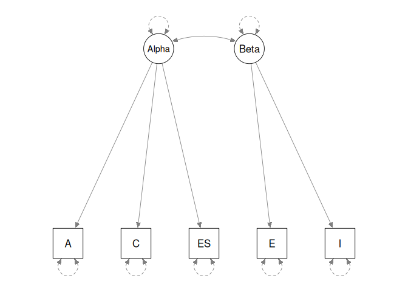<!-- -->

``` r
RAM1 <- lavaan2RAM(model1, obs.variables=c("A","C","ES","E","I"),
                   A.notation="on", S.notation="with")
RAM1
```

```
$A
      A   C   ES  E   I   Alpha           Beta         
A     "0" "0" "0" "0" "0" "0.1*AonAlpha"  "0"          
C     "0" "0" "0" "0" "0" "0.1*ConAlpha"  "0"          
ES    "0" "0" "0" "0" "0" "0.1*ESonAlpha" "0"          
E     "0" "0" "0" "0" "0" "0"             "0.1*EonBeta"
I     "0" "0" "0" "0" "0" "0"             "0.1*IonBeta"
Alpha "0" "0" "0" "0" "0" "0"             "0"          
Beta  "0" "0" "0" "0" "0" "0"             "0"          

$S
      A            C            ES             E            I           
A     "0.5*AwithA" "0"          "0"            "0"          "0"         
C     "0"          "0.5*CwithC" "0"            "0"          "0"         
ES    "0"          "0"          "0.5*ESwithES" "0"          "0"         
E     "0"          "0"          "0"            "0.5*EwithE" "0"         
I     "0"          "0"          "0"            "0"          "0.5*IwithI"
Alpha "0"          "0"          "0"            "0"          "0"         
Beta  "0"          "0"          "0"            "0"          "0"         
      Alpha             Beta             
A     "0"               "0"              
C     "0"               "0"              
ES    "0"               "0"              
E     "0"               "0"              
I     "0"               "0"              
Alpha "1"               "0*AlphawithBeta"
Beta  "0*AlphawithBeta" "1"              

$F
   A C ES E I Alpha Beta
A  1 0  0 0 0     0    0
C  0 1  0 0 0     0    0
ES 0 0  1 0 0     0    0
E  0 0  0 1 0     0    0
I  0 0  0 0 1     0    0

$M
  A         C         ES         E         I         Alpha Beta
1 "0*Amean" "0*Cmean" "0*ESmean" "0*Emean" "0*Imean" "0"   "0" 
```
 
Since this is a correlation structure analysis, the error variances are not free parameters.

``` r
fixed2 <- tssem2(fixed1, RAM=RAM1, intervals="LB",
                 model.name="TSSEM2 Digman97")
summary(fixed2)
```

```

Call:
wls(Cov = coef.tssem1FEM(tssem1.obj), aCov = vcov.tssem1FEM(tssem1.obj), 
    n = sum(tssem1.obj$n), RAM = RAM, Amatrix = Amatrix, Smatrix = Smatrix, 
    Fmatrix = Fmatrix, diag.constraints = diag.constraints, cor.analysis = tssem1.obj$cor.analysis, 
    intervals.type = intervals.type, mx.algebras = mx.algebras, 
    mxModel.Args = mxModel.Args, subset.variables = subset.variables, 
    model.name = model.name, suppressWarnings = suppressWarnings, 
    silent = silent, run = run)

95% confidence intervals: Likelihood-based statistic
Coefficients:
              Estimate Std.Error  lbound  ubound z value Pr(>|z|)
AonAlpha       0.56280        NA 0.53270 0.59303      NA       NA
ConAlpha       0.60522        NA 0.57524 0.63540      NA       NA
EonBeta        0.78141        NA 0.71843 0.85503      NA       NA
ESonAlpha      0.71920        NA 0.68859 0.75039      NA       NA
IonBeta        0.55137        NA 0.49979 0.60272      NA       NA
AlphawithBeta  0.36268        NA 0.31850 0.40662      NA       NA

Goodness-of-fit indices:
                                               Value
Sample size                                4496.0000
Chi-square of target model                   65.4526
DF of target model                            4.0000
p value of target model                       0.0000
Number of constraints imposed on "Smatrix"    0.0000
DF manually adjusted                          0.0000
Chi-square of independence model           3112.7591
DF of independence model                     10.0000
RMSEA                                         0.0585
RMSEA lower 95% CI                            0.0465
RMSEA upper 95% CI                            0.0713
SRMR                                          0.0284
TLI                                           0.9505
CFI                                           0.9802
AIC                                          57.4526
BIC                                          31.8088
OpenMx status1: 0 ("0" or "1": The optimization is considered fine.
Other values indicate problems.)
```

``` r
plot(fixed2)
```

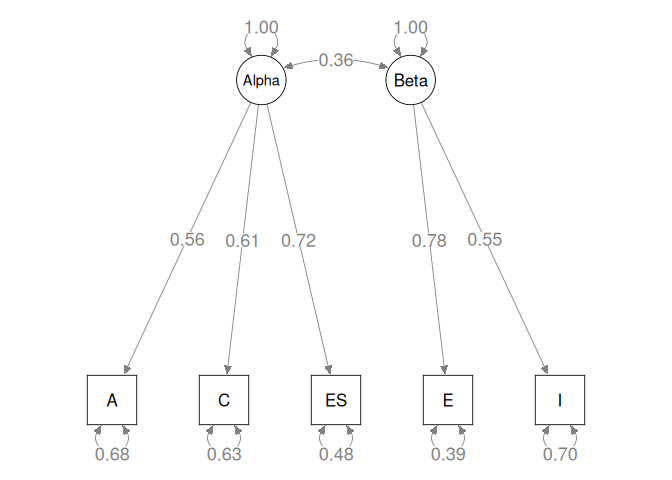<!-- -->

Stage 2 fit: χ²(df = 4, N = 4496) = 65.45, CFI = 0.9802, RMSEA = 0.0585, SRMR = 0.0284.

## Fixed-effects TSSEM with cluster
### Stage 1 analysis
There are 4 types of sample characteristics in the original `cluster`. We may group them into either younger or older sample. 

``` r
#### Display the frequencies of "cluster"
table(Digman97$cluster)
```

```

  Adolescents      Children Mature adults  Young adults 
            1             4             6             3 
```

``` r
#### Fixed-effects TSSEM with several clusters
#### Create a variable for different cluster
#### Younger participants: Children and Adolescents
#### Older participants: others
clusters <- ifelse(Digman97$cluster %in% c("Children","Adolescents"),
                   yes="Younger participants", no="Older participants")
  
#### Show the clusters
clusters
```

```
 [1] "Younger participants" "Younger participants" "Younger participants"
 [4] "Younger participants" "Younger participants" "Older participants"  
 [7] "Older participants"   "Older participants"   "Older participants"  
[10] "Older participants"   "Older participants"   "Older participants"  
[13] "Older participants"   "Older participants"  
```

We conduct a fixed-effects model for each sample group with `cluster=clusters`.

``` r
## Example of Fixed-effects TSSEM with several clusters
cluster1 <- tssem1(Digman97$data, Digman97$n, method="FEM", 
                   cluster=clusters)
summary(cluster1)
```

```
$`Older participants`

Call:
tssem1FEM(Cov = data.cluster[[i]], n = n.cluster[[i]], cor.analysis = cor.analysis, 
    model.name = model.name, suppressWarnings = suppressWarnings, 
    silent = silent, run = run)

Coefficients:
       Estimate Std.Error z value  Pr(>|z|)    
S[1,2] 0.297471  0.015436 19.2716 < 2.2e-16 ***
S[1,3] 0.370248  0.014532 25.4774 < 2.2e-16 ***
S[1,4] 0.137694  0.016403  8.3944 < 2.2e-16 ***
S[1,5] 0.098061  0.016724  5.8637 4.528e-09 ***
S[2,3] 0.393692  0.014146 27.8306 < 2.2e-16 ***
S[2,4] 0.183045  0.016055 11.4009 < 2.2e-16 ***
S[2,5] 0.092774  0.016643  5.5743 2.485e-08 ***
S[3,4] 0.260753  0.015554 16.7645 < 2.2e-16 ***
S[3,5] 0.096141  0.016573  5.8009 6.597e-09 ***
S[4,5] 0.411756  0.013900 29.6224 < 2.2e-16 ***
---
Signif. codes:  0 '***' 0.001 '**' 0.01 '*' 0.05 '.' 0.1 ' ' 1

Goodness-of-fit indices:
                                     Value
Sample size                      3658.0000
Chi-square of target model        826.1222
DF of target model                 80.0000
p value of target model             0.0000
Chi-square of independence model 3000.9731
DF of independence model           90.0000
RMSEA                               0.1515
RMSEA lower 95% CI                  0.1422
RMSEA upper 95% CI                  0.1609
SRMR                                0.1459
TLI                                 0.7116
CFI                                 0.7437
AIC                               666.1222
BIC                               169.7485
OpenMx status1: 0 ("0" or "1": The optimization is considered fine.
Other values may indicate problems.)

$`Younger participants`

Call:
tssem1FEM(Cov = data.cluster[[i]], n = n.cluster[[i]], cor.analysis = cor.analysis, 
    model.name = model.name, suppressWarnings = suppressWarnings, 
    silent = silent, run = run)

Coefficients:
        Estimate Std.Error z value  Pr(>|z|)    
S[1,2]  0.604330  0.022125 27.3142 < 2.2e-16 ***
S[1,3]  0.465536  0.027493 16.9327 < 2.2e-16 ***
S[1,4] -0.031381  0.035940 -0.8732   0.38258    
S[1,5]  0.061508  0.034547  1.7804   0.07500 .  
S[2,3]  0.501432  0.026348 19.0311 < 2.2e-16 ***
S[2,4] -0.060678  0.034557 -1.7559   0.07911 .  
S[2,5]  0.320987  0.031064 10.3330 < 2.2e-16 ***
S[3,4]  0.175437  0.033675  5.2097 1.891e-07 ***
S[3,5]  0.305149  0.031586  9.6609 < 2.2e-16 ***
S[4,5]  0.478640  0.026883 17.8045 < 2.2e-16 ***
---
Signif. codes:  0 '***' 0.001 '**' 0.01 '*' 0.05 '.' 0.1 ' ' 1

Goodness-of-fit indices:
                                     Value
Sample size                       838.0000
Chi-square of target model        346.3732
DF of target model                 40.0000
p value of target model             0.0000
Chi-square of independence model 1470.4511
DF of independence model           50.0000
RMSEA                               0.2138
RMSEA lower 95% CI                  0.1934
RMSEA upper 95% CI                  0.2348
SRMR                                0.1411
TLI                                 0.7304
CFI                                 0.7843
AIC                               266.3732
BIC                                77.1324
OpenMx status1: 0 ("0" or "1": The optimization is considered fine.
Other values may indicate problems.)
```

Stage 1 fit by group: Older participants: χ²(df = 80, N = 3658) = 826.12, CFI = 0.7437, RMSEA = 0.1515, SRMR = 0.1459; Younger participants: χ²(df = 40, N = 838) = 346.37, CFI = 0.7843, RMSEA = 0.2138, SRMR = 0.1411.

* The pooled correlation matrix for each cluster can be extracted by the use of the `coef()` command.

``` r
coef(cluster1)
```

```
$`Older participants`
            A          C         ES         E          I
A  1.00000000 0.29747123 0.37024803 0.1376942 0.09806125
C  0.29747123 1.00000000 0.39369157 0.1830450 0.09277411
ES 0.37024803 0.39369157 1.00000000 0.2607530 0.09614072
E  0.13769424 0.18304500 0.26075304 1.0000000 0.41175622
I  0.09806125 0.09277411 0.09614072 0.4117562 1.00000000

$`Younger participants`
             A          C        ES          E          I
A   1.00000000  0.6043300 0.4655359 -0.0313810 0.06150839
C   0.60433002  1.0000000 0.5014319 -0.0606784 0.32098713
ES  0.46553592  0.5014319 1.0000000  0.1754367 0.30514853
E  -0.03138100 -0.0606784 0.1754367  1.0000000 0.47864004
I   0.06150839  0.3209871 0.3051485  0.4786400 1.00000000
```

### Stage 2 analysis
We fit the Stage 2 model separately for each group.

``` r
cluster2 <- tssem2(cluster1, RAM=RAM1, intervals.type="z")
#### Please note that the estimates for the younger participants are problematic.
summary(cluster2)
```

```
$`Older participants`

Call:
wls(Cov = coef.tssem1FEM(tssem1.obj), aCov = vcov.tssem1FEM(tssem1.obj), 
    n = sum(tssem1.obj$n), RAM = RAM, Amatrix = Amatrix, Smatrix = Smatrix, 
    Fmatrix = Fmatrix, diag.constraints = diag.constraints, cor.analysis = tssem1.obj$cor.analysis, 
    intervals.type = intervals.type, mx.algebras = mx.algebras, 
    mxModel.Args = mxModel.Args, subset.variables = subset.variables, 
    model.name = model.name, suppressWarnings = suppressWarnings, 
    silent = silent, run = run)

95% confidence intervals: z statistic approximation
Coefficients:
              Estimate Std.Error   lbound   ubound z value  Pr(>|z|)    
AonAlpha      0.512656  0.018206 0.476973 0.548340  28.158 < 2.2e-16 ***
ConAlpha      0.549967  0.017945 0.514795 0.585140  30.647 < 2.2e-16 ***
EonBeta       0.967136  0.058751 0.851986 1.082287  16.462 < 2.2e-16 ***
ESonAlpha     0.732174  0.018929 0.695074 0.769273  38.680 < 2.2e-16 ***
IonBeta       0.430649  0.029634 0.372568 0.488730  14.532 < 2.2e-16 ***
AlphawithBeta 0.349236  0.028118 0.294125 0.404346  12.420 < 2.2e-16 ***
---
Signif. codes:  0 '***' 0.001 '**' 0.01 '*' 0.05 '.' 0.1 ' ' 1

Goodness-of-fit indices:
                                               Value
Sample size                                3658.0000
Chi-square of target model                   21.9954
DF of target model                            4.0000
p value of target model                       0.0002
Number of constraints imposed on "Smatrix"    0.0000
DF manually adjusted                          0.0000
Chi-square of independence model           2273.3179
DF of independence model                     10.0000
RMSEA                                         0.0351
RMSEA lower 95% CI                            0.0216
RMSEA upper 95% CI                            0.0500
SRMR                                          0.0160
TLI                                           0.9801
CFI                                           0.9920
AIC                                          13.9954
BIC                                         -10.8233
OpenMx status1: 0 ("0" or "1": The optimization is considered fine.
Other values indicate problems.)

$`Younger participants`

Call:
wls(Cov = coef.tssem1FEM(tssem1.obj), aCov = vcov.tssem1FEM(tssem1.obj), 
    n = sum(tssem1.obj$n), RAM = RAM, Amatrix = Amatrix, Smatrix = Smatrix, 
    Fmatrix = Fmatrix, diag.constraints = diag.constraints, cor.analysis = tssem1.obj$cor.analysis, 
    intervals.type = intervals.type, mx.algebras = mx.algebras, 
    mxModel.Args = mxModel.Args, subset.variables = subset.variables, 
    model.name = model.name, suppressWarnings = suppressWarnings, 
    silent = silent, run = run)

95% confidence intervals: z statistic approximation
Coefficients:
               Estimate Std.Error    lbound    ubound z value Pr(>|z|)    
AonAlpha       0.747647  0.023880  0.700842  0.794451 31.3081   <2e-16 ***
ConAlpha       0.911705  0.019864  0.872772  0.950638 45.8969   <2e-16 ***
EonBeta        0.152563  0.159128 -0.159322  0.464448  0.9587   0.3377    
ESonAlpha      0.677435  0.025864  0.626743  0.728126 26.1926   <2e-16 ***
IonBeta        3.283839  3.363262 -3.308033  9.875711  0.9764   0.3289    
AlphawithBeta  0.117257  0.125421 -0.128565  0.363078  0.9349   0.3498    
---
Signif. codes:  0 '***' 0.001 '**' 0.01 '*' 0.05 '.' 0.1 ' ' 1

Goodness-of-fit indices:
                                               Value
Sample size                                 838.0000
Chi-square of target model                  145.6167
DF of target model                            4.0000
p value of target model                       0.0000
Number of constraints imposed on "Smatrix"    0.0000
DF manually adjusted                          0.0000
Chi-square of independence model           2480.2403
DF of independence model                     10.0000
RMSEA                                         0.2055
RMSEA lower 95% CI                            0.1777
RMSEA upper 95% CI                            0.2348
SRMR                                          0.1051
TLI                                           0.8567
CFI                                           0.9427
AIC                                         137.6167
BIC                                         118.6926
OpenMx status1: 0 ("0" or "1": The optimization is considered fine.
Other values indicate problems.)
```

Stage 2 fit by group: Older participants: χ²(df = 4, N = 3658) = 22.00, CFI = 0.9920, RMSEA = 0.0351, SRMR = 0.0160; Younger participants: χ²(df = 4, N = 838) = 145.62, CFI = 0.9427, RMSEA = 0.2055, SRMR = 0.1051.

We may also plot the parameter estimates of these two groups.

``` r
library(semPlot)

## Convert the model to semPlotModel object with 2 plots
my.plots <- lapply(X=cluster2, FUN=meta2semPlot, latNames=c("Alpha","Beta"))

## Setup two plots
layout(t(1:2))
semPaths(my.plots[[1]], whatLabels="est", nCharNodes=10, color="green")
title("Younger") 
semPaths(my.plots[[2]], whatLabels="est", nCharNodes=10, color="yellow")
title("Older")
```

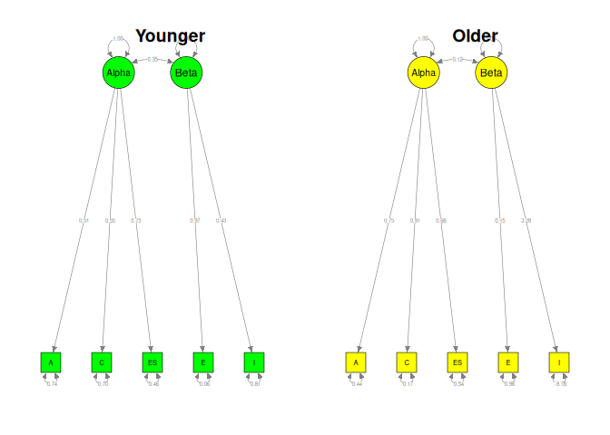<!-- -->

## Random-effects TSSEM
### Stage 1 analysis
A diagonal random-effects covariance is used because there are too few studies to estimate a full matrix. The summary reports the $I^2$ indices.

``` r
#### Random-effects TSSEM with random effects on the diagonals
random1 <- tssem1(Digman97$data, Digman97$n, method="REM", RE.type="Diag")
summary(random1)
```

```

Call:
meta(y = ES, v = acovR, RE.constraints = Diag(paste0(RE.startvalues, 
    "*Tau2_", 1:no.es, "_", 1:no.es)), RE.lbound = RE.lbound, 
    I2 = I2, model.name = model.name, suppressWarnings = suppressWarnings, 
    silent = silent, run = run)

95% confidence intervals: z statistic approximation (robust=FALSE)
Coefficients:
               Estimate   Std.Error      lbound      ubound z value  Pr(>|z|)
Intercept1   0.38971909  0.05429256  0.28330762  0.49613055  7.1781 7.067e-13
Intercept2   0.43265880  0.04145136  0.35141563  0.51390198 10.4377 < 2.2e-16
Intercept3   0.04945633  0.06071079 -0.06953464  0.16844729  0.8146   0.41529
Intercept4   0.09603708  0.04478711  0.00825595  0.18381822  2.1443   0.03201
Intercept5   0.42724244  0.03911620  0.35057609  0.50390878 10.9224 < 2.2e-16
Intercept6   0.11929319  0.04106203  0.03881309  0.19977328  2.9052   0.00367
Intercept7   0.19292425  0.04757962  0.09966991  0.28617859  4.0548 5.018e-05
Intercept8   0.22690164  0.03240892  0.16338132  0.29042196  7.0012 2.538e-12
Intercept9   0.18105566  0.04258855  0.09758363  0.26452769  4.2513 2.126e-05
Intercept10  0.43614968  0.03205960  0.37331401  0.49898535 13.6043 < 2.2e-16
Tau2_1_1     0.03648372  0.01513055  0.00682839  0.06613905  2.4113   0.01590
Tau2_2_2     0.01963098  0.00859789  0.00277942  0.03648253  2.2832   0.02242
Tau2_3_3     0.04571437  0.01952285  0.00745030  0.08397845  2.3416   0.01920
Tau2_4_4     0.02236122  0.00995083  0.00285794  0.04186449  2.2472   0.02463
Tau2_5_5     0.01729072  0.00796404  0.00168149  0.03289995  2.1711   0.02992
Tau2_6_6     0.01815481  0.00895896  0.00059557  0.03571405  2.0264   0.04272
Tau2_7_7     0.02604882  0.01130266  0.00389601  0.04820162  2.3047   0.02119
Tau2_8_8     0.00988761  0.00513713 -0.00018098  0.01995619  1.9247   0.05426
Tau2_9_9     0.01988244  0.00895053  0.00233973  0.03742515  2.2214   0.02633
Tau2_10_10   0.01049222  0.00501578  0.00066148  0.02032296  2.0918   0.03645
               
Intercept1  ***
Intercept2  ***
Intercept3     
Intercept4  *  
Intercept5  ***
Intercept6  ** 
Intercept7  ***
Intercept8  ***
Intercept9  ***
Intercept10 ***
Tau2_1_1    *  
Tau2_2_2    *  
Tau2_3_3    *  
Tau2_4_4    *  
Tau2_5_5    *  
Tau2_6_6    *  
Tau2_7_7    *  
Tau2_8_8    .  
Tau2_9_9    *  
Tau2_10_10  *  
---
Signif. codes:  0 '***' 0.001 '**' 0.01 '*' 0.05 '.' 0.1 ' ' 1

Q statistic on the homogeneity of effect sizes: 1220.334
Degrees of freedom of the Q statistic: 130
P value of the Q statistic: 1.664182e-176

Heterogeneity indices (based on the estimated Tau2):
                              Estimate
Intercept1: I2 (Q statistic)    0.9326
Intercept2: I2 (Q statistic)    0.8872
Intercept3: I2 (Q statistic)    0.9325
Intercept4: I2 (Q statistic)    0.8703
Intercept5: I2 (Q statistic)    0.8797
Intercept6: I2 (Q statistic)    0.8480
Intercept7: I2 (Q statistic)    0.8887
Intercept8: I2 (Q statistic)    0.7669
Intercept9: I2 (Q statistic)    0.8590
Intercept10: I2 (Q statistic)   0.8193

Number of studies (or clusters): 14
Number of observed statistics: 140
Number of estimated parameters: 20
Degrees of freedom: 120
-2 log likelihood: -112.4196 
OpenMx status1: 0 ("0" or "1": The optimization is considered fine.
Other values may indicate problems.)
```

* The pooled correlation coefficients (fixed effects) and the variance components (the random effects) can be extracted by the use of the `coef()` command via the `select` argument.

``` r
## Fixed effects
coef(random1, select="fixed")
```

```
 Intercept1  Intercept2  Intercept3  Intercept4  Intercept5  Intercept6 
 0.38971909  0.43265880  0.04945633  0.09603708  0.42724244  0.11929319 
 Intercept7  Intercept8  Intercept9 Intercept10 
 0.19292425  0.22690164  0.18105566  0.43614968 
```

``` r
## Random effects
coef(random1, select="random")
```

```
   Tau2_1_1    Tau2_2_2    Tau2_3_3    Tau2_4_4    Tau2_5_5    Tau2_6_6 
0.036483719 0.019630976 0.045714375 0.022361217 0.017290720 0.018154812 
   Tau2_7_7    Tau2_8_8    Tau2_9_9  Tau2_10_10 
0.026048817 0.009887609 0.019882439 0.010492218 
```

### Stage 2 analysis
Since this is a correlation structure analysis, the error variances are not free parameters.

``` r
random2 <- tssem2(random1, RAM=RAM1, intervals="LB")
summary(random2)
```

```

Call:
wls(Cov = pooledS, aCov = aCov, n = tssem1.obj$total.n, RAM = RAM, 
    Amatrix = Amatrix, Smatrix = Smatrix, Fmatrix = Fmatrix, 
    diag.constraints = diag.constraints, cor.analysis = cor.analysis, 
    intervals.type = intervals.type, mx.algebras = mx.algebras, 
    mxModel.Args = mxModel.Args, subset.variables = subset.variables, 
    model.name = model.name, suppressWarnings = suppressWarnings, 
    silent = silent, run = run)

95% confidence intervals: Likelihood-based statistic
Coefficients:
              Estimate Std.Error  lbound  ubound z value Pr(>|z|)
AonAlpha       0.56944        NA 0.46898 0.67544      NA       NA
ConAlpha       0.59063        NA 0.48949 0.69754      NA       NA
EonBeta        0.67996        NA 0.54613 0.80246      NA       NA
ESonAlpha      0.76045        NA 0.64835 0.89700      NA       NA
IonBeta        0.64184        NA 0.50430 0.70558      NA       NA
AlphawithBeta  0.37769        NA 0.28670 0.47396      NA       NA

Goodness-of-fit indices:
                                               Value
Sample size                                4496.0000
Chi-square of target model                    7.8204
DF of target model                            4.0000
p value of target model                       0.0984
Number of constraints imposed on "Smatrix"    0.0000
DF manually adjusted                          0.0000
Chi-square of independence model            501.6769
DF of independence model                     10.0000
RMSEA                                         0.0146
RMSEA lower 95% CI                            0.0000
RMSEA upper 95% CI                            0.0297
SRMR                                          0.0436
TLI                                           0.9806
CFI                                           0.9922
AIC                                          -0.1796
BIC                                         -25.8234
OpenMx status1: 0 ("0" or "1": The optimization is considered fine.
Other values indicate problems.)
```

``` r
## Plot the parameter estimates
plot(random2, color="green")
```

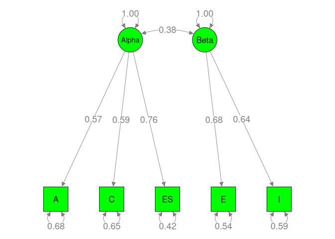<!-- -->

Stage 2 fit: χ²(df = 4, N = 4496) = 7.82, CFI = 0.9922, RMSEA = 0.0146, SRMR = 0.0436.

## Becker and Schram (1994)
### Inspect the data
* We may list the first few cases of the data by using the `head()` command.

``` r
#### Load the metaSEM library for TSSEM
library(metaSEM)
  
#### Inspect the data for inspection (not required for the analysis)
head(Becker94$data)
```

```
$`Becker (1978) Females`
         Math Spatial Verbal
Math     1.00    0.47  -0.21
Spatial  0.47    1.00  -0.15
Verbal  -0.21   -0.15   1.00

$`Becker (1978) Males`
        Math Spatial Verbal
Math    1.00    0.28   0.19
Spatial 0.28    1.00   0.18
Verbal  0.19    0.18   1.00

$`Berry (1957) Females`
        Math Spatial Verbal
Math    1.00    0.48   0.41
Spatial 0.48    1.00   0.26
Verbal  0.41    0.26   1.00

$`Berry (1957) Males`
        Math Spatial Verbal
Math    1.00    0.37   0.40
Spatial 0.37    1.00   0.27
Verbal  0.40    0.27   1.00

$`Rosenberg (1981) Females`
        Math Spatial Verbal
Math    1.00    0.42   0.48
Spatial 0.42    1.00   0.23
Verbal  0.48    0.23   1.00

$`Rosenberg (1981) Males`
        Math Spatial Verbal
Math    1.00    0.41   0.74
Spatial 0.41    1.00   0.44
Verbal  0.74    0.44   1.00
```

``` r
head(Becker94$n)
```

```
[1]  74 153  48  55  51  18
```

## Fixed-effects TSSEM
### Stage 1 analysis
The fixed-effects Stage 1 analysis tests the homogeneity of the correlation matrices.

``` r
#### Fixed-effects model
## Stage 1 analysis
fixed1 <- tssem1(Becker94$data, Becker94$n, method="FEM")
summary(fixed1)
```

```

Call:
tssem1FEM(Cov = Cov, n = n, cor.analysis = cor.analysis, model.name = model.name, 
    cluster = cluster, suppressWarnings = suppressWarnings, silent = silent, 
    run = run)

Coefficients:
       Estimate Std.Error z value  Pr(>|z|)    
S[1,2] 0.379961  0.037123 10.2351 < 2.2e-16 ***
S[1,3] 0.334562  0.039947  8.3751 < 2.2e-16 ***
S[2,3] 0.176461  0.042334  4.1683 3.069e-05 ***
---
Signif. codes:  0 '***' 0.001 '**' 0.01 '*' 0.05 '.' 0.1 ' ' 1

Goodness-of-fit indices:
                                     Value
Sample size                       538.0000
Chi-square of target model         64.0424
DF of target model                 27.0000
p value of target model             0.0001
Chi-square of independence model  207.7894
DF of independence model           30.0000
RMSEA                               0.1597
RMSEA lower 95% CI                  0.1095
RMSEA upper 95% CI                  0.2105
SRMR                                0.1586
TLI                                 0.7685
CFI                                 0.7917
AIC                                10.0424
BIC                              -105.7298
OpenMx status1: 0 ("0" or "1": The optimization is considered fine.
Other values may indicate problems.)
```

``` r
coef(fixed1)
```

```
             Math   Spatial   Verbal
Math    1.0000000 0.3799605 0.334562
Spatial 0.3799605 1.0000000 0.176461
Verbal  0.3345620 0.1764610 1.000000
```

### Stage 2 analysis
We may specify the model via the RAM formulation. If all variables are observed, there is no need to specify the *F* matrix. Since the *df* of the regression model is 0, the proposed model always fits the data perfectly.

``` r
#### Prepare models for stage 2 analysis
model2 <- "## Math is modeled by Spatial and Verbal
           Math ~ Spatial2Math*Spatial + Verbal2Math*Verbal
           ## Variances of predictors are fixed at 1
           Spatial ~~ 1*Spatial
           Verbal ~~ 1*Verbal
           ## Correlation between the predictors
           Spatial ~~ SpatialCorVerbal*Verbal
           ## Error variance
           Math ~~ ErrorVarMath*Math"
plot(model2)
```

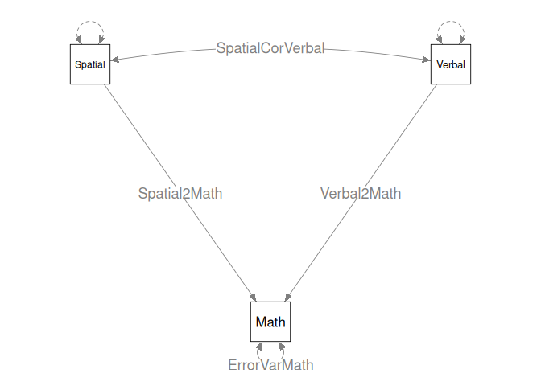<!-- -->

``` r
RAM2 <- lavaan2RAM(model2)
RAM2
```

```
$A
        Math Spatial            Verbal           
Math    "0"  "0.1*Spatial2Math" "0.1*Verbal2Math"
Spatial "0"  "0"                "0"              
Verbal  "0"  "0"                "0"              

$S
        Math               Spatial              Verbal              
Math    "0.5*ErrorVarMath" "0"                  "0"                 
Spatial "0"                "1"                  "0*SpatialCorVerbal"
Verbal  "0"                "0*SpatialCorVerbal" "1"                 

$F
        Math Spatial Verbal
Math       1       0      0
Spatial    0       1      0
Verbal     0       0      1

$M
  Math         Spatial         Verbal        
1 "0*Mathmean" "0*Spatialmean" "0*Verbalmean"
```

``` r
## Stage 2 analysis
fixed2 <- tssem2(fixed1, RAM=RAM2, intervals="LB")
summary(fixed2)
```

```

Call:
wls(Cov = coef.tssem1FEM(tssem1.obj), aCov = vcov.tssem1FEM(tssem1.obj), 
    n = sum(tssem1.obj$n), RAM = RAM, Amatrix = Amatrix, Smatrix = Smatrix, 
    Fmatrix = Fmatrix, diag.constraints = diag.constraints, cor.analysis = tssem1.obj$cor.analysis, 
    intervals.type = intervals.type, mx.algebras = mx.algebras, 
    mxModel.Args = mxModel.Args, subset.variables = subset.variables, 
    model.name = model.name, suppressWarnings = suppressWarnings, 
    silent = silent, run = run)

95% confidence intervals: Likelihood-based statistic
Coefficients:
                 Estimate Std.Error   lbound   ubound z value Pr(>|z|)
Spatial2Math     0.331238        NA 0.257859 0.404518      NA       NA
Verbal2Math      0.276111        NA 0.199240 0.353038      NA       NA
SpatialCorVerbal 0.176461        NA 0.093456 0.259466      NA       NA

Goodness-of-fit indices:
                                            Value
Sample size                                538.00
Chi-square of target model                   0.00
DF of target model                           0.00
p value of target model                        NA
Number of constraints imposed on "Smatrix"   0.00
DF manually adjusted                         0.00
Chi-square of independence model           160.47
DF of independence model                     3.00
RMSEA                                        0.00
RMSEA lower 95% CI                           0.00
RMSEA upper 95% CI                           0.00
SRMR                                         0.00
TLI                                          1.00
CFI                                          1.00
AIC                                          0.00
BIC                                          0.00
OpenMx status1: 0 ("0" or "1": The optimization is considered fine.
Other values indicate problems.)
```

``` r
plot(fixed2)
```

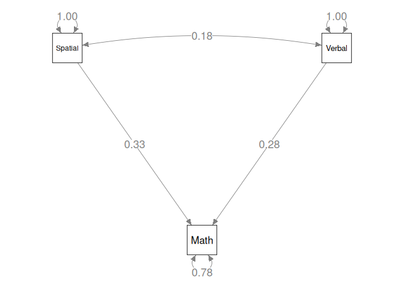<!-- -->

## Fixed-effects TSSEM with cluster
### Stage 1 analysis
We examine the Stage 1 fit separately for female and male participants.

``` r
#### Fixed-effects model with cluster
## Stage 1 analysis
cluster1 <- tssem1(Becker94$data, Becker94$n, method="FEM", cluster=Becker94$gender)
summary(cluster1)
```

```
$Females

Call:
tssem1FEM(Cov = data.cluster[[i]], n = n.cluster[[i]], cor.analysis = cor.analysis, 
    model.name = model.name, suppressWarnings = suppressWarnings, 
    silent = silent, run = run)

Coefficients:
       Estimate Std.Error z value  Pr(>|z|)    
S[1,2] 0.455896  0.051993  8.7685 < 2.2e-16 ***
S[1,3] 0.341583  0.061943  5.5144 3.499e-08 ***
S[2,3] 0.171931  0.064731  2.6561  0.007905 ** 
---
Signif. codes:  0 '***' 0.001 '**' 0.01 '*' 0.05 '.' 0.1 ' ' 1

Goodness-of-fit indices:
                                    Value
Sample size                      235.0000
Chi-square of target model        43.3724
DF of target model                12.0000
p value of target model            0.0000
Chi-square of independence model 123.4399
DF of independence model          15.0000
RMSEA                              0.2358
RMSEA lower 95% CI                 0.1627
RMSEA upper 95% CI                 0.3134
SRMR                               0.2141
TLI                                0.6384
CFI                                0.7107
AIC                               19.3724
BIC                              -22.1426
OpenMx status1: 0 ("0" or "1": The optimization is considered fine.
Other values may indicate problems.)

$Males

Call:
tssem1FEM(Cov = data.cluster[[i]], n = n.cluster[[i]], cor.analysis = cor.analysis, 
    model.name = model.name, suppressWarnings = suppressWarnings, 
    silent = silent, run = run)

Coefficients:
       Estimate Std.Error z value  Pr(>|z|)    
S[1,2] 0.318051  0.051698  6.1521 7.646e-10 ***
S[1,3] 0.328286  0.052226  6.2858 3.261e-10 ***
S[2,3] 0.179549  0.055944  3.2094   0.00133 ** 
---
Signif. codes:  0 '***' 0.001 '**' 0.01 '*' 0.05 '.' 0.1 ' ' 1

Goodness-of-fit indices:
                                    Value
Sample size                      303.0000
Chi-square of target model        16.6863
DF of target model                12.0000
p value of target model            0.1618
Chi-square of independence model  84.3496
DF of independence model          15.0000
RMSEA                              0.0803
RMSEA lower 95% CI                 0.0000
RMSEA upper 95% CI                 0.1642
SRMR                               0.1025
TLI                                0.9155
CFI                                0.9324
AIC                               -7.3137
BIC                              -51.8785
OpenMx status1: 0 ("0" or "1": The optimization is considered fine.
Other values may indicate problems.)
```

``` r
coef(cluster1)
```

```
$Females
             Math   Spatial    Verbal
Math    1.0000000 0.4558958 0.3415826
Spatial 0.4558958 1.0000000 0.1719309
Verbal  0.3415826 0.1719309 1.0000000

$Males
             Math   Spatial    Verbal
Math    1.0000000 0.3180507 0.3282856
Spatial 0.3180507 1.0000000 0.1795489
Verbal  0.3282856 0.1795489 1.0000000
```

### Stage 2 analysis

``` r
## Stage 2 analysis
cluster2 <- tssem2(cluster1, RAM=RAM2, intervals="LB")
summary(cluster2)
```

```
$Females

Call:
wls(Cov = coef.tssem1FEM(tssem1.obj), aCov = vcov.tssem1FEM(tssem1.obj), 
    n = sum(tssem1.obj$n), RAM = RAM, Amatrix = Amatrix, Smatrix = Smatrix, 
    Fmatrix = Fmatrix, diag.constraints = diag.constraints, cor.analysis = tssem1.obj$cor.analysis, 
    intervals.type = intervals.type, mx.algebras = mx.algebras, 
    mxModel.Args = mxModel.Args, subset.variables = subset.variables, 
    model.name = model.name, suppressWarnings = suppressWarnings, 
    silent = silent, run = run)

95% confidence intervals: Likelihood-based statistic
Coefficients:
                 Estimate Std.Error   lbound   ubound z value Pr(>|z|)
Spatial2Math     0.409265        NA 0.304882 0.512763      NA       NA
Verbal2Math      0.271217        NA 0.156099 0.387166      NA       NA
SpatialCorVerbal 0.171931        NA 0.044875 0.298952      NA       NA

Goodness-of-fit indices:
                                            Value
Sample size                                235.00
Chi-square of target model                   0.00
DF of target model                           0.00
p value of target model                        NA
Number of constraints imposed on "Smatrix"   0.00
DF manually adjusted                         0.00
Chi-square of independence model           105.57
DF of independence model                     3.00
RMSEA                                        0.00
RMSEA lower 95% CI                           0.00
RMSEA upper 95% CI                           0.00
SRMR                                         0.00
TLI                                          1.00
CFI                                          1.00
AIC                                          0.00
BIC                                          0.00
OpenMx status1: 0 ("0" or "1": The optimization is considered fine.
Other values indicate problems.)

$Males

Call:
wls(Cov = coef.tssem1FEM(tssem1.obj), aCov = vcov.tssem1FEM(tssem1.obj), 
    n = sum(tssem1.obj$n), RAM = RAM, Amatrix = Amatrix, Smatrix = Smatrix, 
    Fmatrix = Fmatrix, diag.constraints = diag.constraints, cor.analysis = tssem1.obj$cor.analysis, 
    intervals.type = intervals.type, mx.algebras = mx.algebras, 
    mxModel.Args = mxModel.Args, subset.variables = subset.variables, 
    model.name = model.name, suppressWarnings = suppressWarnings, 
    silent = silent, run = run)

95% confidence intervals: Likelihood-based statistic
Coefficients:
                 Estimate Std.Error   lbound   ubound z value Pr(>|z|)
Spatial2Math     0.267739        NA 0.166613 0.368835      NA       NA
Verbal2Math      0.280213        NA 0.177978 0.382769      NA       NA
SpatialCorVerbal 0.179549        NA 0.069892 0.289306      NA       NA

Goodness-of-fit indices:
                                             Value
Sample size                                303.000
Chi-square of target model                   0.000
DF of target model                           0.000
p value of target model                         NA
Number of constraints imposed on "Smatrix"   0.000
DF manually adjusted                         0.000
Chi-square of independence model            68.564
DF of independence model                     3.000
RMSEA                                        0.000
RMSEA lower 95% CI                           0.000
RMSEA upper 95% CI                           0.000
SRMR                                         0.000
TLI                                          1.000
CFI                                          1.000
AIC                                          0.000
BIC                                          0.000
OpenMx status1: 0 ("0" or "1": The optimization is considered fine.
Other values indicate problems.)
```

* We may also plot the parameter estimates of these two groups.

``` r
## Convert the model to semPlotModel object with 2 plots
my.plots <- lapply(X=cluster2, FUN=meta2semPlot)

## Setup two plots
layout(t(1:2))
semPaths(my.plots[[1]], whatLabels="est", nCharNodes=10, color="green")
title("Females") 
semPaths(my.plots[[2]], whatLabels="est", nCharNodes=10, color="yellow")
title("Males")
```

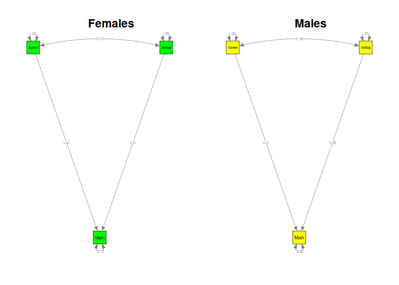<!-- -->

## Random-effects TSSEM
### Stage 1 analysis
The summary reports the $I^2$ indices for the correlations.

``` r
#### Random-effects model
## Stage 1 analysis: A diagonal matrix for random effects 
random1 <- tssem1(Becker94$data, Becker94$n, method="REM", RE.type="Diag")
summary(random1)
```

```

Call:
meta(y = ES, v = acovR, RE.constraints = Diag(paste0(RE.startvalues, 
    "*Tau2_", 1:no.es, "_", 1:no.es)), RE.lbound = RE.lbound, 
    I2 = I2, model.name = model.name, suppressWarnings = suppressWarnings, 
    silent = silent, run = run)

95% confidence intervals: z statistic approximation (robust=FALSE)
Coefficients:
             Estimate  Std.Error     lbound     ubound z value  Pr(>|z|)    
Intercept1  0.3777491  0.0395030  0.3003246  0.4551735  9.5625 < 2.2e-16 ***
Intercept2  0.3807843  0.0784956  0.2269357  0.5346328  4.8510 1.228e-06 ***
Intercept3  0.1704927  0.0513545  0.0698398  0.2711457  3.3199 0.0009004 ***
Tau2_1_1    0.0005038  0.0042009 -0.0077298  0.0087374  0.1199 0.9045414    
Tau2_2_2    0.0416264  0.0257388 -0.0088206  0.0920734  1.6173 0.1058209    
Tau2_3_3    0.0067540  0.0102792 -0.0133928  0.0269008  0.6571 0.5111470    
---
Signif. codes:  0 '***' 0.001 '**' 0.01 '*' 0.05 '.' 0.1 ' ' 1

Q statistic on the homogeneity of effect sizes: 61.02635
Degrees of freedom of the Q statistic: 27
P value of the Q statistic: 0.000193212

Heterogeneity indices (based on the estimated Tau2):
                             Estimate
Intercept1: I2 (Q statistic)   0.0337
Intercept2: I2 (Q statistic)   0.7224
Intercept3: I2 (Q statistic)   0.2676

Number of studies (or clusters): 10
Number of observed statistics: 30
Number of estimated parameters: 6
Degrees of freedom: 24
-2 log likelihood: -22.61046 
OpenMx status1: 0 ("0" or "1": The optimization is considered fine.
Other values may indicate problems.)
```

``` r
coef(random1, select="fixed")
```

```
Intercept1 Intercept2 Intercept3 
 0.3777491  0.3807843  0.1704927 
```

``` r
coef(random1, select="random")
```

```
   Tau2_1_1    Tau2_2_2    Tau2_3_3 
0.000503800 0.041626400 0.006753956 
```

### Stage 2 analysis

``` r
## Stage 2 analysis
random2 <- tssem2(random1, RAM=RAM2, intervals="LB")
summary(random2)
```

```

Call:
wls(Cov = pooledS, aCov = aCov, n = tssem1.obj$total.n, RAM = RAM, 
    Amatrix = Amatrix, Smatrix = Smatrix, Fmatrix = Fmatrix, 
    diag.constraints = diag.constraints, cor.analysis = cor.analysis, 
    intervals.type = intervals.type, mx.algebras = mx.algebras, 
    mxModel.Args = mxModel.Args, subset.variables = subset.variables, 
    model.name = model.name, suppressWarnings = suppressWarnings, 
    silent = silent, run = run)

95% confidence intervals: Likelihood-based statistic
Coefficients:
                 Estimate Std.Error  lbound  ubound z value Pr(>|z|)
Spatial2Math      0.32219        NA 0.23713 0.40452      NA       NA
Verbal2Math       0.32585        NA 0.16859 0.48282      NA       NA
SpatialCorVerbal  0.17049        NA 0.06973 0.27131      NA       NA

Goodness-of-fit indices:
                                            Value
Sample size                                538.00
Chi-square of target model                   0.00
DF of target model                           0.00
p value of target model                        NA
Number of constraints imposed on "Smatrix"   0.00
DF manually adjusted                         0.00
Chi-square of independence model           110.81
DF of independence model                     3.00
RMSEA                                        0.00
RMSEA lower 95% CI                           0.00
RMSEA upper 95% CI                           0.00
SRMR                                         0.00
TLI                                          1.00
CFI                                          1.00
AIC                                          0.00
BIC                                          0.00
OpenMx status1: 0 ("0" or "1": The optimization is considered fine.
Other values indicate problems.)
```

* We may also plot the models with the labels or the parameter estimates.

``` r
## Plot the model with labels
plot(random2, whatLabels="path", color="red")
```

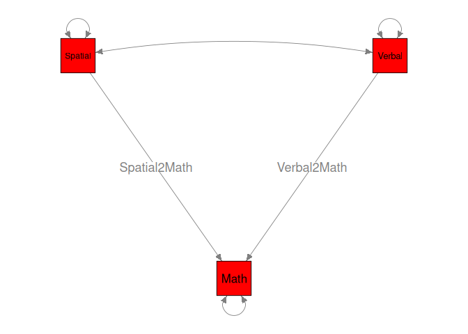<!-- -->

``` r
## Plot the parameter estimates
plot(random2, color="green")
```

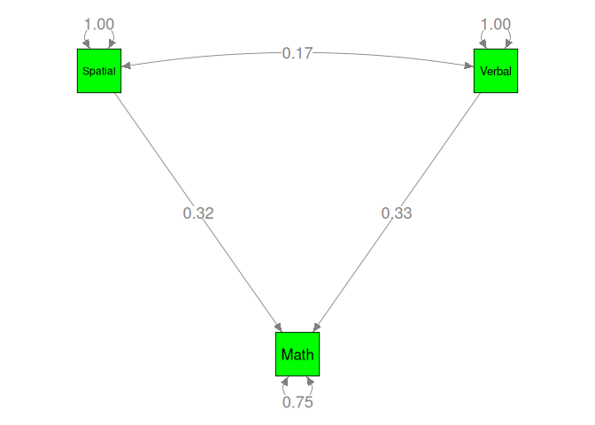<!-- -->

# One-stage meta-analytic structural equation modeling (OSMASEM)

## Nohe15
* **Data**: Nohe, C., Meier, L. L., Sonntag, K., & Michel, A. (2015). The chicken or the egg? A meta-analysis of panel studies of the relationship between work–family conflict and strain. *Journal of Applied Psychology*, *100*(2), 522–536. https://doi.org/10.1037/a0038012

### Data preparation

``` r
## Convert correlation matrices into a dataframe
my.df <- Cor2DataFrame(Nohe15A1$data, Nohe15A1$n)

## Add the standardized Lag (moderator) to the data
my.df$data <- data.frame(my.df$data, Lag=scale(Nohe15A1$Lag), check.names=FALSE)
head(my.df$data)
```

```
                                       S1_W1 W2_W1 S2_W1 W2_S1 S2_S1 S2_W2
Britt...Dawson..2005.                   0.29  0.58  0.22  0.24  0.57  0.27
Demerouti.et.al...2004.                 0.53  0.57  0.41  0.41  0.68  0.54
Ford..2010.                             0.35  0.75  0.32  0.26  0.74  0.30
Hammer.et.al...2005...female.subsample  0.32  0.57  0.22  0.30  0.43  0.30
Hammer.et.al...2005...male.subsample    0.19  0.54  0.17  0.21  0.60  0.30
Innstrand.et.al...2008.                 0.42  0.63  0.31  0.30  0.62  0.44
                                       C(S1_W1 S1_W1) C(W2_W1 S1_W1)
Britt...Dawson..2005.                     0.001422479   0.0002033635
Demerouti.et.al...2004.                   0.002076395   0.0002968500
Ford..2010.                               0.002120708   0.0003031852
Hammer.et.al...2005...female.subsample    0.002972616   0.0004249776
Hammer.et.al...2005...male.subsample      0.002972616   0.0004249776
Innstrand.et.al...2008.                   0.000311227   0.0000444943
                                       C(S2_W1 S1_W1) C(W2_S1 S1_W1)
Britt...Dawson..2005.                    0.0008791243   0.0008736611
Demerouti.et.al...2004.                  0.0012832591   0.0012752845
Ford..2010.                              0.0013106457   0.0013025009
Hammer.et.al...2005...female.subsample   0.0018371444   0.0018257278
Hammer.et.al...2005...male.subsample     0.0018371444   0.0018257278
Innstrand.et.al...2008.                  0.0001923453   0.0001911500
                                       C(S2_S1 S1_W1) C(S2_W2 S1_W1)
Britt...Dawson..2005.                    2.047346e-04   0.0004890894
Demerouti.et.al...2004.                  2.988513e-04   0.0007139245
Ford..2010.                              3.052293e-04   0.0007291607
Hammer.et.al...2005...female.subsample   4.278427e-04   0.0010220714
Hammer.et.al...2005...male.subsample     4.278427e-04   0.0010220714
Innstrand.et.al...2008.                  4.479427e-05   0.0001070088
                                       C(W2_W1 W2_W1) C(S2_W1 W2_W1)
Britt...Dawson..2005.                    0.0007981106   3.750391e-04
Demerouti.et.al...2004.                  0.0011650033   5.474451e-04
Ford..2010.                              0.0011898662   5.591284e-04
Hammer.et.al...2005...female.subsample   0.0016678466   7.837355e-04
Hammer.et.al...2005...male.subsample     0.0016678466   7.837355e-04
Innstrand.et.al...2008.                  0.0001746202   8.205553e-05
                                       C(W2_S1 W2_W1) C(S2_S1 W2_W1)
Britt...Dawson..2005.                    3.671018e-04   1.042810e-04
Demerouti.et.al...2004.                  5.358591e-04   1.522191e-04
Ford..2010.                              5.472951e-04   1.554677e-04
Hammer.et.al...2005...female.subsample   7.671487e-04   2.179205e-04
Hammer.et.al...2005...male.subsample     7.671487e-04   2.179205e-04
Innstrand.et.al...2008.                  8.031892e-05   2.281583e-05
                                       C(S2_W2 W2_W1) C(S2_W1 S2_W1)
Britt...Dawson..2005.                    2.035379e-04    0.001649681
Demerouti.et.al...2004.                  2.971046e-04    0.002408042
Ford..2010.                              3.034452e-04    0.002459434
Hammer.et.al...2005...female.subsample   4.253420e-04    0.003447411
Hammer.et.al...2005...male.subsample     4.253420e-04    0.003447411
Innstrand.et.al...2008.                  4.453246e-05    0.000360937
                                       C(W2_S1 S2_W1) C(S2_S1 S2_W1)
Britt...Dawson..2005.                    0.0005769098   3.592773e-04
Demerouti.et.al...2004.                  0.0008421160   5.244375e-04
Ford..2010.                              0.0008600880   5.356298e-04
Hammer.et.al...2005...female.subsample   0.0012055935   7.507973e-04
Hammer.et.al...2005...male.subsample     0.0012055935   7.507973e-04
Innstrand.et.al...2008.                  0.0001262232   7.860697e-05
                                       C(S2_W2 S2_W1) C(W2_S1 W2_S1)
Britt...Dawson..2005.                    0.0008607786   0.0016601406
Demerouti.et.al...2004.                  0.0012564798   0.0024233097
Ford..2010.                              0.0012832949   0.0024750266
Hammer.et.al...2005...female.subsample   0.0017988065   0.0034692681
Hammer.et.al...2005...male.subsample     0.0017988065   0.0034692681
Innstrand.et.al...2008.                  0.0001883314   0.0003632254
                                       C(S2_S1 W2_S1) C(S2_W2 W2_S1)
Britt...Dawson..2005.                    3.727412e-04   0.0008739022
Demerouti.et.al...2004.                  5.440909e-04   0.0012756364
Ford..2010.                              5.557026e-04   0.0013028604
Hammer.et.al...2005...female.subsample   7.789335e-04   0.0018262316
Hammer.et.al...2005...male.subsample     7.789335e-04   0.0018262316
Innstrand.et.al...2008.                  8.155277e-05   0.0001912028
                                       C(S2_S1 S2_S1) C(S2_W2 S2_S1)
Britt...Dawson..2005.                    0.0007805638   0.0001951863
Demerouti.et.al...2004.                  0.0011393902   0.0002849138
Ford..2010.                              0.0011637064   0.0002909943
Hammer.et.al...2005...female.subsample   0.0016311782   0.0004078894
Hammer.et.al...2005...male.subsample     0.0016311782   0.0004078894
Innstrand.et.al...2008.                  0.0001707811   0.0000427052
                                       C(S2_W2 S2_W2)        Lag
Britt...Dawson..2005.                    0.0013981148 -0.6794521
Demerouti.et.al...2004.                  0.0020408303 -0.7711151
Ford..2010.                              0.0020843846 -0.8016694
Hammer.et.al...2005...female.subsample   0.0029217015 -0.1294740
Hammer.et.al...2005...male.subsample     0.0029217015 -0.1294740
Innstrand.et.al...2008.                  0.0003058963  0.6038301
```

``` r
## Display the pairwise no. of studies
pattern.na(my.df, show.na=FALSE, type="osmasem")
```

```
      S1_W1 W2_W1 S2_W1 W2_S1 S2_S1 S2_W2
S1_W1    32    32    32    32    32    32
W2_W1    32    32    32    32    32    32
S2_W1    32    32    32    32    32    32
W2_S1    32    32    32    32    32    32
S2_S1    32    32    32    32    32    32
S2_W2    32    32    32    32    32    32
```

``` r
## Proposed model
model3 <- 'W2 ~ w2w*W1 + s2w*S1
           S2 ~ w2s*W1 + s2s*S1
           W1 ~~ w1WITHs1*S1
           W2 ~~ w2WITHs2*S2
           W1 ~~ 1*W1
           S1 ~~ 1*S1
           W2 ~~ Errw2*W2
           S2 ~~ Errs2*S2'

## Plot the model
plot(model3, col="yellow", layout="spring")     
```

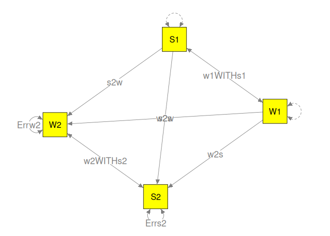<!-- -->

``` r
## Convert the lavaan syntax into the RAM specification
RAM3 <- lavaan2RAM(model3, obs.variables=c("W1", "S1", "W2", "S2"))
RAM3
```

```
$A
   W1        S1        W2  S2 
W1 "0"       "0"       "0" "0"
S1 "0"       "0"       "0" "0"
W2 "0.1*w2w" "0.1*s2w" "0" "0"
S2 "0.1*w2s" "0.1*s2s" "0" "0"

$S
   W1           S1           W2           S2          
W1 "1"          "0*w1WITHs1" "0"          "0"         
S1 "0*w1WITHs1" "1"          "0"          "0"         
W2 "0"          "0"          "0.5*Errw2"  "0*w2WITHs2"
S2 "0"          "0"          "0*w2WITHs2" "0.5*Errs2" 

$F
   W1 S1 W2 S2
W1  1  0  0  0
S1  0  1  0  0
W2  0  0  1  0
S2  0  0  0  1

$M
  W1         S1         W2         S2        
1 "0*W1mean" "0*S1mean" "0*W2mean" "0*S2mean"
```

### Fitting a just-identified model (df=0)

``` r
# Fit the OSMASEM
fit0 <- osmasem(model.name="No moderator", RAM=RAM3, data=my.df)
summary(fit0)
```

```
Summary of No moderator 
 
free parameters:
       name  matrix row col    Estimate  Std.Error A    z value      Pr(>|z|)
1       w2w      A0  W2  W1  0.57247133 0.02226456    25.712220 8.533834e-146
2       w2s      A0  S2  W1  0.08023683 0.02484214     3.229868  1.238475e-03
3       s2w      A0  W2  S1  0.08584122 0.02479590     3.461912  5.363531e-04
4       s2s      A0  S2  S1  0.58612403 0.02079000    28.192589 7.208342e-175
5  w1WITHs1      S0  S1  W1  0.38045217 0.02256156    16.862847  8.442203e-64
6  w2WITHs2      S0  S2  W2  0.16888459 0.02523192     6.693291  2.182059e-11
7    Tau1_1 vecTau1   1   1 -4.30671722 0.28716839   -14.997184  7.660085e-51
8    Tau1_2 vecTau1   2   1 -4.73764524 0.28838623   -16.428126  1.203205e-60
9    Tau1_3 vecTau1   3   1 -4.94593056 0.31593251   -15.655022  3.070048e-55
10   Tau1_4 vecTau1   4   1 -4.95352326 0.31339092   -15.806212  2.819175e-56
11   Tau1_5 vecTau1   5   1 -4.92491364 0.29039423   -16.959406  1.639946e-64
12   Tau1_6 vecTau1   6   1 -4.39967581 0.28374629   -15.505668  3.175952e-54

To obtain confidence intervals re-run with intervals=TRUE

Model Statistics: 
               |  Parameters  |  Degrees of Freedom  |  Fit (-2lnL units)
       Model:             12                    180             -300.1701
   Saturated:             27                    165                    NA
Independence:             12                    180                    NA
Number of observations/statistics: 12906/192

Information Criteria: 
      |  df Penalty  |  Parameters Penalty  |  Sample-Size Adjusted
AIC:      -660.1701              -276.1701                -276.1459
BIC:     -2003.9507              -186.5847                -224.7195
To get additional fit indices, see help(mxRefModels)
timestamp: [omitted for comparison]
Wall clock time: [omitted for comparison]
optimizer:  SLSQP 
OpenMx version number: 2.22.11 
Need help?  See help(mxSummary) 
```

``` r
## Plot the fitted model
plot(fit0, layout="spring", color="yellow")
```

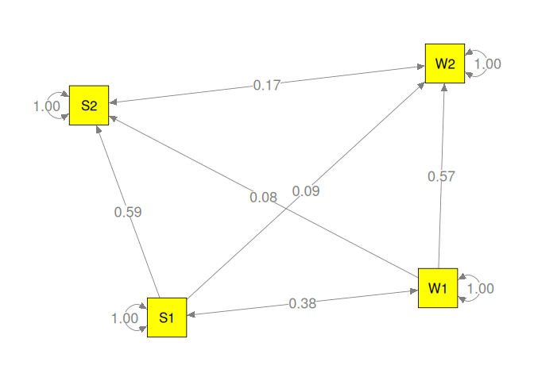<!-- -->

``` r
## Get the estimated coefficients
coef(fit0)
```

```
       w2w        w2s        s2w        s2s   w1WITHs1   w2WITHs2 
0.57247133 0.08023683 0.08584122 0.58612403 0.38045217 0.16888459 
```

``` r
## A matrix
mxEval(Amatrix, fit0$mx.fit)
```

```
           [,1]       [,2] [,3] [,4]
[1,] 0.00000000 0.00000000    0    0
[2,] 0.00000000 0.00000000    0    0
[3,] 0.57247133 0.08584122    0    0
[4,] 0.08023683 0.58612403    0    0
```

``` r
## S matrix
mxEval(Smatrix, fit0$mx.fit)
```

```
          [,1]      [,2]      [,3]      [,4]
[1,] 1.0000000 0.3804522 0.0000000 0.0000000
[2,] 0.3804522 1.0000000 0.0000000 0.0000000
[3,] 0.0000000 0.0000000 0.6275158 0.1688846
[4,] 0.0000000 0.0000000 0.1688846 0.6142363
```

``` r
## Extract the heterogeneity variance-covariance matrix
VarCorr(fit0)
```

```
           Tau2_1      Tau2_2      Tau2_3      Tau2_4      Tau2_5     Tau2_6
Tau2_1 0.01347772 0.000000000 0.000000000 0.000000000 0.000000000 0.00000000
Tau2_2 0.00000000 0.008759248 0.000000000 0.000000000 0.000000000 0.00000000
Tau2_3 0.00000000 0.000000000 0.007112293 0.000000000 0.000000000 0.00000000
Tau2_4 0.00000000 0.000000000 0.000000000 0.007058496 0.000000000 0.00000000
Tau2_5 0.00000000 0.000000000 0.000000000 0.000000000 0.007263354 0.00000000
Tau2_6 0.00000000 0.000000000 0.000000000 0.000000000 0.000000000 0.01228132
```

### Using `Lag` as a moderator on the A matrix

``` r
A1 <- create.modMatrix(RAM=RAM3, output="A", mod="Lag")
A1              
```

```
   W1           S1           W2  S2 
W1 "0"          "0"          "0" "0"
S1 "0"          "0"          "0" "0"
W2 "0*data.Lag" "0*data.Lag" "0" "0"
S2 "0*data.Lag" "0*data.Lag" "0" "0"
```

``` r
fit1 <- osmasem(model.name="Lag as moderator on Ax", RAM=RAM3, Ax=A1, data=my.df)
summary(fit1)
```

```
Summary of Lag as moderator on Ax 
 
free parameters:
       name  matrix row col     Estimate  Std.Error A     z value      Pr(>|z|)
1       w2w      A0  W2  W1  0.573039774 0.01839766    31.1474343 5.494460e-213
2       w2s      A0  S2  W1  0.079844963 0.02419489     3.3000755  9.665882e-04
3       s2w      A0  W2  S1  0.085391026 0.02393613     3.5674539  3.604668e-04
4       s2s      A0  S2  S1  0.586234249 0.01962561    29.8708832 4.702303e-196
5  w1WITHs1      S0  S1  W1  0.381183701 0.02282277    16.7019026  1.269513e-62
6  w2WITHs2      S0  S2  W2  0.166974817 0.02500439     6.6778195  2.425234e-11
7     w2w_1      A1  W2  W1 -0.062015587 0.01850574    -3.3511549  8.047528e-04
8     w2s_1      A1  S2  W1 -0.025933718 0.02096724    -1.2368685  2.161359e-01
9     s2w_1      A1  W2  S1 -0.002382818 0.02055897    -0.1159016  9.077305e-01
10    s2s_1      A1  S2  S1 -0.027809761 0.01974172    -1.4086797  1.589299e-01
11   Tau1_1 vecTau1   1   1 -4.276381062 0.28720205   -14.8898000  3.839164e-50
12   Tau1_2 vecTau1   2   1 -5.261036068 0.32310516   -16.2827360  1.308840e-59
13   Tau1_3 vecTau1   3   1 -5.048387485 0.32015075   -15.7687825  5.102391e-56
14   Tau1_4 vecTau1   4   1 -5.039816726 0.31967923   -15.7652306  5.397497e-56
15   Tau1_5 vecTau1   5   1 -5.074951111 0.29424554   -17.2473339  1.171835e-66
16   Tau1_6 vecTau1   6   1 -4.397726437 0.28288197   -15.5461534  1.689533e-54

To obtain confidence intervals re-run with intervals=TRUE

Model Statistics: 
               |  Parameters  |  Degrees of Freedom  |  Fit (-2lnL units)
       Model:             16                    176             -323.6921
   Saturated:             27                    165                    NA
Independence:             12                    180                    NA
Number of observations/statistics: 12906/192

Information Criteria: 
      |  df Penalty  |  Parameters Penalty  |  Sample-Size Adjusted
AIC:      -675.6921              -291.6921                -291.6499
BIC:     -1989.6109              -172.2449                -223.0913
To get additional fit indices, see help(mxRefModels)
timestamp: [omitted for comparison]
Wall clock time: [omitted for comparison]
optimizer:  SLSQP 
OpenMx version number: 2.22.11 
Need help?  See help(mxSummary) 
```

``` r
## Get the estimated coefficients
coef(fit1)
```

```
         w2w          w2s          s2w          s2s     w1WITHs1     w2WITHs2 
 0.573039774  0.079844963  0.085391026  0.586234249  0.381183701  0.166974817 
       w2w_1        w2s_1        s2w_1        s2s_1 
-0.062015587 -0.025933718 -0.002382818 -0.027809761 
```

``` r
## Extract the residual heterogeneity variance-covariance matrix
VarCorr(fit1)
```

```
           Tau2_1      Tau2_2      Tau2_3      Tau2_4      Tau2_5     Tau2_6
Tau2_1 0.01389285 0.000000000 0.000000000 0.000000000 0.000000000 0.00000000
Tau2_2 0.00000000 0.005189925 0.000000000 0.000000000 0.000000000 0.00000000
Tau2_3 0.00000000 0.000000000 0.006419677 0.000000000 0.000000000 0.00000000
Tau2_4 0.00000000 0.000000000 0.000000000 0.006474935 0.000000000 0.00000000
Tau2_5 0.00000000 0.000000000 0.000000000 0.000000000 0.006251392 0.00000000
Tau2_6 0.00000000 0.000000000 0.000000000 0.000000000 0.000000000 0.01230528
```

``` r
## Calculate the R2
osmasemR2(fit1, fit0)
```

```
$Tau2.0
   Tau2_1_1    Tau2_2_2    Tau2_3_3    Tau2_4_4    Tau2_5_5    Tau2_6_6 
0.013477721 0.008759248 0.007112293 0.007058496 0.007263354 0.012281321 

$Tau2.1
   Tau2_1_1    Tau2_2_2    Tau2_3_3    Tau2_4_4    Tau2_5_5    Tau2_6_6 
0.013892849 0.005189925 0.006419677 0.006474935 0.006251392 0.012305285 

$R2
  Tau2_1_1   Tau2_2_2   Tau2_3_3   Tau2_4_4   Tau2_5_5   Tau2_6_6 
0.00000000 0.40749196 0.09738297 0.08267501 0.13932427 0.00000000 
```

``` r
## Compare the models with and without the moderator
anova(fit1, fit0)
```

```
                    base   comparison ep  minus2LL  df       AIC   diffLL
1 Lag as moderator on Ax         <NA> 16 -323.6921 176 -291.6921       NA
2 Lag as moderator on Ax No moderator 12 -300.1701 180 -276.1701 23.52199
  diffdf            p
1     NA           NA
2      4 9.957486e-05
```

### Using `Lag` as a moderator on the S matrix

``` r
S1 <- create.modMatrix(RAM=RAM3, output="S", mod="Lag")
S1
```

```
   W1           S1           W2           S2          
W1 "0"          "0*data.Lag" "0"          "0"         
S1 "0*data.Lag" "0"          "0"          "0"         
W2 "0"          "0"          "0"          "0*data.Lag"
S2 "0"          "0"          "0*data.Lag" "0"         
```

``` r
fit2 <- osmasem(model.name="Lag as moderator on Sx", RAM=RAM3, Sx=S1, data=my.df)
summary(fit2)
```

```
Summary of Lag as moderator on Sx 
 
free parameters:
         name  matrix row col     Estimate  Std.Error A     z value
1         w2w      A0  W2  W1  0.569234675 0.02189963    25.9928913
2         w2s      A0  S2  W1  0.085032451 0.02395176     3.5501550
3         s2w      A0  W2  S1  0.092336296 0.02405804     3.8380635
4         s2s      A0  S2  S1  0.584608184 0.02049270    28.5276243
5    w1WITHs1      S0  S1  W1  0.376986127 0.02230557    16.9009856
6    w2WITHs2      S0  S2  W2  0.165484773 0.02477818     6.6786495
7  w1WITHs1_1      S1  S1  W1 -0.053146825 0.01794365    -2.9618745
8  w2WITHs2_1      S1  S2  W2 -0.008169636 0.02172731    -0.3760077
9      Tau1_1 vecTau1   1   1 -4.339045034 0.29006142   -14.9590561
10     Tau1_2 vecTau1   2   1 -4.753851937 0.28940616   -16.4262295
11     Tau1_3 vecTau1   3   1 -5.048750494 0.31984412   -15.7850347
12     Tau1_4 vecTau1   4   1 -5.032584563 0.31998251   -15.7276866
13     Tau1_5 vecTau1   5   1 -4.929130094 0.29095958   -16.9409447
14     Tau1_6 vecTau1   6   1 -4.421108766 0.28341627   -15.5993471
        Pr(>|z|)
1  5.958928e-149
2   3.850044e-04
3   1.240084e-04
4  5.323702e-179
5   4.424492e-64
6   2.411541e-11
7   3.057724e-03
8   7.069111e-01
9   1.359405e-50
10  1.241419e-60
11  3.944326e-56
12  9.771652e-56
13  2.244903e-64
14  7.354242e-55

To obtain confidence intervals re-run with intervals=TRUE

Model Statistics: 
               |  Parameters  |  Degrees of Freedom  |  Fit (-2lnL units)
       Model:             14                    178             -309.5338
   Saturated:             27                    165                    NA
Independence:             12                    180                    NA
Number of observations/statistics: 12906/192

Information Criteria: 
      |  df Penalty  |  Parameters Penalty  |  Sample-Size Adjusted
AIC:      -665.5338              -281.5338                -281.5012
BIC:     -1994.3835              -177.0175                -221.5081
To get additional fit indices, see help(mxRefModels)
timestamp: [omitted for comparison]
Wall clock time: [omitted for comparison]
optimizer:  SLSQP 
OpenMx version number: 2.22.11 
Need help?  See help(mxSummary) 
```

``` r
## Get the estimated coefficients
coef(fit2)
```

```
         w2w          w2s          s2w          s2s     w1WITHs1     w2WITHs2 
 0.569234675  0.085032451  0.092336296  0.584608184  0.376986127  0.165484773 
  w1WITHs1_1   w2WITHs2_1 
-0.053146825 -0.008169636 
```

``` r
## Extract the residual heterogeneity variance-covariance matrix
VarCorr(fit2)
```

```
           Tau2_1      Tau2_2      Tau2_3      Tau2_4      Tau2_5    Tau2_6
Tau2_1 0.01304898 0.000000000 0.000000000 0.000000000 0.000000000 0.0000000
Tau2_2 0.00000000 0.008618434 0.000000000 0.000000000 0.000000000 0.0000000
Tau2_3 0.00000000 0.000000000 0.006417347 0.000000000 0.000000000 0.0000000
Tau2_4 0.00000000 0.000000000 0.000000000 0.006521932 0.000000000 0.0000000
Tau2_5 0.00000000 0.000000000 0.000000000 0.000000000 0.007232792 0.0000000
Tau2_6 0.00000000 0.000000000 0.000000000 0.000000000 0.000000000 0.0120209
```

``` r
## Calculate the R2
osmasemR2(fit2, fit0)
```

```
$Tau2.0
   Tau2_1_1    Tau2_2_2    Tau2_3_3    Tau2_4_4    Tau2_5_5    Tau2_6_6 
0.013477721 0.008759248 0.007112293 0.007058496 0.007263354 0.012281321 

$Tau2.1
   Tau2_1_1    Tau2_2_2    Tau2_3_3    Tau2_4_4    Tau2_5_5    Tau2_6_6 
0.013048984 0.008618434 0.006417347 0.006521932 0.007232792 0.012020897 

$R2
   Tau2_1_1    Tau2_2_2    Tau2_3_3    Tau2_4_4    Tau2_5_5    Tau2_6_6 
0.031810852 0.016076076 0.097710566 0.076016723 0.004207577 0.021204900 
```

``` r
## Compare the models with and without the moderator
anova(fit2, fit0)
```

```
                    base   comparison ep  minus2LL  df       AIC   diffLL
1 Lag as moderator on Sx         <NA> 14 -309.5338 178 -281.5338       NA
2 Lag as moderator on Sx No moderator 12 -300.1701 180 -276.1701 9.363693
  diffdf           p
1     NA          NA
2      2 0.009261896
```

### Using `Lag` as a moderator on both the A and S matrices

``` r
fit3 <- osmasem(model.name="Lag as moderator on Ax and Sx", 
                RAM=RAM3, Ax=A1, Sx=S1, data=my.df)
summary(fit3)
```

```
Summary of Lag as moderator on Ax and Sx 
 
free parameters:
         name  matrix row col     Estimate  Std.Error A     z value
1         w2w      A0  W2  W1  0.574425655 0.01843828    31.1539773
2         w2s      A0  S2  W1  0.079662709 0.02387732     3.3363343
3         s2w      A0  W2  S1  0.083087380 0.02363557     3.5153530
4         s2s      A0  S2  S1  0.585858069 0.01964430    29.8233116
5    w1WITHs1      S0  S1  W1  0.381044069 0.02197100    17.3430434
6    w2WITHs2      S0  S2  W2  0.167582956 0.02478854     6.7605015
7       w2w_1      A1  W2  W1 -0.063025046 0.01656924    -3.8037374
8       w2s_1      A1  S2  W1 -0.013043455 0.02072889    -0.6292404
9       s2w_1      A1  W2  S1  0.006865334 0.02021928     0.3395440
10      s2s_1      A1  S2  S1 -0.031632462 0.01771821    -1.7853082
11 w1WITHs1_1      S1  S1  W1 -0.038859426 0.02182854    -1.7802122
12 w2WITHs2_1      S1  S2  W2  0.007050339 0.02335411     0.3018886
13     Tau1_1 vecTau1   1   1 -4.369254648 0.28854003   -15.1426291
14     Tau1_2 vecTau1   2   1 -5.266339972 0.32345359   -16.2815939
15     Tau1_3 vecTau1   3   1 -5.063938562 0.32110093   -15.7705510
16     Tau1_4 vecTau1   4   1 -5.069240182 0.32137658   -15.7735208
17     Tau1_5 vecTau1   5   1 -5.078311878 0.29448366   -17.2448000
18     Tau1_6 vecTau1   6   1 -4.411530069 0.28341742   -15.5654864
        Pr(>|z|)
1  4.480405e-213
2   8.489101e-04
3   4.391698e-04
4  1.948255e-195
5   2.226305e-67
6   1.375149e-11
7   1.425293e-04
8   5.291917e-01
9   7.342000e-01
10  7.421133e-02
11  7.504124e-02
12  7.627370e-01
13  8.475646e-52
14  1.333500e-59
15  4.961505e-56
16  4.733585e-56
17  1.224357e-66
18  1.249169e-54

To obtain confidence intervals re-run with intervals=TRUE

Model Statistics: 
               |  Parameters  |  Degrees of Freedom  |  Fit (-2lnL units)
       Model:             18                    174             -327.0718
   Saturated:             27                    165                    NA
Independence:             12                    180                    NA
Number of observations/statistics: 12906/192

Information Criteria: 
      |  df Penalty  |  Parameters Penalty  |  Sample-Size Adjusted
AIC:      -675.0718              -291.0718                -291.0187
BIC:     -1974.0596              -156.6937                -213.8959
To get additional fit indices, see help(mxRefModels)
timestamp: [omitted for comparison]
Wall clock time: [omitted for comparison]
optimizer:  SLSQP 
OpenMx version number: 2.22.11 
Need help?  See help(mxSummary) 
```

``` r
coef(fit3)
```

```
         w2w          w2s          s2w          s2s     w1WITHs1     w2WITHs2 
 0.574425655  0.079662709  0.083087380  0.585858069  0.381044069  0.167582956 
       w2w_1        w2s_1        s2w_1        s2s_1   w1WITHs1_1   w2WITHs2_1 
-0.063025046 -0.013043455  0.006865334 -0.031632462 -0.038859426  0.007050339 
```

``` r
VarCorr(fit3)
```

```
           Tau2_1      Tau2_2      Tau2_3      Tau2_4      Tau2_5     Tau2_6
Tau2_1 0.01266067 0.000000000 0.000000000 0.000000000 0.000000000 0.00000000
Tau2_2 0.00000000 0.005162471 0.000000000 0.000000000 0.000000000 0.00000000
Tau2_3 0.00000000 0.000000000 0.006320616 0.000000000 0.000000000 0.00000000
Tau2_4 0.00000000 0.000000000 0.000000000 0.006287195 0.000000000 0.00000000
Tau2_5 0.00000000 0.000000000 0.000000000 0.000000000 0.006230418 0.00000000
Tau2_6 0.00000000 0.000000000 0.000000000 0.000000000 0.000000000 0.01213659
```

``` r
osmasemR2(fit3, fit0)
```

```
$Tau2.0
   Tau2_1_1    Tau2_2_2    Tau2_3_3    Tau2_4_4    Tau2_5_5    Tau2_6_6 
0.013477721 0.008759248 0.007112293 0.007058496 0.007263354 0.012281321 

$Tau2.1
   Tau2_1_1    Tau2_2_2    Tau2_3_3    Tau2_4_4    Tau2_5_5    Tau2_6_6 
0.012660674 0.005162471 0.006320616 0.006287195 0.006230418 0.012136594 

$R2
  Tau2_1_1   Tau2_2_2   Tau2_3_3   Tau2_4_4   Tau2_5_5   Tau2_6_6 
0.06062209 0.41062624 0.11131106 0.10927267 0.14221195 0.01178427 
```

``` r
anova(fit3, fit0)
```

```
                           base   comparison ep  minus2LL  df       AIC
1 Lag as moderator on Ax and Sx         <NA> 18 -327.0718 174 -291.0718
2 Lag as moderator on Ax and Sx No moderator 12 -300.1701 180 -276.1701
    diffLL diffdf            p
1       NA     NA           NA
2 26.90166      6 0.0001510804
```


## Roorda11
* **Data**: Roorda, D. L., Koomen, H. M. Y., Spilt, J. L., & Oort, F. J. (2011). The influence of affective teacher-student relationships on students' school engagement and achievement a meta-analytic approach. *Review of Educational Research*, *81*(4), 493-529.

### Data preparation

``` r
my.df <- Cor2DataFrame(Roorda11$data, Roorda11$n)

## Add centered SES as a moderator (standardizing SES helps to improve the stability of the results)
my.df$data <- data.frame(my.df$data, SES=scale(Roorda11$SES), check.names=FALSE)
head(my.df$data)
```

```
  neg_pos enga_pos achiev_pos enga_neg achiev_neg achiev_enga
1   -0.54       NA       0.18       NA      -0.29          NA
2      NA     0.64       0.29       NA         NA        0.23
3      NA     0.29         NA       NA         NA          NA
4      NA     0.29         NA       NA         NA          NA
5      NA      NaN        NaN      NaN      -0.24          NA
6      NA     0.06      -0.09       NA         NA        0.20
  C(neg_pos neg_pos) C(enga_pos neg_pos) C(achiev_pos neg_pos)
1       0.0005989505       -0.0001515537         -9.072901e-05
2       0.0018375295       -0.0004649541         -2.783489e-04
3       0.0063790659       -0.0016141090         -9.663008e-04
4       0.0118882591       -0.0030081122         -1.800833e-03
5       0.0043833804       -0.0011091363         -6.639944e-04
6       0.0084368290       -0.0021347893         -1.278011e-03
  C(enga_neg neg_pos) C(achiev_neg neg_pos) C(achiev_enga neg_pos)
1        0.0001507645          3.883511e-05          -2.214653e-05
2        0.0004625328          1.191428e-04          -6.794368e-05
3        0.0016057034          4.136097e-04          -2.358695e-04
4        0.0029924472          7.708180e-04          -4.395750e-04
5        0.0011033604          2.842122e-04          -1.620779e-04
6        0.0021236722          5.470321e-04          -3.119565e-04
  C(enga_pos enga_pos) C(achiev_pos enga_pos) C(enga_neg enga_pos)
1         0.0006397571           0.0001647860        -0.0001910374
2         0.0019627209           0.0005055496        -0.0005860866
3         0.0068136735           0.0017550382        -0.0020346257
4         0.0126982097           0.0032707530        -0.0037918025
5         0.0046820215           0.0012059760        -0.0013980948
6         0.0090116327           0.0023211795        -0.0026909566
  C(achiev_neg enga_pos) C(achiev_enga enga_pos) C(achiev_pos achiev_pos)
1          -5.134706e-05            3.127045e-05             0.0007526509
2          -1.575285e-04            9.593510e-05             0.0023090695
3          -5.468671e-04            3.330430e-04             0.0080160379
4          -1.019161e-03            6.206711e-04             0.0149389797
5          -3.757802e-04            2.288508e-04             0.0055082272
6          -7.232759e-04            4.404762e-04             0.0106018566
  C(enga_neg achiev_pos) C(achiev_neg achiev_pos) C(achiev_enga achiev_pos)
1          -6.395587e-05            -0.0002463389              0.0001998711
2          -1.962112e-04            -0.0007557470              0.0006131878
3          -6.811560e-04            -0.0026236095              0.0021287088
4          -1.269427e-03            -0.0048894540              0.0039671391
5          -4.680569e-04            -0.0018028154              0.0014627440
6          -9.008838e-04            -0.0034699351              0.0028153890
  C(enga_neg enga_neg) C(achiev_neg enga_neg) C(achiev_enga enga_neg)
1         0.0006389864           0.0001558887           -7.403049e-05
2         0.0019603563           0.0004782534           -2.271193e-04
3         0.0068054645           0.0016602779           -7.884548e-04
4         0.0126829112           0.0030941543           -1.469393e-03
5         0.0046763807           0.0011408614           -5.417874e-04
6         0.0090007757           0.0021958515           -1.042795e-03
  C(achiev_neg achiev_neg) C(achiev_enga achiev_neg) C(achiev_enga achiev_enga)
1             0.0007298084             -0.0001921433               0.0006716401
2             0.0022389905             -0.0005894795               0.0020605351
3             0.0077727556             -0.0020464045               0.0071532396
4             0.0144855900             -0.0038137538               0.0133310375
5             0.0053410555             -0.0014061885               0.0049153546
6             0.0102800961             -0.0027065349               0.0094607363
         SES
1  0.4464188
2  0.7145383
3  0.8821129
4 -0.8941783
5 -0.9947231
6 -0.5925439
```

``` r
## Display the pairwise no. of studies
pattern.na(my.df, show.na=FALSE, type="osmasem")
```

```
            neg_pos enga_pos achiev_pos enga_neg achiev_neg achiev_enga
neg_pos          15        6         13        6         13           4
enga_pos          6       21         10        6          4          10
achiev_pos       13       10         26        4         13          10
enga_neg          6        6          4        8          5           5
achiev_neg       13        4         13        5         18           5
achiev_enga       4       10         10        5          5          13
```

``` r
## Proposed model
model4 <- 'enga ~ b31*neg + b32*pos
           achiev ~ b41*neg + b42*pos + b43*enga
           pos ~~ p21*neg
           pos ~~ 1*pos
           neg ~~ 1*neg
           enga ~~ p33*enga
           achiev ~~ p44*achiev'

plot(model4, color="yellow")
```

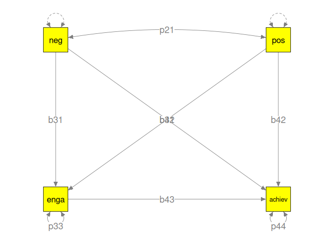<!-- -->

``` r
## Convert the lavaan model to the RAM specification
RAM4 <- lavaan2RAM(model4, obs.variables=c("neg", "pos", "enga", "achiev"))
RAM4
```

```
$A
       neg       pos       enga      achiev
neg    "0"       "0"       "0"       "0"   
pos    "0"       "0"       "0"       "0"   
enga   "0.1*b31" "0.1*b32" "0"       "0"   
achiev "0.1*b41" "0.1*b42" "0.1*b43" "0"   

$S
       neg     pos     enga      achiev   
neg    "1"     "0*p21" "0"       "0"      
pos    "0*p21" "1"     "0"       "0"      
enga   "0"     "0"     "0.5*p33" "0"      
achiev "0"     "0"     "0"       "0.5*p44"

$F
       neg pos enga achiev
neg      1   0    0      0
pos      0   1    0      0
enga     0   0    1      0
achiev   0   0    0      1

$M
  neg         pos         enga         achiev        
1 "0*negmean" "0*posmean" "0*engamean" "0*achievmean"
```

### Fitting a just-identified model (df=0)

``` r
mx.fit0a <- osmasem(model.name="Just identified model", RAM=RAM4, data= my.df)
summary(mx.fit0a)
```

```
Summary of Just identified model 
 
free parameters:
     name  matrix    row  col    Estimate  Std.Error A    z value     Pr(>|z|)
1     b31      A0   enga  neg -0.24326591 0.04795946    -5.072323 3.929877e-07
2     b41      A0 achiev  neg -0.09342502 0.03205929    -2.914132 3.566791e-03
3     b32      A0   enga  pos  0.25513470 0.04084654     6.246177 4.206214e-10
4     b42      A0 achiev  pos  0.04088993 0.02704882     1.511708 1.306081e-01
5     b43      A0 achiev enga  0.23653108 0.04498219     5.258328 1.453712e-07
6     p21      S0    pos  neg -0.23871422 0.04044945    -5.901545 3.601137e-09
7  Tau1_1 vecTau1      1    1 -3.94708169 0.43952154    -8.980406 2.697707e-19
8  Tau1_2 vecTau1      2    1 -3.75556387 0.36305548   -10.344325 4.440350e-25
9  Tau1_3 vecTau1      3    1 -5.11517562 0.44208312   -11.570620 5.806182e-31
10 Tau1_4 vecTau1      4    1 -4.43990809 0.63050447    -7.041834 1.897252e-12
11 Tau1_5 vecTau1      5    1 -5.00853416 0.53170330    -9.419791 4.519850e-21
12 Tau1_6 vecTau1      6    1 -4.23844213 0.47764609    -8.873604 7.081619e-19

To obtain confidence intervals re-run with intervals=TRUE

Model Statistics: 
               |  Parameters  |  Degrees of Freedom  |  Fit (-2lnL units)
       Model:             12                     89             -127.1991
   Saturated:             27                     74                    NA
Independence:             12                     89                    NA
Number of observations/statistics: 29438/101

Information Criteria: 
      |  df Penalty  |  Parameters Penalty  |  Sample-Size Adjusted
AIC:      -305.1991            -103.199109               -103.18851
BIC:     -1043.0128              -3.718609                -41.85444
To get additional fit indices, see help(mxRefModels)
timestamp: [omitted for comparison]
Wall clock time: [omitted for comparison]
optimizer:  SLSQP 
OpenMx version number: 2.22.11 
Need help?  See help(mxSummary) 
```

``` r
## Plot the fitted model
plot(mx.fit0a, layout="spring", color="yellow")
```

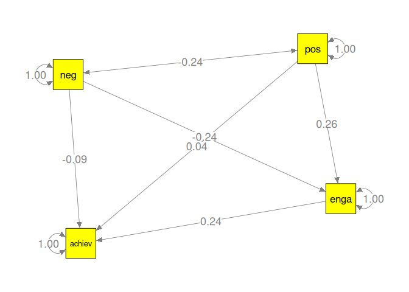<!-- -->

``` r
coef(mx.fit0a)
```

```
        b31         b41         b32         b42         b43         p21 
-0.24326591 -0.09342502  0.25513470  0.04088993  0.23653108 -0.23871422 
```

``` r
## Extract the variance component
VarCorr(mx.fit0a)
```

```
           Tau2_1     Tau2_2      Tau2_3     Tau2_4      Tau2_5     Tau2_6
Tau2_1 0.01931098 0.00000000 0.000000000 0.00000000 0.000000000 0.00000000
Tau2_2 0.00000000 0.02338726 0.000000000 0.00000000 0.000000000 0.00000000
Tau2_3 0.00000000 0.00000000 0.006004923 0.00000000 0.000000000 0.00000000
Tau2_4 0.00000000 0.00000000 0.000000000 0.01179702 0.000000000 0.00000000
Tau2_5 0.00000000 0.00000000 0.000000000 0.00000000 0.006680689 0.00000000
Tau2_6 0.00000000 0.00000000 0.000000000 0.00000000 0.000000000 0.01443005
```

### Fitting an over-identified model with b41=b42=0 (df=2))

``` r
## Proposed model
model5 <- 'enga ~ b31*neg + b32*pos
           achiev ~ 0*neg + 0*pos + b43*enga
           pos ~~ p21*neg
           pos ~~ 1*pos
           neg ~~ 1*neg
           enga ~~ p33*enga
           achiev ~~ p44*achiev'

plot(model5, layout="tree", color="yellow")
```

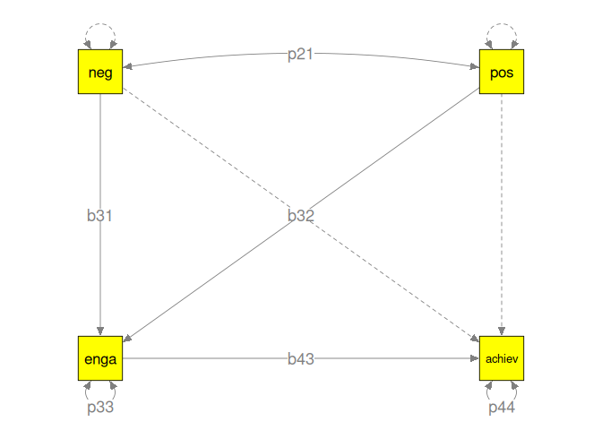<!-- -->

``` r
RAM5 <- lavaan2RAM(model5, obs.variables=c("neg", "pos", "enga", "achiev"))
RAM5
```

```
$A
       neg       pos       enga      achiev
neg    "0"       "0"       "0"       "0"   
pos    "0"       "0"       "0"       "0"   
enga   "0.1*b31" "0.1*b32" "0"       "0"   
achiev "0"       "0"       "0.1*b43" "0"   

$S
       neg     pos     enga      achiev   
neg    "1"     "0*p21" "0"       "0"      
pos    "0*p21" "1"     "0"       "0"      
enga   "0"     "0"     "0.5*p33" "0"      
achiev "0"     "0"     "0"       "0.5*p44"

$F
       neg pos enga achiev
neg      1   0    0      0
pos      0   1    0      0
enga     0   0    1      0
achiev   0   0    0      1

$M
  neg         pos         enga         achiev        
1 "0*negmean" "0*posmean" "0*engamean" "0*achievmean"
```

``` r
mx.fit0b <- osmasem(model.name="Over identified model", RAM=RAM5, data= my.df)

## Get the summary and test statistics
summary(mx.fit0b, fitIndices=TRUE)
```

```
Summary of Over identified model 
 
free parameters:
     name  matrix    row  col   Estimate  Std.Error A    z value     Pr(>|z|)
1     b31      A0   enga  neg -0.2964373 0.05474967    -5.414413 6.149015e-08
2     b32      A0   enga  pos  0.2649761 0.03780500     7.009023 2.399883e-12
3     b43      A0 achiev enga  0.3500633 0.04052992     8.637156 5.762944e-18
4     p21      S0    pos  neg -0.2386957 0.04057830    -5.882347 4.044882e-09
5  Tau1_1 vecTau1      1    1 -3.9389468 0.43954423    -8.961434 3.204817e-19
6  Tau1_2 vecTau1      2    1 -3.7413228 0.36746792   -10.181359 2.401835e-24
7  Tau1_3 vecTau1      3    1 -5.1270702 0.45402216   -11.292555 1.428238e-29
8  Tau1_4 vecTau1      4    1 -4.1993659 0.69797747    -6.016478 1.782531e-09
9  Tau1_5 vecTau1      5    1 -4.7599654 0.54940175    -8.663907 4.558672e-18
10 Tau1_6 vecTau1      6    1 -3.9085201 0.52666463    -7.421269 1.160030e-13

To obtain confidence intervals re-run with intervals=TRUE

Model Statistics: 
               |  Parameters  |  Degrees of Freedom  |  Fit (-2lnL units)
       Model:             10                     91           -117.557994
   Saturated:             12                     89           -127.199109
Independence:              6                     95              8.937319
Number of observations/statistics: 29438/101

chi-square:  χ² ( df=2 ) = 9.641115,  p = 0.008062292
Information Criteria: 
      |  df Penalty  |  Parameters Penalty  |  Sample-Size Adjusted
AIC:       -299.558              -97.55799                -97.55052
BIC:      -1053.952              -14.65758                -46.43744
CFI: 0.9412838 
TLI: 0.8238514   (also known as NNFI) 
RMSEA:  0.01139224  [95% CI (0.003446381, 0.02034632)]
Prob(RMSEA <= 0.05): 1
timestamp: [omitted for comparison]
Wall clock time: [omitted for comparison]
optimizer:  SLSQP 
OpenMx version number: 2.22.11 
Need help?  See help(mxSummary) 
```

``` r
## Get the SRMR
osmasemSRMR(mx.fit0b)
```

```
[1] 0.04402731
```

``` r
## Get the coefficients
coef(mx.fit0b)
```

```
       b31        b32        b43        p21 
-0.2964373  0.2649761  0.3500633 -0.2386957 
```

``` r
## Extract the variance component
VarCorr(mx.fit0b)
```

```
           Tau2_1    Tau2_2     Tau2_3     Tau2_4      Tau2_5     Tau2_6
Tau2_1 0.01946871 0.0000000 0.00000000 0.00000000 0.000000000 0.00000000
Tau2_2 0.00000000 0.0237227 0.00000000 0.00000000 0.000000000 0.00000000
Tau2_3 0.00000000 0.0000000 0.00593392 0.00000000 0.000000000 0.00000000
Tau2_4 0.00000000 0.0000000 0.00000000 0.01500509 0.000000000 0.00000000
Tau2_5 0.00000000 0.0000000 0.00000000 0.00000000 0.008565906 0.00000000
Tau2_6 0.00000000 0.0000000 0.00000000 0.00000000 0.000000000 0.02007018
```

### Using `SES` as a moderator on the A matrix on the just-identified model

``` r
## data.SES as a moderator
A1 <- create.modMatrix(RAM=RAM4, output="A", mod="SES")
A1
```

```
       neg          pos          enga         achiev
neg    "0"          "0"          "0"          "0"   
pos    "0"          "0"          "0"          "0"   
enga   "0*data.SES" "0*data.SES" "0"          "0"   
achiev "0*data.SES" "0*data.SES" "0*data.SES" "0"   
```

``` r
mx.fit1 <- osmasem(model.name="Ax as moderator", RAM=RAM4, Ax=A1, data= my.df)
summary(mx.fit1)
```

```
Summary of Ax as moderator 
 
free parameters:
     name  matrix    row  col     Estimate  Std.Error A      z value
1     b31      A0   enga  neg -0.225527620 0.04086164    -5.51929944
2     b41      A0 achiev  neg -0.098288910 0.03138365    -3.13185049
3     b32      A0   enga  pos  0.247627714 0.04297918     5.76157424
4     b42      A0 achiev  pos  0.039945842 0.02754367     1.45027294
5     b43      A0 achiev enga  0.244496986 0.04242093     5.76359277
6     p21      S0    pos  neg -0.239388669 0.04053847    -5.90522243
7   b31_1      A1   enga  neg -0.058565602 0.04046453    -1.44733196
8   b41_1      A1 achiev  neg  0.001098267 0.03183874     0.03449467
9   b32_1      A1   enga  pos  0.019830419 0.04592344     0.43181479
10  b42_1      A1 achiev  pos -0.005822272 0.02831309    -0.20563884
11  b43_1      A1 achiev enga -0.050966279 0.04162396    -1.22444571
12 Tau1_1 vecTau1      1    1 -3.941357717 0.43986548    -8.96037064
13 Tau1_2 vecTau1      2    1 -3.779828036 0.36123221   -10.46370714
14 Tau1_3 vecTau1      3    1 -5.114510017 0.43816503   -11.67256553
15 Tau1_4 vecTau1      4    1 -5.013804052 0.84391612    -5.94111659
16 Tau1_5 vecTau1      5    1 -5.022473004 0.53892643    -9.31940373
17 Tau1_6 vecTau1      6    1 -4.384431353 0.48872582    -8.97114741
       Pr(>|z|)
1  3.403538e-08
2  1.737083e-03
3  8.333300e-09
4  1.469824e-01
5  8.234196e-09
6  3.521713e-09
7  1.478040e-01
8  9.724827e-01
9  6.658760e-01
10 8.370730e-01
11 2.207841e-01
12 3.235889e-19
13 1.267956e-25
14 1.760333e-31
15 2.830872e-09
16 1.169959e-20
17 2.934414e-19

To obtain confidence intervals re-run with intervals=TRUE

Model Statistics: 
               |  Parameters  |  Degrees of Freedom  |  Fit (-2lnL units)
       Model:             17                     84             -131.9935
   Saturated:             27                     74                    NA
Independence:             12                     89                    NA
Number of observations/statistics: 29438/101

Information Criteria: 
      |  df Penalty  |  Parameters Penalty  |  Sample-Size Adjusted
AIC:      -299.9935              -97.99353                -97.97272
BIC:      -996.3570               42.93718                -11.08858
To get additional fit indices, see help(mxRefModels)
timestamp: [omitted for comparison]
Wall clock time: [omitted for comparison]
optimizer:  SLSQP 
OpenMx version number: 2.22.11 
Need help?  See help(mxSummary) 
```

``` r
## Get the coefficients
coef(mx.fit1)
```

```
         b31          b41          b32          b42          b43          p21 
-0.225527620 -0.098288910  0.247627714  0.039945842  0.244496986 -0.239388669 
       b31_1        b41_1        b32_1        b42_1        b43_1 
-0.058565602  0.001098267  0.019830419 -0.005822272 -0.050966279 
```

``` r
## Get the R2
osmasemR2(mx.fit1, mx.fit0a)
```

```
$Tau2.0
   Tau2_1_1    Tau2_2_2    Tau2_3_3    Tau2_4_4    Tau2_5_5    Tau2_6_6 
0.019310975 0.023387259 0.006004923 0.011797023 0.006680689 0.014430054 

$Tau2.1
   Tau2_1_1    Tau2_2_2    Tau2_3_3    Tau2_4_4    Tau2_5_5    Tau2_6_6 
0.019421827 0.022826616 0.006008921 0.006645575 0.006588214 0.012469977 

$R2
  Tau2_1_1   Tau2_2_2   Tau2_3_3   Tau2_4_4   Tau2_5_5   Tau2_6_6 
0.00000000 0.02397216 0.00000000 0.43667354 0.01384215 0.13583298 
```

``` r
## Extract the variance component
VarCorr(mx.fit1)
```

```
           Tau2_1     Tau2_2      Tau2_3      Tau2_4      Tau2_5     Tau2_6
Tau2_1 0.01942183 0.00000000 0.000000000 0.000000000 0.000000000 0.00000000
Tau2_2 0.00000000 0.02282662 0.000000000 0.000000000 0.000000000 0.00000000
Tau2_3 0.00000000 0.00000000 0.006008921 0.000000000 0.000000000 0.00000000
Tau2_4 0.00000000 0.00000000 0.000000000 0.006645575 0.000000000 0.00000000
Tau2_5 0.00000000 0.00000000 0.000000000 0.000000000 0.006588214 0.00000000
Tau2_6 0.00000000 0.00000000 0.000000000 0.000000000 0.000000000 0.01246998
```

``` r
## Comparing with the model without the moderator
anova(mx.fit1, mx.fit0a)
```

```
             base            comparison ep  minus2LL df        AIC   diffLL
1 Ax as moderator                  <NA> 17 -131.9935 84  -97.99353       NA
2 Ax as moderator Just identified model 12 -127.1991 89 -103.19911 4.794416
  diffdf         p
1     NA        NA
2      5 0.4414817
```

### Using `SES` as a moderator on the S matrix

``` r
S1 <- create.modMatrix(RAM=RAM4, output="S", mod="SES")
S1
```

```
       neg          pos          enga achiev
neg    "0"          "0*data.SES" "0"  "0"   
pos    "0*data.SES" "0"          "0"  "0"   
enga   "0"          "0"          "0"  "0"   
achiev "0"          "0"          "0"  "0"   
```

``` r
mx.fit2 <- osmasem(model.name="Sx as moderator", RAM=RAM4, Sx=S1, data= my.df)
summary(mx.fit2)
```

```
Summary of Sx as moderator 
 
free parameters:
     name  matrix    row  col    Estimate  Std.Error A    z value     Pr(>|z|)
1     b31      A0   enga  neg -0.24065289 0.04559656    -5.277874 1.306914e-07
2     b41      A0 achiev  neg -0.09173707 0.03147241    -2.914841 3.558700e-03
3     b32      A0   enga  pos  0.25341805 0.04086685     6.201067 5.608178e-10
4     b42      A0 achiev  pos  0.04264173 0.02700073     1.579281 1.142717e-01
5     b43      A0 achiev enga  0.23723931 0.04503766     5.267577 1.382366e-07
6     p21      S0    pos  neg -0.23700731 0.03856954    -6.144935 7.999609e-10
7   p21_1      S1    pos  neg -0.06195801 0.04074914    -1.520474 1.283919e-01
8  Tau1_1 vecTau1      1    1 -4.06972373 0.44017715    -9.245650 2.338160e-20
9  Tau1_2 vecTau1      2    1 -3.77189155 0.36260357   -10.402246 2.421571e-25
10 Tau1_3 vecTau1      3    1 -5.09000947 0.44245761   -11.503948 1.260162e-30
11 Tau1_4 vecTau1      4    1 -4.60593535 0.67301085    -6.843776 7.713260e-12
12 Tau1_5 vecTau1      5    1 -5.03060992 0.54006064    -9.314898 1.220694e-20
13 Tau1_6 vecTau1      6    1 -4.22966036 0.47695379    -8.868072 7.442353e-19

To obtain confidence intervals re-run with intervals=TRUE

Model Statistics: 
               |  Parameters  |  Degrees of Freedom  |  Fit (-2lnL units)
       Model:             13                     88             -129.4354
   Saturated:             27                     74                    NA
Independence:             12                     89                    NA
Number of observations/statistics: 29438/101

Information Criteria: 
      |  df Penalty  |  Parameters Penalty  |  Sample-Size Adjusted
AIC:      -305.4354            -103.435443               -103.42307
BIC:     -1034.9591               4.335099                -36.97872
To get additional fit indices, see help(mxRefModels)
timestamp: [omitted for comparison]
Wall clock time: [omitted for comparison]
optimizer:  SLSQP 
OpenMx version number: 2.22.11 
Need help?  See help(mxSummary) 
```

``` r
## Get the coefficients
coef(mx.fit2)
```

```
        b31         b41         b32         b42         b43         p21 
-0.24065289 -0.09173707  0.25341805  0.04264173  0.23723931 -0.23700731 
      p21_1 
-0.06195801 
```

``` r
## R2
osmasemR2(mx.fit2, mx.fit0a)
```

```
$Tau2.0
   Tau2_1_1    Tau2_2_2    Tau2_3_3    Tau2_4_4    Tau2_5_5    Tau2_6_6 
0.019310975 0.023387259 0.006004923 0.011797023 0.006680689 0.014430054 

$Tau2.1
   Tau2_1_1    Tau2_2_2    Tau2_3_3    Tau2_4_4    Tau2_5_5    Tau2_6_6 
0.017082107 0.023008500 0.006157962 0.009992351 0.006534824 0.014557334 

$R2
  Tau2_1_1   Tau2_2_2   Tau2_3_3   Tau2_4_4   Tau2_5_5   Tau2_6_6 
0.11541975 0.01619511 0.00000000 0.15297686 0.02183387 0.00000000 
```

``` r
## Extract the variance component
VarCorr(mx.fit2)
```

```
           Tau2_1    Tau2_2      Tau2_3      Tau2_4      Tau2_5     Tau2_6
Tau2_1 0.01708211 0.0000000 0.000000000 0.000000000 0.000000000 0.00000000
Tau2_2 0.00000000 0.0230085 0.000000000 0.000000000 0.000000000 0.00000000
Tau2_3 0.00000000 0.0000000 0.006157962 0.000000000 0.000000000 0.00000000
Tau2_4 0.00000000 0.0000000 0.000000000 0.009992351 0.000000000 0.00000000
Tau2_5 0.00000000 0.0000000 0.000000000 0.000000000 0.006534824 0.00000000
Tau2_6 0.00000000 0.0000000 0.000000000 0.000000000 0.000000000 0.01455733
```

``` r
## Comparing with the model without the moderator
anova(mx.fit2, mx.fit0a)
```

```
             base            comparison ep  minus2LL df       AIC   diffLL
1 Sx as moderator                  <NA> 13 -129.4354 88 -103.4354       NA
2 Sx as moderator Just identified model 12 -127.1991 89 -103.1991 2.236334
  diffdf         p
1     NA        NA
2      1 0.1348003
```

## Scalco17
* **Data**: Scalco, A., Noventa, S., Sartori, R., & Ceschi, A. (2017). Predicting organic food consumption: A meta-analytic structural equation model based on the theory of planned behavior. *Appetite*, *112*, 235-248.

### Data preparation

``` r
my.df <- Cor2DataFrame(Scalco17$data, Scalco17$n, acov = "weighted")

## Add the centered Age as a moderator
my.df$data <- data.frame(my.df$data, Age=scale(Scalco17$Age,  scale=FALSE), check.names=FALSE)
head(my.df$data)
```

```
                                      SN_ATT PBC_ATT BI_ATT BEH_ATT PBC_SN
Al-Swidi et al., 2014                  0.562    0.18  0.798      NA  0.314
Arvola et al., 2008 (Study A from IT)  0.690    0.44  0.730      NA  0.460
Arvola et al., 2008 (Study A from UK)  0.520    0.22  0.600      NA  0.280
Arvola et al., 2008 (Study A from FI)  0.570    0.40  0.670      NA  0.340
Arvola et al., 2008 (Study B from IT)  0.760    0.35  0.710      NA  0.360
Arvola et al., 2008 (Study B from UK)  0.460    0.03  0.550      NA  0.150
                                      BI_SN BEH_SN BI_PBC BEH_PBC BEH_BI
Al-Swidi et al., 2014                 0.696     NA  0.216      NA     NA
Arvola et al., 2008 (Study A from IT) 0.620     NA  0.410      NA     NA
Arvola et al., 2008 (Study A from UK) 0.560     NA  0.310      NA     NA
Arvola et al., 2008 (Study A from FI) 0.550     NA  0.360      NA     NA
Arvola et al., 2008 (Study B from IT) 0.640     NA  0.240      NA     NA
Arvola et al., 2008 (Study B from UK) 0.580     NA  0.100      NA     NA
                                      C(SN_ATT SN_ATT) C(PBC_ATT SN_ATT)
Al-Swidi et al., 2014                      0.003943223      0.0007678297
Arvola et al., 2008 (Study A from IT)      0.003591847      0.0006994092
Arvola et al., 2008 (Study A from UK)      0.002687233      0.0005232617
Arvola et al., 2008 (Study A from FI)      0.003627765      0.0007064033
Arvola et al., 2008 (Study B from IT)      0.003591847      0.0006994092
Arvola et al., 2008 (Study B from UK)      0.002687233      0.0005232617
                                      C(BI_ATT SN_ATT) C(BEH_ATT SN_ATT)
Al-Swidi et al., 2014                      0.001195058      0.0012021335
Arvola et al., 2008 (Study A from IT)      0.001088568      0.0010950127
Arvola et al., 2008 (Study A from UK)      0.000814410      0.0008192317
Arvola et al., 2008 (Study A from FI)      0.001099454      0.0011059628
Arvola et al., 2008 (Study B from IT)      0.001088568      0.0010950127
Arvola et al., 2008 (Study B from UK)      0.000814410      0.0008192317
                                      C(PBC_SN SN_ATT) C(BI_SN SN_ATT)
Al-Swidi et al., 2014                     0.0010869711     0.001853515
Arvola et al., 2008 (Study A from IT)     0.0009901123     0.001688351
Arvola et al., 2008 (Study A from UK)     0.0007407507     0.001263136
Arvola et al., 2008 (Study A from FI)     0.0010000134     0.001705234
Arvola et al., 2008 (Study B from IT)     0.0009901123     0.001688351
Arvola et al., 2008 (Study B from UK)     0.0007407507     0.001263136
                                      C(BEH_SN SN_ATT) C(BI_PBC SN_ATT)
Al-Swidi et al., 2014                      0.001499226     0.0005441017
Arvola et al., 2008 (Study A from IT)      0.001365632     0.0004956174
Arvola et al., 2008 (Study A from UK)      0.001021695     0.0003707952
Arvola et al., 2008 (Study A from FI)      0.001379288     0.0005005736
Arvola et al., 2008 (Study B from IT)      0.001365632     0.0004956174
Arvola et al., 2008 (Study B from UK)      0.001021695     0.0003707952
                                      C(BEH_PBC SN_ATT) C(BEH_BI SN_ATT)
Al-Swidi et al., 2014                      0.0004085993     0.0006118224
Arvola et al., 2008 (Study A from IT)      0.0003721895     0.0005573036
Arvola et al., 2008 (Study A from UK)      0.0002784529     0.0004169456
Arvola et al., 2008 (Study A from FI)      0.0003759114     0.0005628766
Arvola et al., 2008 (Study B from IT)      0.0003721895     0.0005573036
Arvola et al., 2008 (Study B from UK)      0.0002784529     0.0004169456
                                      C(PBC_ATT PBC_ATT) C(BI_ATT PBC_ATT)
Al-Swidi et al., 2014                        0.004547982      0.0007764240
Arvola et al., 2008 (Study A from IT)        0.004142716      0.0007072377
Arvola et al., 2008 (Study A from UK)        0.003099365      0.0005291186
Arvola et al., 2008 (Study A from FI)        0.004184143      0.0007143101
Arvola et al., 2008 (Study B from IT)        0.004142716      0.0007072377
Arvola et al., 2008 (Study B from UK)        0.003099365      0.0005291186
                                      C(BEH_ATT PBC_ATT) C(PBC_SN PBC_ATT)
Al-Swidi et al., 2014                       0.0013663028       0.001663770
Arvola et al., 2008 (Study A from IT)       0.0012445531       0.001515513
Arvola et al., 2008 (Study A from UK)       0.0009311101       0.001133828
Arvola et al., 2008 (Study A from FI)       0.0012569986       0.001530668
Arvola et al., 2008 (Study B from IT)       0.0012445531       0.001515513
Arvola et al., 2008 (Study B from UK)       0.0009311101       0.001133828
                                      C(BI_SN PBC_ATT) C(BEH_SN PBC_ATT)
Al-Swidi et al., 2014                     0.0004362867      0.0005789490
Arvola et al., 2008 (Study A from IT)     0.0003974097      0.0005273595
Arvola et al., 2008 (Study A from UK)     0.0002973213      0.0003945430
Arvola et al., 2008 (Study A from FI)     0.0004013838      0.0005326331
Arvola et al., 2008 (Study B from IT)     0.0003974097      0.0005273595
Arvola et al., 2008 (Study B from UK)     0.0002973213      0.0003945430
                                      C(BI_PBC PBC_ATT) C(BEH_PBC PBC_ATT)
Al-Swidi et al., 2014                       0.002592420        0.001688969
Arvola et al., 2008 (Study A from IT)       0.002361412        0.001538467
Arvola et al., 2008 (Study A from UK)       0.001766686        0.001151001
Arvola et al., 2008 (Study A from FI)       0.002385026        0.001553852
Arvola et al., 2008 (Study B from IT)       0.002361412        0.001538467
Arvola et al., 2008 (Study B from UK)       0.001766686        0.001151001
                                      C(BEH_BI PBC_ATT) C(BI_ATT BI_ATT)
Al-Swidi et al., 2014                      0.0006653392      0.002028709
Arvola et al., 2008 (Study A from IT)      0.0006060515      0.001847933
Arvola et al., 2008 (Study A from UK)      0.0004534163      0.001382528
Arvola et al., 2008 (Study A from FI)      0.0006121121      0.001866412
Arvola et al., 2008 (Study B from IT)      0.0006060515      0.001847933
Arvola et al., 2008 (Study B from UK)      0.0004534163      0.001382528
                                      C(BEH_ATT BI_ATT) C(PBC_SN BI_ATT)
Al-Swidi et al., 2014                       0.001295026     0.0004215179
Arvola et al., 2008 (Study A from IT)       0.001179627     0.0003839569
Arvola et al., 2008 (Study A from UK)       0.000882536     0.0002872566
Arvola et al., 2008 (Study A from FI)       0.001191424     0.0003877964
Arvola et al., 2008 (Study B from IT)       0.001179627     0.0003839569
Arvola et al., 2008 (Study B from UK)       0.000882536     0.0002872566
                                      C(BI_SN BI_ATT) C(BEH_SN BI_ATT)
Al-Swidi et al., 2014                    0.0005366946     0.0005252379
Arvola et al., 2008 (Study A from IT)    0.0004888703     0.0004784345
Arvola et al., 2008 (Study A from UK)    0.0003657474     0.0003579399
Arvola et al., 2008 (Study A from FI)    0.0004937590     0.0004832189
Arvola et al., 2008 (Study B from IT)    0.0004888703     0.0004784345
Arvola et al., 2008 (Study B from UK)    0.0003657474     0.0003579399
                                      C(BI_PBC BI_ATT) C(BEH_PBC BI_ATT)
Al-Swidi et al., 2014                     0.0005461543      0.0003593252
Arvola et al., 2008 (Study A from IT)     0.0004974870      0.0003273062
Arvola et al., 2008 (Study A from UK)     0.0003721940      0.0002448735
Arvola et al., 2008 (Study A from FI)     0.0005024619      0.0003305792
Arvola et al., 2008 (Study B from IT)     0.0004974870      0.0003273062
Arvola et al., 2008 (Study B from UK)     0.0003721940      0.0002448735
                                      C(BEH_BI BI_ATT) C(BEH_ATT BEH_ATT)
Al-Swidi et al., 2014                     0.0005717433        0.003394125
Arvola et al., 2008 (Study A from IT)     0.0005207959        0.003091678
Arvola et al., 2008 (Study A from UK)     0.0003896325        0.002313033
Arvola et al., 2008 (Study A from FI)     0.0005260039        0.003122595
Arvola et al., 2008 (Study B from IT)     0.0005207959        0.003091678
Arvola et al., 2008 (Study B from UK)     0.0003896325        0.002313033
                                      C(PBC_SN BEH_ATT) C(BI_SN BEH_ATT)
Al-Swidi et al., 2014                      0.0006188984     0.0006147047
Arvola et al., 2008 (Study A from IT)      0.0005637491     0.0005599290
Arvola et al., 2008 (Study A from UK)      0.0004217678     0.0004189099
Arvola et al., 2008 (Study A from FI)      0.0005693865     0.0005655283
Arvola et al., 2008 (Study B from IT)      0.0005637491     0.0005599290
Arvola et al., 2008 (Study B from UK)      0.0004217678     0.0004189099
                                      C(BEH_SN BEH_ATT) C(BI_PBC BEH_ATT)
Al-Swidi et al., 2014                      0.0010606132      0.0007797342
Arvola et al., 2008 (Study A from IT)      0.0009661032      0.0007102529
Arvola et al., 2008 (Study A from UK)      0.0007227883      0.0005313744
Arvola et al., 2008 (Study A from FI)      0.0009757642      0.0007173555
Arvola et al., 2008 (Study B from IT)      0.0009661032      0.0007102529
Arvola et al., 2008 (Study B from UK)      0.0007227883      0.0005313744
                                      C(BEH_PBC BEH_ATT) C(BEH_BI BEH_ATT)
Al-Swidi et al., 2014                       0.0007167330      0.0014083870
Arvola et al., 2008 (Study A from IT)       0.0006528657      0.0012828872
Arvola et al., 2008 (Study A from UK)       0.0004884403      0.0009597897
Arvola et al., 2008 (Study A from FI)       0.0006593944      0.0012957161
Arvola et al., 2008 (Study B from IT)       0.0006528657      0.0012828872
Arvola et al., 2008 (Study B from UK)       0.0004884403      0.0009597897
                                      C(PBC_SN PBC_SN) C(BI_SN PBC_SN)
Al-Swidi et al., 2014                      0.004844335    0.0010602620
Arvola et al., 2008 (Study A from IT)      0.004412661    0.0009657832
Arvola et al., 2008 (Study A from UK)      0.003301324    0.0007225489
Arvola et al., 2008 (Study A from FI)      0.004456788    0.0009754410
Arvola et al., 2008 (Study B from IT)      0.004412661    0.0009657832
Arvola et al., 2008 (Study B from UK)      0.003301324    0.0007225489
                                      C(BEH_SN PBC_SN) C(BI_PBC PBC_SN)
Al-Swidi et al., 2014                      0.001559439      0.002233175
Arvola et al., 2008 (Study A from IT)      0.001420479      0.002034179
Arvola et al., 2008 (Study A from UK)      0.001062729      0.001521867
Arvola et al., 2008 (Study A from FI)      0.001434684      0.002054521
Arvola et al., 2008 (Study B from IT)      0.001420479      0.002034179
Arvola et al., 2008 (Study B from UK)      0.001062729      0.001521867
                                      C(BEH_PBC PBC_SN) C(BEH_BI PBC_SN)
Al-Swidi et al., 2014                       0.001572052     0.0006097939
Arvola et al., 2008 (Study A from IT)       0.001431968     0.0005554558
Arvola et al., 2008 (Study A from UK)       0.001071325     0.0004155632
Arvola et al., 2008 (Study A from FI)       0.001446288     0.0005610104
Arvola et al., 2008 (Study B from IT)       0.001431968     0.0005554558
Arvola et al., 2008 (Study B from UK)       0.001071325     0.0004155632
                                      C(BI_SN BI_SN) C(BEH_SN BI_SN)
Al-Swidi et al., 2014                    0.002860046     0.001725475
Arvola et al., 2008 (Study A from IT)    0.002605191     0.001571720
Arvola et al., 2008 (Study A from UK)    0.001949069     0.001175879
Arvola et al., 2008 (Study A from FI)    0.002631243     0.001587437
Arvola et al., 2008 (Study B from IT)    0.002605191     0.001571720
Arvola et al., 2008 (Study B from UK)    0.001949069     0.001175879
                                      C(BI_PBC BI_SN) C(BEH_PBC BI_SN)
Al-Swidi et al., 2014                    0.0005120247     0.0003559340
Arvola et al., 2008 (Study A from IT)    0.0004663988     0.0003242171
Arvola et al., 2008 (Study A from UK)    0.0003489354     0.0002425624
Arvola et al., 2008 (Study A from FI)    0.0004710628     0.0003274592
Arvola et al., 2008 (Study B from IT)    0.0004663988     0.0003242171
Arvola et al., 2008 (Study B from UK)    0.0003489354     0.0002425624
                                      C(BEH_BI BI_SN) C(BEH_SN BEH_SN)
Al-Swidi et al., 2014                    0.0006331393      0.003763991
Arvola et al., 2008 (Study A from IT)    0.0005767210      0.003428586
Arvola et al., 2008 (Study A from UK)    0.0004314727      0.002565090
Arvola et al., 2008 (Study A from FI)    0.0005824882      0.003462872
Arvola et al., 2008 (Study B from IT)    0.0005767210      0.003428586
Arvola et al., 2008 (Study B from UK)    0.0004314727      0.002565090
                                      C(BI_PBC BEH_SN) C(BEH_PBC BEH_SN)
Al-Swidi et al., 2014                     0.0006727085      0.0005788170
Arvola et al., 2008 (Study A from IT)     0.0006127642      0.0005272392
Arvola et al., 2008 (Study A from UK)     0.0004584384      0.0003944530
Arvola et al., 2008 (Study A from FI)     0.0006188918      0.0005325116
Arvola et al., 2008 (Study B from IT)     0.0006127642      0.0005272392
Arvola et al., 2008 (Study B from UK)     0.0004584384      0.0003944530
                                      C(BEH_BI BEH_SN) C(BI_PBC BI_PBC)
Al-Swidi et al., 2014                     0.0011957529      0.004234767
Arvola et al., 2008 (Study A from IT)     0.0010892006      0.003857411
Arvola et al., 2008 (Study A from UK)     0.0008148834      0.002885915
Arvola et al., 2008 (Study A from FI)     0.0011000926      0.003895986
Arvola et al., 2008 (Study B from IT)     0.0010892006      0.003857411
Arvola et al., 2008 (Study B from UK)     0.0008148834      0.002885915
                                      C(BEH_PBC BI_PBC) C(BEH_BI BI_PBC)
Al-Swidi et al., 2014                       0.002227326     0.0009451243
Arvola et al., 2008 (Study A from IT)       0.002028851     0.0008609053
Arvola et al., 2008 (Study A from UK)       0.001517881     0.0006440847
Arvola et al., 2008 (Study A from FI)       0.002049139     0.0008695143
Arvola et al., 2008 (Study B from IT)       0.002028851     0.0008609053
Arvola et al., 2008 (Study B from UK)       0.001517881     0.0006440847
                                      C(BEH_PBC BEH_PBC) C(BEH_BI BEH_PBC)
Al-Swidi et al., 2014                        0.003778506      0.0006339265
Arvola et al., 2008 (Study A from IT)        0.003441808      0.0005774380
Arvola et al., 2008 (Study A from UK)        0.002574982      0.0004320092
Arvola et al., 2008 (Study A from FI)        0.003476226      0.0005832124
Arvola et al., 2008 (Study B from IT)        0.003441808      0.0005774380
Arvola et al., 2008 (Study B from UK)        0.002574982      0.0004320092
                                      C(BEH_BI BEH_BI)       Age
Al-Swidi et al., 2014                      0.002176139 -2.398421
Arvola et al., 2008 (Study A from IT)      0.001982225  2.871579
Arvola et al., 2008 (Study A from UK)      0.001482998  2.871579
Arvola et al., 2008 (Study A from FI)      0.002002048  2.871579
Arvola et al., 2008 (Study B from IT)      0.001982225  2.871579
Arvola et al., 2008 (Study B from UK)      0.001482998  2.871579
```

``` r
## Display the pairwise no. of studies
pattern.na(my.df, show.na=FALSE, type="osmasem")
```

```
        SN_ATT PBC_ATT BI_ATT BEH_ATT PBC_SN BI_SN BEH_SN BI_PBC BEH_PBC BEH_BI
SN_ATT      22      22     22       6     22    22      6     22       6      6
PBC_ATT     22      22     22       6     22    22      6     22       6      6
BI_ATT      22      22     23       6     22    23      6     23       6      6
BEH_ATT      6       6      6       6      6     6      6      6       6      6
PBC_SN      22      22     22       6     22    22      6     22       6      6
BI_SN       22      22     23       6     22    23      6     23       6      6
BEH_SN       6       6      6       6      6     6      6      6       6      6
BI_PBC      22      22     23       6     22    23      6     23       6      6
BEH_PBC      6       6      6       6      6     6      6      6       6      6
BEH_BI       6       6      6       6      6     6      6      6       6      6
```

``` r
## Proposed model
model6 <- 'BI ~ b41*ATT + b42*SN + b43*PBC
           BEH ~ b54*BI + b53*PBC 
           ATT ~~ p21*SN
           ATT ~~ p31*PBC
           SN ~~ p32*PBC
           ATT ~~ 1*ATT
           SN ~~ 1*SN
           PBC ~~ 1*PBC
           BI ~~ p44*BI
           BEH ~~ p44*BEH'

plot(model6, color="yellow")     
```

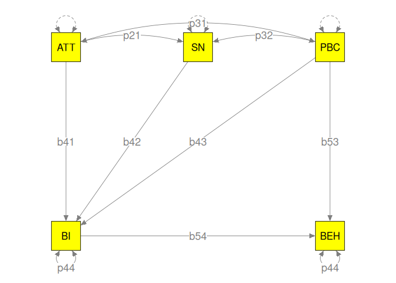<!-- -->

``` r
RAM6 <- lavaan2RAM(model6, obs.variables=c("ATT", "SN", "PBC", "BI","BEH"))
RAM6
```

```
$A
    ATT       SN        PBC       BI        BEH
ATT "0"       "0"       "0"       "0"       "0"
SN  "0"       "0"       "0"       "0"       "0"
PBC "0"       "0"       "0"       "0"       "0"
BI  "0.1*b41" "0.1*b42" "0.1*b43" "0"       "0"
BEH "0"       "0"       "0.1*b53" "0.1*b54" "0"

$S
    ATT     SN      PBC     BI        BEH      
ATT "1"     "0*p21" "0*p31" "0"       "0"      
SN  "0*p21" "1"     "0*p32" "0"       "0"      
PBC "0*p31" "0*p32" "1"     "0"       "0"      
BI  "0"     "0"     "0"     "0.5*p44" "0"      
BEH "0"     "0"     "0"     "0"       "0.5*p44"

$F
    ATT SN PBC BI BEH
ATT   1  0   0  0   0
SN    0  1   0  0   0
PBC   0  0   1  0   0
BI    0  0   0  1   0
BEH   0  0   0  0   1

$M
  ATT         SN         PBC         BI         BEH        
1 "0*ATTmean" "0*SNmean" "0*PBCmean" "0*BImean" "0*BEHmean"
```

## Fitting an over-identified model

``` r
mx.fit0 <- osmasem(model.name="No moderator", RAM=RAM6, data=my.df)

## Get the chi-square statistic on the proposed model
summary(mx.fit0, fitIndices=TRUE)
```

```
Summary of No moderator 
 
free parameters:
      name  matrix row col   Estimate  Std.Error A    z value     Pr(>|z|)
1      b41      A0  BI ATT  0.4548365 0.03958523    11.490056 1.480157e-30
2      b42      A0  BI  SN  0.2781751 0.04707428     5.909280 3.436072e-09
3      b43      A0  BI PBC  0.1369546 0.03334842     4.106777 4.012174e-05
4      b53      A0 BEH PBC  0.1305298 0.07190047     1.815423 6.945893e-02
5      b54      A0 BEH  BI  0.5825793 0.07659636     7.605836 2.830679e-14
6      p21      S0  SN ATT  0.4127350 0.04003477    10.309412 6.389081e-25
7      p31      S0 PBC ATT  0.2549528 0.03031157     8.411074 4.062724e-17
8      p32      S0 PBC  SN  0.2367971 0.02308960    10.255576 1.117074e-24
9   Tau1_1 vecTau1   1   1 -3.4174846 0.32640833   -10.469967 1.186838e-25
10  Tau1_2 vecTau1   2   1 -4.0475548 0.34541631   -11.717903 1.031950e-31
11  Tau1_3 vecTau1   3   1 -3.9631221 0.31649622   -12.521862 5.668938e-36
12  Tau1_4 vecTau1   4   1 -4.3571400 0.65215586    -6.681133 2.371020e-11
13  Tau1_5 vecTau1   5   1 -4.7251577 0.40835073   -11.571322 5.758857e-31
14  Tau1_6 vecTau1   6   1 -3.6019191 0.31551987   -11.415823 3.485872e-30
15  Tau1_7 vecTau1   7   1 -4.1704613 0.65208172    -6.395611 1.599062e-10
16  Tau1_8 vecTau1   8   1 -4.2846713 0.34785959   -12.317244 7.315189e-35
17  Tau1_9 vecTau1   9   1 -3.9774805 0.59091385    -6.731067 1.684237e-11
18 Tau1_10 vecTau1  10   1 -3.4394344 0.70132325    -4.904207 9.380550e-07

To obtain confidence intervals re-run with intervals=TRUE

Model Statistics: 
               |  Parameters  |  Degrees of Freedom  |  Fit (-2lnL units)
       Model:             18                    141             -153.2011
   Saturated:             20                    139             -156.9808
Independence:             10                    149              159.8486
Number of observations/statistics: 11349/159

chi-square:  χ² ( df=2 ) = 3.779661,  p = 0.1510974
Information Criteria: 
      |  df Penalty  |  Parameters Penalty  |  Sample-Size Adjusted
AIC:      -435.2011              -117.2011                -117.1408
BIC:     -1469.7019                14.8628                 -42.3390
CFI: 0.9941998 
TLI: 0.9709992   (also known as NNFI) 
RMSEA:  0.008854721  [95% CI (0, 0.02466774)]
Prob(RMSEA <= 0.05): 1
timestamp: [omitted for comparison]
Wall clock time: [omitted for comparison]
optimizer:  SLSQP 
OpenMx version number: 2.22.11 
Need help?  See help(mxSummary) 
```

``` r
## Get the SRMR
osmasemSRMR(mx.fit0)
```

```
[1] 0.03592283
```

``` r
## Extract the variance component
diag(VarCorr(mx.fit0))
```

```
     Tau2_1      Tau2_2      Tau2_3      Tau2_4      Tau2_5      Tau2_6 
0.032794825 0.017465028 0.019003691 0.012814986 0.008869315 0.027271335 
     Tau2_7      Tau2_8      Tau2_9     Tau2_10 
0.015445134 0.013778149 0.018732776 0.032082825 
```

### Using `Age` as a moderator on the A matrix

``` r
## An index for data without missing value in Age
indexAge <- !is.na(Scalco17$Age)
indexAge
```

```
 [1]  TRUE  TRUE  TRUE  TRUE  TRUE  TRUE  TRUE FALSE  TRUE  TRUE  TRUE FALSE
[13]  TRUE  TRUE  TRUE  TRUE  TRUE FALSE  TRUE  TRUE  TRUE  TRUE FALSE
```

``` r
A1 <- create.modMatrix(RAM=RAM6, output="A", mod="Age")
A1                
```

```
    ATT          SN           PBC          BI           BEH
ATT "0"          "0"          "0"          "0"          "0"
SN  "0"          "0"          "0"          "0"          "0"
PBC "0"          "0"          "0"          "0"          "0"
BI  "0*data.Age" "0*data.Age" "0*data.Age" "0"          "0"
BEH "0"          "0"          "0*data.Age" "0*data.Age" "0"
```

``` r
## Refit the model without any moderator with indexAge
mx.fit0.Age <- osmasem(model.name="No moderator", RAM=RAM6, data=my.df, subset.rows=indexAge)

mx.fit1 <- osmasem(model.name="Ax as moderator", RAM=RAM6, Ax=A1, data=my.df, subset.rows=indexAge)
summary(mx.fit1)
```

```
Summary of Ax as moderator 
 
free parameters:
      name  matrix row col     Estimate   Std.Error A     z value     Pr(>|z|)
1      b41      A0  BI ATT  0.494316475 0.037016487    13.3539543 1.123245e-40
2      b42      A0  BI  SN  0.270283644 0.045625148     5.9240058 3.141923e-09
3      b43      A0  BI PBC  0.106333960 0.035297718     3.0124883 2.591155e-03
4      b53      A0 BEH PBC  0.231819718 0.214809247     1.0791887 2.805036e-01
5      b54      A0 BEH  BI  0.505362034 0.128009206     3.9478570 7.885390e-05
6      p21      S0  SN ATT  0.436652349 0.045342872     9.6300108 5.972318e-22
7      p31      S0 PBC ATT  0.254545041 0.033163644     7.6754242 1.648721e-14
8      p32      S0 PBC  SN  0.245076513 0.027056708     9.0578838 1.330059e-19
9    b41_1      A1  BI ATT -0.004274837 0.005017517    -0.8519826 3.942237e-01
10   b42_1      A1  BI  SN  0.018113816 0.005343634     3.3897935 6.994529e-04
11   b43_1      A1  BI PBC  0.001718690 0.004055061     0.4238382 6.716838e-01
12   b53_1      A1 BEH PBC -0.013887913 0.037502822    -0.3703165 7.111467e-01
13   b54_1      A1 BEH  BI  0.018597093 0.021048826     0.8835216 3.769545e-01
14  Tau1_1 vecTau1   1   1 -3.366738729 0.357756766    -9.4106920 4.928812e-21
15  Tau1_2 vecTau1   2   1 -4.069524881 0.383456028   -10.6127550 2.599685e-26
16  Tau1_3 vecTau1   3   1 -4.337171292 0.351979843   -12.3222150 6.877886e-35
17  Tau1_4 vecTau1   4   1 -5.052226235 0.829347573    -6.0918081 1.116425e-09
18  Tau1_5 vecTau1   5   1 -4.584681438 0.436547289   -10.5021416 8.444228e-26
19  Tau1_6 vecTau1   6   1 -4.086577167 0.360299781   -11.3421584 8.111875e-30
20  Tau1_7 vecTau1   7   1 -5.036008243 0.928966998    -5.4210841 5.923867e-08
21  Tau1_8 vecTau1   8   1 -4.440357801 0.391148513   -11.3521020 7.240096e-30
22  Tau1_9 vecTau1   9   1 -3.738376291 0.730978020    -5.1142116 3.150540e-07
23 Tau1_10 vecTau1  10   1 -5.306395991 0.959238704    -5.5318827 3.168117e-08

To obtain confidence intervals re-run with intervals=TRUE

Model Statistics: 
               |  Parameters  |  Degrees of Freedom  |  Fit (-2lnL units)
       Model:             23                    104             -149.3285
   Saturated:             65                     62                    NA
Independence:             20                    107                    NA
Number of observations/statistics: 9507/127

Information Criteria: 
      |  df Penalty  |  Parameters Penalty  |  Sample-Size Adjusted
AIC:      -357.3285             -103.32854               -103.21212
BIC:     -1101.9460               61.34648                -11.74392
To get additional fit indices, see help(mxRefModels)
timestamp: [omitted for comparison]
Wall clock time: [omitted for comparison]
optimizer:  SLSQP 
OpenMx version number: 2.22.11 
Need help?  See help(mxSummary) 
```

``` r
coef(mx.fit1)
```

```
         b41          b42          b43          b53          b54          p21 
 0.494316475  0.270283644  0.106333960  0.231819718  0.505362034  0.436652349 
         p31          p32        b41_1        b42_1        b43_1        b53_1 
 0.254545041  0.245076513 -0.004274837  0.018113816  0.001718690 -0.013887913 
       b54_1 
 0.018597093 
```

``` r
osmasemR2(mx.fit1, mx.fit0.Age)
```

```
$Tau2.0
   Tau2_1_1    Tau2_2_2    Tau2_3_3    Tau2_4_4    Tau2_5_5    Tau2_6_6 
0.034362492 0.016891794 0.013896526 0.006192533 0.010061654 0.032521058 
   Tau2_7_7    Tau2_8_8    Tau2_9_9  Tau2_10_10 
0.007863536 0.013393076 0.023999236 0.009817008 

$Tau2.1
   Tau2_1_1    Tau2_2_2    Tau2_3_3    Tau2_4_4    Tau2_5_5    Tau2_6_6 
0.034501974 0.017085504 0.013073457 0.006395081 0.010207001 0.016796627 
   Tau2_7_7    Tau2_8_8    Tau2_9_9  Tau2_10_10 
0.006499642 0.011791719 0.023792704 0.004959770 

$R2
   Tau2_1_1    Tau2_2_2    Tau2_3_3    Tau2_4_4    Tau2_5_5    Tau2_6_6 
0.000000000 0.000000000 0.059228389 0.000000000 0.000000000 0.483515351 
   Tau2_7_7    Tau2_8_8    Tau2_9_9  Tau2_10_10 
0.173445424 0.119566042 0.008605771 0.494777891 
```

``` r
## Extract the variance component
diag(VarCorr(mx.fit1))
```

```
     Tau2_1      Tau2_2      Tau2_3      Tau2_4      Tau2_5      Tau2_6 
0.034501974 0.017085504 0.013073457 0.006395081 0.010207001 0.016796627 
     Tau2_7      Tau2_8      Tau2_9     Tau2_10 
0.006499642 0.011791719 0.023792704 0.004959770 
```

``` r
anova(mx.fit1, mx.fit0.Age)
```

```
             base   comparison ep  minus2LL  df        AIC   diffLL diffdf
1 Ax as moderator         <NA> 23 -149.3285 104 -103.32854       NA     NA
2 Ax as moderator No moderator 18 -131.9769 109  -95.97692 17.35163      5
            p
1          NA
2 0.003879019
```

### Using `Age` as a moderator on the S matrix

``` r
S1 <- create.modMatrix(RAM=RAM6, output="S", mod="Age")
S1   
```

```
    ATT          SN           PBC          BI  BEH
ATT "0"          "0*data.Age" "0*data.Age" "0" "0"
SN  "0*data.Age" "0"          "0*data.Age" "0" "0"
PBC "0*data.Age" "0*data.Age" "0"          "0" "0"
BI  "0"          "0"          "0"          "0" "0"
BEH "0"          "0"          "0"          "0" "0"
```

``` r
mx.fit2 <- osmasem(model.name="Sx as moderator", RAM=RAM6, Sx=S1, data=my.df, subset.rows=indexAge)
summary(mx.fit2)
```

```
Summary of Sx as moderator 
 
free parameters:
      name  matrix row col     Estimate   Std.Error A    z value     Pr(>|z|)
1      b41      A0  BI ATT  0.502034516 0.036526113    13.744537 5.492316e-43
2      b42      A0  BI  SN  0.271247551 0.044979795     6.030431 1.635229e-09
3      b43      A0  BI PBC  0.112593450 0.034449124     3.268398 1.081581e-03
4      b53      A0 BEH PBC  0.159775463 0.094407272     1.692406 9.056853e-02
5      b54      A0 BEH  BI  0.608563217 0.058046433    10.484076 1.022402e-25
6      p21      S0  SN ATT  0.419470521 0.038367661    10.932919 8.022575e-28
7      p31      S0 PBC ATT  0.242344135 0.029628739     8.179361 2.853541e-16
8      p32      S0 PBC  SN  0.236407028 0.024730102     9.559485 1.183446e-21
9    p21_1      S1  SN ATT  0.020822481 0.004735238     4.397346 1.095827e-05
10   p31_1      S1 PBC ATT  0.009453323 0.003791840     2.493070 1.266439e-02
11   p32_1      S1 PBC  SN  0.008224384 0.003490345     2.356324 1.845680e-02
12  Tau1_1 vecTau1   1   1 -3.738628084 0.370170568   -10.099744 5.538642e-24
13  Tau1_2 vecTau1   2   1 -4.358347413 0.394566533   -11.045913 2.294247e-28
14  Tau1_3 vecTau1   3   1 -4.292986615 0.352365302   -12.183341 3.813346e-34
15  Tau1_4 vecTau1   4   1 -5.189757223 0.814126953    -6.374629 1.834065e-10
16  Tau1_5 vecTau1   5   1 -4.844411727 0.449437087   -10.778843 4.333022e-27
17  Tau1_6 vecTau1   6   1 -3.995039009 0.366104680   -10.912286 1.006918e-27
18  Tau1_7 vecTau1   7   1 -5.030052507 0.934364247    -5.383396 7.309359e-08
19  Tau1_8 vecTau1   8   1 -4.396553562 0.388153061   -11.326855 9.661137e-30
20  Tau1_9 vecTau1   9   1 -3.742581304 0.732547665    -5.108994 3.238794e-07
21 Tau1_10 vecTau1  10   1 -4.823924524 0.836387697    -5.767570 8.042272e-09

To obtain confidence intervals re-run with intervals=TRUE

Model Statistics: 
               |  Parameters  |  Degrees of Freedom  |  Fit (-2lnL units)
       Model:             21                    106             -161.4281
   Saturated:             65                     62                    NA
Independence:             20                    107                    NA
Number of observations/statistics: 9507/127

Information Criteria: 
      |  df Penalty  |  Parameters Penalty  |  Sample-Size Adjusted
AIC:      -373.4281             -119.42814                -119.3307
BIC:     -1132.3652               30.92732                 -35.8074
To get additional fit indices, see help(mxRefModels)
timestamp: [omitted for comparison]
Wall clock time: [omitted for comparison]
optimizer:  SLSQP 
OpenMx version number: 2.22.11 
Need help?  See help(mxSummary) 
```

``` r
coef(mx.fit2)
```

```
        b41         b42         b43         b53         b54         p21 
0.502034516 0.271247551 0.112593450 0.159775463 0.608563217 0.419470521 
        p31         p32       p21_1       p31_1       p32_1 
0.242344135 0.236407028 0.020822481 0.009453323 0.008224384 
```

``` r
osmasemR2(mx.fit2, mx.fit0.Age)
```

```
$Tau2.0
   Tau2_1_1    Tau2_2_2    Tau2_3_3    Tau2_4_4    Tau2_5_5    Tau2_6_6 
0.034362492 0.016891794 0.013896526 0.006192533 0.010061654 0.032521058 
   Tau2_7_7    Tau2_8_8    Tau2_9_9  Tau2_10_10 
0.007863536 0.013393076 0.023999236 0.009817008 

$Tau2.1
   Tau2_1_1    Tau2_2_2    Tau2_3_3    Tau2_4_4    Tau2_5_5    Tau2_6_6 
0.023786714 0.012799523 0.013664055 0.005573360 0.007872247 0.018406728 
   Tau2_7_7    Tau2_8_8    Tau2_9_9  Tau2_10_10 
0.006538467 0.012319726 0.023692866 0.008035191 

$R2
  Tau2_1_1   Tau2_2_2   Tau2_3_3   Tau2_4_4   Tau2_5_5   Tau2_6_6   Tau2_7_7 
0.30777097 0.24226386 0.01672870 0.09998704 0.21759912 0.43400586 0.16850799 
  Tau2_8_8   Tau2_9_9 Tau2_10_10 
0.08014214 0.01276584 0.18150309 
```

``` r
## Extract the variance component
diag(VarCorr(mx.fit2))
```

```
     Tau2_1      Tau2_2      Tau2_3      Tau2_4      Tau2_5      Tau2_6 
0.023786714 0.012799523 0.013664055 0.005573360 0.007872247 0.018406728 
     Tau2_7      Tau2_8      Tau2_9     Tau2_10 
0.006538467 0.012319726 0.023692866 0.008035191 
```

``` r
anova(mx.fit2, mx.fit0.Age)
```

```
             base   comparison ep  minus2LL  df        AIC   diffLL diffdf
1 Sx as moderator         <NA> 21 -161.4281 106 -119.42814       NA     NA
2 Sx as moderator No moderator 18 -131.9769 109  -95.97692 29.45123      3
             p
1           NA
2 1.800109e-06
```
# Installation and help
* First of all, you need [R](https://www.r-project.org/) to run it. You can install the `metaSEM` package by running the following command inside an `R` session:

```
install.packages("metaSEM")
```

* The developmental version can be installed from [GitHub](https://github.com/mikewlcheung/metasem/) by running:

```
library(devtools)
install_github("mikewlcheung/metasem")
```

## Potential issues with the OpenMx available at CRAN
* The OpenMx available at [CRAN](https://cran.r-project.org/package=OpenMx) includes the open source `SLSQP` and `CSOLNP` optimizers. 
* If the `SLSQP` optimizer (default in the `metaSEM` package) does not work well for you, e.g., there are many error codes, you may try to rerun the analysis. For example,

```
random1 <- meta(y=yi, v=vi, data=Hox02)
random1 <- rerun(random1)
summary(random1)
```
* If you still prefer the non-free `NPSOL` optimizer, you may install it from the `OpenMx` website and call it by running:

```
mxOption(NULL, "Default optimizer", "NPSOL")
```

## Help
* If you need help, please send your questions to `OpenMx` discussion forum, a discussion forum for the `metaSEM` package in `OpenMx`. Please include information on the R session. It will be helpful if you can include a reproducible example. You may save a copy of your data, say `my.df`, and attach the content of `myData.R` in the post by using
```
sessionInfo()
dump(c("my.df"), file="myData.R")
```

The files are based on the following versions of `R` and `R` packages:

``` r
sessionInfo()
```

```
Warning in system("timedatectl", intern = TRUE): running command 'timedatectl'
had status 1
```

```
R version 4.6.2 (2026-10-29)
Platform: x86_64-pc-linux-gnu
Running under: Linux Mint 22.3

Matrix products: default
BLAS:   /usr/lib/x86_64-linux-gnu/blas/libblas.so.3.12.0 
LAPACK: /usr/lib/x86_64-linux-gnu/lapack/liblapack.so.3.12.0  LAPACK version 3.12.0

locale:
 [1] LC_CTYPE=C.UTF-8       LC_NUMERIC=C           LC_TIME=C.UTF-8       
 [4] LC_COLLATE=C.UTF-8     LC_MONETARY=C.UTF-8    LC_MESSAGES=C.UTF-8   
 [7] LC_PAPER=C.UTF-8       LC_NAME=C              LC_ADDRESS=C          
[10] LC_TELEPHONE=C         LC_MEASUREMENT=C.UTF-8 LC_IDENTIFICATION=C   

time zone: Asia/Singapore
tzcode source: system (glibc)

attached base packages:
[1] stats     graphics  grDevices utils     datasets  methods   base     

other attached packages:
 [1] semPlot_1.2.0       metafor_5.2-1       numDeriv_2016.8-1.1
 [4] metadat_1.6-0       Matrix_1.7-6        knitr_1.52         
 [7] metaSEM_2.0         testthat_3.3.2      OpenMx_2.22.11     
[10] lavaan_0.7-3       

loaded via a namespace (and not attached):
 [1] psych_2.6.3         tidyselect_1.2.1    dplyr_1.2.1        
 [4] farver_2.1.2        S7_0.2.2            fastmap_1.2.0      
 [7] mathjaxr_2.0-0      digest_0.6.39       rpart_4.1.27       
[10] lifecycle_1.0.5     cluster_2.1.8.2     magrittr_2.0.5     
[13] compiler_4.6.2      rlang_1.3.0         Hmisc_5.2-5        
[16] sass_0.4.10         tools_4.6.2         igraph_2.3.4       
[19] yaml_2.3.12         data.table_1.18.2.1 htmlwidgets_1.6.4  
[22] pkgbuild_1.4.8      mnormt_2.1.2        plyr_1.8.9         
[25] RColorBrewer_1.1-3  abind_1.4-8         pkgload_1.5.2      
[28] foreign_0.8-92      desc_1.4.3          nnet_7.3-21        
[31] grid_4.6.2          stats4_4.6.2        colorspace_2.1-2   
[34] ggplot2_4.0.3       gtools_3.9.5        scales_1.4.0       
[37] MASS_7.3-66         cli_3.6.6           mvtnorm_1.4-2      
[40] ellipse_0.5.0       rmarkdown_2.32      generics_0.1.4     
[43] otel_0.2.0          RcppParallel_6.2.0  rstudioapi_0.19.0  
[46] reshape2_1.4.5      pbapply_1.7-5       cachem_1.1.0       
[49] stringr_1.6.0       parallel_4.6.2      base64enc_0.1-6    
[52] vctrs_0.7.3         jsonlite_2.0.0      glasso_1.11        
[55] Formula_1.2-6       htmlTable_2.5.0     jpeg_0.1-11        
[58] jquerylib_0.1.4     qgraph_1.10.1       glue_1.8.1         
[61] stringi_1.8.7       gtable_0.3.6        quadprog_1.5-8     
[64] tibble_3.3.1        pillar_1.11.1       htmltools_0.5.9    
[67] brio_1.1.5          R6_2.6.1            rprojroot_2.1.1    
[70] evaluate_1.0.5      pbivnorm_0.6.0      lattice_0.23-1     
[73] png_0.1-9           backports_1.5.1     corpcor_1.6.10     
[76] bslib_0.10.0        fdrtool_1.2.18      Rcpp_1.1.2         
[79] gridExtra_2.3.1     nlme_3.1-172        checkmate_2.3.4    
[82] xfun_0.60           pkgconfig_2.0.3    
```
